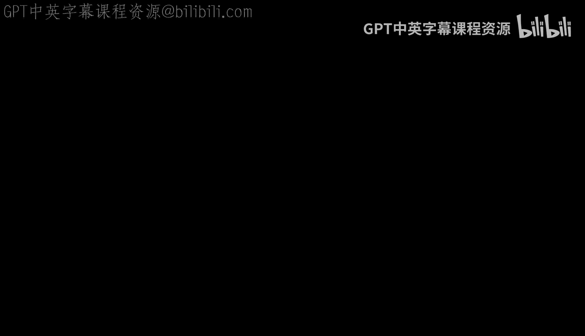
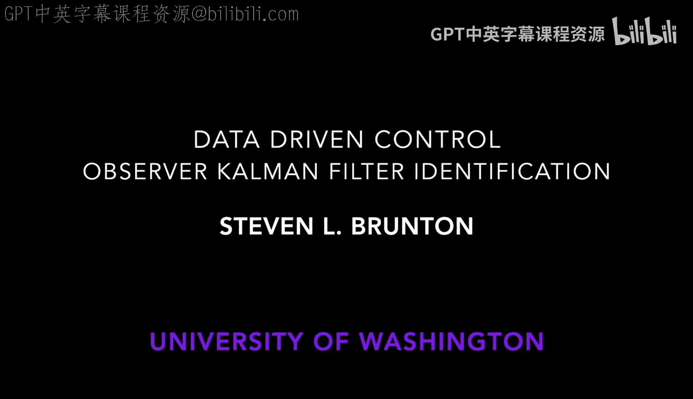

# 华盛顿大学《基于数据的机器学习控制｜Data-Driven Control with Machine Learning 2018》中英字幕 p18 -18-Data-Driven Control_ Observer Kalman Filter Identification.zh_en -BV1BK6MBQEtN_p18-

Welcome back。Okay in the last few lectures we've been talking about eigenystem realization algorithm。

 which is a very versatile and powerful data- drivenriven tool。

 If I have impulse response data from a system， if I can kick the system and measure the outputs。

 I can build a reduced order model， a low dimensional model that best captures those input output dynamics and then I can use that model for prediction and control this is a great method。

 I use it all the time。😊，And it's now scalable。 You can run it on on huge systems。

 but it's fundamentally based on this assumption that I can get an impulse response for a system。

 Okay， that is actually harder to do than you might think。

 So how would you get an impulse response for a system you care about， Like， let's say I have a。

Mass on a spring。 Okay， and I want to give this thing。 And I can， I can move the base。

 An impulse response might be just to。Jk your hand up and down as fast as possible or build a motor to do that。

 Okay， you can build an impulse response for that super simple system。

 What if I want to characterize my car， Okay， what is an impulse response for that。

 Do I just like gun it on the gas and then let up。 Well， that might not give me a lot of information。

 Maybe my， you know， the system is a little bit。Unresponsive。 So in some cases。

 and maybe I have noise。 maybe this is actually maybe the biggest issue is maybe I have an impulse。

 but really I have like a noisy measurement。 I've got a lot of noise on top of this。

 And so I don't have a reliable impulse response。I could do 20 impulse responses and average of the results。

All kinds of things can go wrong。 Maybe my system's not entirely linear。

 Maybe it's like mostly linear， but there's some nonlinear stochastic stuff happening。

All kinds of reasons why you might get a crappy impulse response and need to use something else。

 So there's a more powerful add on to this called the observer。Observer Coleman。Filter。

Identification。Observer call filter identification。

It's called OK IDD and I think this was developed in the 90s。

 let's just say 90s by a bunch of people， summit Princeton， Summit Langley。

The names that come to my mind are fan and long men， but I'm sure there were many others。 Okay。

 very interesting。 sorry， this is hard to read。 observer， common filter identification。

Identify okay Id。 And so this is kind of a 1，2 combo。 If you have noisy， tough data。

 you can't do an impulse response。 You take that data。 You first hit it with O Id。

 and then you hit it with ER。 Okay， so what okay Id is。

 is it takes kind of pseudo random input output data。 So now I have like， you know， maybe I just。

 I can force my system with some kind of。Sudoran data。

 and I get some some corresponding output response in Y， whatever you and Y are pseudo random input。

 and then the system output。What OKID does。Maybe I should drop down here what OID does。

Is it estimates kind of an optimal common filter estimator of what the impulse response would have been that is most consistent with this input output data for non impulse responses。

So I think about this really in terms of a schematic。

 there is some heavy math under the hood of observer callman filter identification。

 it's a very cool idea。To optimally estimate what the best impulse response would have been actually really you're optimally estimating what these matrices are that's most consistent with this input output data。

 and then you can use those measurements with the ER to get a reduced order model so this is kind of if you have if you can't do an impulse response or you have really noisy data or it takes a really long time for it to decay to  zero。

 The first you could first do observe or common filter and then do eigens systemem realization algorithm。

 so you can give it pseudoran rich input data， kick the system， you know。

 maybe hit the gas and different， you know hold it down for a second。

 let go hold it down for two seconds， let go for three seconds， get a pseudoran input。

 measure the output。Get your impulse response estimated and then run it through ER。

That's the procedure。 Okay， this is probably about as deep down the rabbit hole as we're going to get in this entire modern data driven control lecture series。

 You know， we've already gone from。Linear system identification to balanced models。

 to balance truncation to eigen system realization to observer or comment。 I mean。

 this is like many layers deep in terms of bringing out heavier and heavier guns。

To solve harder and harder problems。 So if you have noisy。Hard to measure lightly damped dynamics。

You might do OKID followed by ER if you're starting to feel overwhelmed。

Skip this lecture and go to the Matlab demo where we actually play around with this stuff。

 or even skip that entirely and go to some of the nonlinear system Id lectures。 DMMD， Coopman， Cindy。

 those are kind of the modern methods。 This is the classic history。 You know， And this does fit in。

 but， but I feel like I have to tell you that it's very interesting and very powerful。

 I'm not going show you how the entire O Id works。 It is。😊。

Based on this idea that you can use a common filter to estimate these matrices from this data。

 and then you can use these matrices with ER to get a system model。 That's how it was developed。嗯。

I guess what I want to show you。Is roughly how the math would look。 Okay， so I'm going to do this。

 Let's see。 I'll do this in green。So remember how we did an impulse response to get these。

I literally said u equals the identity and then it's zero at all other times and I get these。

That's what we're going to do here。 But now U is not simple。 U is changing at every time step。 Okay。

 so what I'm going to do， we're going to assume that there's a system X K plus 1 equals a， X。

 K plus B， UK and Y， K equals C。Xk plus D UK。And what I'm going to do is just like before I'm going to see what happens with you。

X。This is going to take a lot of space and why。For various， you know K0， K1， K2。

 and so on and so forth， Okay， so as time increases。

 what happens to the state and to the measurements y。Okay。

So the unfortunate thing is this is not just a delta。 I have to call this U 0， U1， U2， U3。

 dot dot dot dot dot， and I have to figure out what the system response is for this。

This series of pseudoran inputs。Okay， we assume that x0 is0。And so y0 is just d times。U 0。

 that' simple。 Okay， but now。At time 1， x1 is b times u0， so that's b times u 0。

 And so y1 is C times B times u0。But now plus d times u1。Because this is not zero anymore so plus。

D times U1。 You can already see this is going to get more complicated than ERA。 Okay， time2。

This is my state at time1， so my state at time2 is A， B， U0。Plus b times u1。Yeah， it's getting worse。

 Okay， I'm just going work down here。 Next time it's going to be a squared B， U 0 plus A， B。

 U 1 plus B， U 2 and so on and so forth。 So every time step。

 I pick up another term because I have another little deelta U kicking the system。

 This thing is being constantly forced。 So this is getting worse and worse。

And then the Y's are also getting nastiier and lastsier。 So now I have C， A， B， U not plus C。

 B U1 plus D， U2， and so on and forth so forth。 C A squared B， U not。

 You can kind of get the pattern here plus C A， B， U1 plus C， B。You 2 plus D。You3。

So the long story short。Is that now the impulse response was really convenient because the output Y was simple。

 There was only one term per time step， whereas here， because I'm constantly forcing the system。

 I'm getting to convolve， the convolution of all of these little forcings and it's building up。

 I mean the a matrix， the effect of these might be decaying。

 this might be less important after 100 iterations， but it's still in the math。It's still there。

This is where it gets kind of interesting is I can take this expression。And I can。Write down。

All of these ys， this is just， you know， y0， y 1， Y 2， blah， blah， blah， U0， u1， Ube， blah， blah。

 blah。And what I can do。You're gonna have to kind of take my word for it because I don't have enough space to really show all of this is that you can write。

Y 0， y 1， Y 2， dot， dot， dot， dot， dot。Equals。D C， B， C， A， B， dot， da， dat， dat， dot。

Times this giant matrix。Of。U 0， U1， U2 dot dot dot0， u0， u1 dot dot dot0，0。

 you get the picture dot dot dot。 So is kind of upper triangular matrix of all of my U's。

 U not on the diagonal， U1 on the next diagonal U2 on the next one， U3， U4， U5。

 And the idea is if I multiply this out。 let's just kind of do this example。

 So y 0 equals d times u 0， check。Y1 equals d times u1 plus Cb times u0。

Check y 3 equals these three terms times those three terms。 Check。 So you get the idea here。

 what I've done。As I've said， my measured why。This is data， okay， this is data。This is data， I have。

 I know what my U is， and I know what my Y is， this is my impulse response。This is the thing I want。

Okay， all of this impulse response matrices。 That's this matrix here。 That's what I want。

 So basically， what okay I does is it's an optimal way kind of knowing that there's gonna be noise and disturbances in your system。

 It's an optimal way knowing that this and this are both going to be noisy and bad and corrupted of kind of inverting this U matrix and solving for this impulse response。

 It's kind of this this denoing pseudo inverse using a common filter that solves for the impulse response。

 That's under that's at least the big picture。 what's happening You have this continuously forced system。

You can write down what that would look like if it was linear。

 you can formulate that in terms of these data matrices in terms of data you have and the thing you want。

 and then this algorithm basically is a procedure for solving for this in a way that is kind of optimal with respect to noisy。

 crappy data。OkayIn the next lecture， we're going to code these up。

 we're going to play around with them。 I'm going to show you you'll have all of this code so you can go through and try it out on your own systems。

 but you understand at least kind of the high level view of what O ID is doing to augment ER if it's hard to get an impulse response if you have noisy data we're going to code it up next time and that's going to be it for the linear system ID Thank you。

