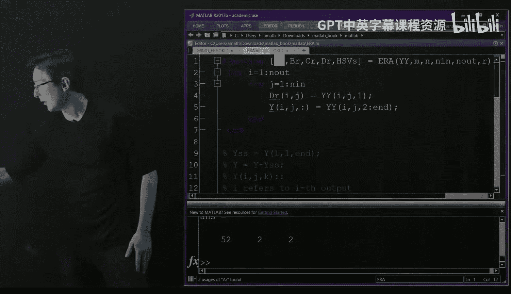
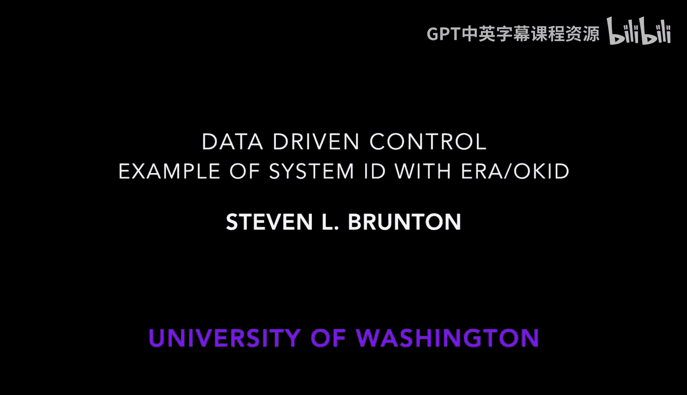

# 华盛顿大学《基于数据的机器学习控制｜Data-Driven Control with Machine Learning 2018》中英字幕 p19 -19-Data-Driven Control_ ERA_OKID Example in Matlab.zh_en -BV1BK6MBQEtN_p19-

Welcome back Okay， so we have talked a lot about linear system identification using the eigenystem realization algorithm and the observer commonman filter identification。

 So here we're going to do some quick matlab demos just to show how this works on toy systems。

 remember in test ci， this is just a discrete random state space system with 100 states。

 kind of 100 hidden variables， dynamic variables in the OdeE two inputs and two outputs。 Okay。

 so I'm going to load this。 let's run this good。I'm going to act like all I have is data okay I don't have access to the model ABCD。

 I just have data， so what I'm going to do is I'm going to run this impulse of the full system。

 I'm going to collect that data inF that's the only data that I have access to with ER All I have is measurements of YFL and then I'm rerunning impulse without the output just so it plots it to the screen and you can see it。

And then there's some funky stuff here I'm doing。 I'm permuting this output because this output is not the same shape。

 I want it for my code。 So I'm putting it into the right matrix format。

 And just so that you know there's this。ERA。M code that you'll have access to so this is。

A code that I wrote a long time ago based on ER that computes basically the reduced A，B。

C and D matrices from your data Y。At ranknk R， you can read through this。

I also have an OK ID code that I wrote， I guess a while ago。

 given measurements of U and why and some target rank R。

 it'll build that impulse response and put it into this matrix H that you can then use for ER okay so you have access to these codes。

But remember， we have a system we're going to collect data from that system。

 That's what we're going to do here。 And in this case。

This is what the data looks like Okay so I have two inputs and two outputs。

 and if I give an impulse and input one， I get this output and this output。

 and if I have an impulse and input2， these are the two output responses。 So again。

 if I have a two input two output system， I get an array of impulse responses。

 I get two by two impulse responses and this is literally the data that I collect。

 I have an experiment。 I whack my actuator with a hammer I like I crank up the control knob and I can crank it back down。

 and this is what I measure， this is all of my data for ER。Okay。Okay。

 so computing ER from the impulse response is pretty simple。

 I had to reshape my data into a particular format。 I basically reshaped it so that。

I guess I'll have to write this up。If I had。Reshaping your data is pretty interesting actually。

 how do I want to say this？Let's say， I have。Q inputs。And P outputs。And just。

 I guess we can assume it's 2 and 2 in this case。 So what I would end up doing is I get one impulse response for each of these inputs。

 and each of those impulse responses has P measurements。 So in our case， remember。

 we had these kind of。You know， in one in2。Out one， out two。

 and I had these various impulse responses。Just going to do my best to draw something stable。Okay。

 what I would have to do， what this reshaping is doing。Is at time step1。

 I take that measurement and I reshape that into a little two by two matrix。

 I call that kind of my first block。 and at time step 2， I take all four of those measurements。

 and I reshape them into a block。 at time step 3， I reshape those into a two by two block。

 and another two by two block。 and these are kind of those matrices from before。 This is my D matrix。

 This is C B。 this is C A B。 this is C squared B。 I'm reshaping my four impulse responses into this evolving two by2 matrix。

 and that's kind of an important step that you have to do in actually BpoD or in era O Id is really figuring out how how to manipulate your data into the right structure to do this analysis。

 once you do that honestly， I probably spent 30 minutes or an hour just figuring out the right way to write this one line of code。

 But once you have that settle down。Now， what you do is you just run the ER code。 It's that simple。

 I'm， I'm making this MC just tells me how big I should make my ankle matrix。

 It's literally just how much data I have -1 divided by 2 because it's， you know a symmetric matrix。

 So I can only use my matrix can only be half as big as the length of this time series。

 And it's that simple。 All I do is。Run this ER code， and I get an A， B。

C and D matrix that I can build into a system。 So I have my ER system。 It's one line of code。

 You have my ER code。 You can run that one line。 Okay， you collect data。

 you put it in the right form， you run ER， you have it。Now。

 I could just plot the response and show you， but I also want to show you what if you didn't have an impulse response。

 What if it was hard to get this data from an experiment and instead。

Maybe some collaborator emailed you like what the output response was to some random input。Okay。

 so if someone just emails you a data set and it's randomly forced you and the output response to that randomly forced you。

 you'd have to run it through this second line of code， this O K ID code。

 And this would give you a series of these matrices。 That's H is basically。

These matrices in a certain order， Okay， D， then C， B， C A， B， C A squared B， that's what's in H。

 Okay， Then I basically just plug H directly into ER。 and I get my matrix back。 Okay。

 so I hope this is clear。 if you can get impulse response data， you can just do era in one shot。

 if you have randomly forced input data， you have to first kind of estimate the impulse response with okay I。

 then run it through era。 But in both cases， it's only a few lines of Matlab code once you have these functions。

 Okay pretty simple。Let me make sure I actually run everything， this is important。Okay。

 I'm going run this good。We have our data。I'm going to run the ER model， I've generated an ER model。

I'm going to here I actually have to manufacture this random input output data。

 but in the real world you'd collect this from your experiments。Warning， simulation starts， whatever。

 Okay， and I do okay Id。 good。 Now we're ready to plot everything。

 So this is where it gets kind of cool。Ah perfecterfect。

So this is the same system we actually looked at with balance truncation and balanced PD。

 and these are the same impulse responses。 same model order R equals 10。

 The original system actually had 100 states and what you can see is that the full model in blue is very well approximated with a 10 mode era model and it's also pretty well approximated with this ER okayID model。

 So basically all of these cases work really， really well and in this case it's really interesting。

 I didn't have access to that model。 All I had was data and I can fit a low order state space model that very accurately reproduces the system response that I can then use for control。

So system idea in the context of control， you really care about what's happening。

 you how do I maximally capture what happens given an input on my outputs。

 and that's what we're seeing here is given an impulse in the inputs。

 this is the output response and our low order model our 10 mode model does a great job of capturing these system dynamics。

Purely data driven based on some deep and foundational linear algebra， Hannk matrices。

 Han singular value reduction， balanced Grmyions。 But in practice， very simple to run。

 These are one or two lines of Matlab code once you have your data。 so please try this out。

 downloadload some data， generate your own data。 see when it breaks down。

 Try it on nonlinear systems。 This is a great tool， but you'll only understand it。

 if you actually start applying it and trying it out。 Okay， thank you very much。😊。

