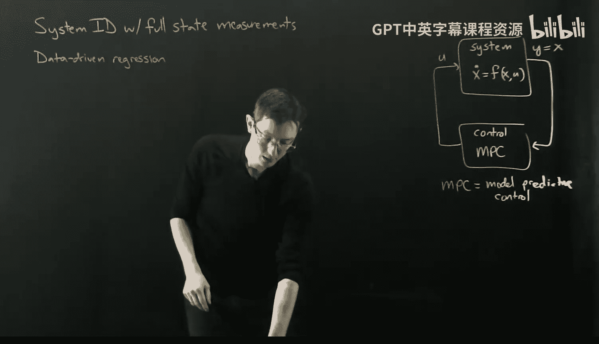

# 华盛顿大学《基于数据的机器学习控制｜Data-Driven Control with Machine Learning 2018》中英字幕 p20 -20-System Identification_ Full-State Models with Control.zh_en -BV1BK6MBQEtN_p20-

Welcome back。Okay， so we've been talking about data driven modeling and control of complex systems。

 maybe high dimensional， maybe nonlinear。 and we've been essentially building this diagram where we have some system。

We have some controller。The system has measurements。

 so there's some measurements of the system Y and then the control law determines some kind of a feedback signal to affect some actuators you to modify the system behavior for some desired objective now remember the system generally we don't have the equations of motion given to us。

 this is not like you open a textbook and you have the equations of motion to then design a control law so we're talking about how do we discover the system model from data okay and in the past we've talked about balanced model reduction in system identification where you have some inputs use of outputs y and you try to get a reduced order model of the input to output dynamics what we're going to talk about now is slightly different but very related where in this case we're assuming that we have access to full state measurements so our measurements y is the are the entire state of the system。

That might be high dimensional， that might be low dimensional。

 but we're going to assume that we don't have limited measurements。

 we can actually measure the full system， so this is becoming increasingly important kind of in this age of big data where it is increasingly likely that you might actually have some scenarios where you have full state measurements of your system Okay。

 so what we're going to say is we're going to call this system identification system I with full state measurements。

And of course， the goal here is for control， so we don't just want to identify a model of the system we want to model。

We want a model of the input output dynamics of the system so that we can then design a control law。

 Okay， so our system model would generally be given by some kind of x dot equals F of x comma U So there's some nonlinear dynamics X dot equals F of X。

 but we also have to take into account what the effect of the actuation U is We assume that we can measure that full state X。

 and so we're going to use data science and data drivenriven optimization。

 things like machine learning to build models of the system that we can then use for control。

And what I would advocate in this case is something like a model predictive controller。

So here MPC equals model。Predictive。Control。Which is a very。

 very powerful control optimization framework where if you have a model for your system。

 you can essentially run a bunch of forecasts of that model for different actuation input puts you。

 and then you can optimize over that U for some kind of a short time control signal that will maximize an objective function Okay so a model predict the control is very powerful。

 you can use it for non nonlinear control。And so I would definitely recommend。

 you know looking into into NPC。 But the basic idea is we're going to talk about how do we build system ID models of these possibly nonlinear input output dynamics that we could then use with model predictive control and the difference here between what we're doing now and what we were doing with the balance model reduction and system identification is that here and we're explicitly assuming that we have full state measurements Y equals x so this is closely related to things like balance truncation。

 balance PoD eigenystem realization algorithm， but more specifically for kind of the big data limit of full state measurements and one of the key tools that we're going to use throughout all of this is data driven。

Regression。And that's maybe that sounds a little fancy。

 I guess all I mean is we're going to use linear regression。

 but we're going to do linear regression of data onto these models。

 so we're going to fit model parameters using data and we're going to add some regularizing terms to that linear regression for example。

 to promote sparsity so there might be only a few terms in this model or to prevent overfitting so we'll use modern regression methods to find these models from data。

And I want to walk you through just kind of， so this is the overview。

 I want to walk you through what we're going to be looking at in the next few lectures。Okay。

 so in the simplest case， we might have linear dynamics。

， we might have linear dynamics， and in the case of linear dynamics， we might just write down x dot。

Eals A X。 Okay， these would be the unforced dynamics of the system with no U。

 We could just build a model x dot equals A X。 This would be the dynamic mode decomposition。 So DMD。

And there will be video lectures on the DMD method and all of the methods I'm telling you about here。

Okay， but what we're going to do in the case of system ID with full state measurements。

 let's say four。Control， this is very important。 We're not just doing unfored system identification。

 We're doing system identification so that we can modify the system with control。So in that case。

 what we're going to do is not just use regression to build a model of this dynamical system A。

 we're also going to figure out how the inputs affect that system。

 so we're also going to identify this plus BU term and that's going to be called dynamic mode decomposition with control so we add a little C there so a pretty straightforward modification to dynamic mode decomposition allows us to also build a linear model of how the input affects that state。

Okay， in the case of a nonlinear system。There are a number of emerging techniques to identify the full blown nonlinear system x dot equals f of x。

So x dot equals F of x， if I just had x dot equals f of x。

 essentially what I would do is do something like the sparse identification of nonlinear dynamics。

 sparse identification of nonlinear dynamics， this is the Cindy algorithm。

 I'll put a link to this in the comments，But essentially what this does is it builds a library of all of the possible right-hand side functions that this could that could describe the dynamics and it uses sparse regression to select only the fewest nonlinear terms in the right- hand side that agree with Xdot equals those terms so it essentially sets up a sparse regression to identify the nonlinear terms in a dynamical system is that that sparsity promoting constraint regularizes the problem and prevents overfitting and it also gives you an interpretable model so it only has a few terms so that you can interpret what the nonlinear dynamics of that system are。

 so this is kind of a neat data-drive regression method for a nonlinear system。

And I'll talk about how we can also identify what the effective control is and that'll be called Cindy with control Okay so hopefully you're seeing kind of the theme here。

 we're going to take the dynamic mode decomposition algorithm and add control。

 we're going to take the Cindy algorithm and add control and then we're going to show how you can put these into a model predictive control framework once you have these these models。

 these statebased models and then the last leg of this I want to talk about is if I have a nonlinear system but I want a linear representation。

Of a nonlinear system。 Okay， so I'll tell you what that means。

 So if I want a linear representation of a nonlinear system。

 then there is this coopman operator theory so I have you might have seen some of these talks or papers or lectures about the coupman operator where essentially what I can do is I could take this this measurement X and I could actually enrich it into an even larger measurement。

 I could measure things like x squared and x cubed and x to the fourth and so on and so forth。

And in that space of all possible measurements of my system。

 it turns out that the dynamics actually become linear even for strongly non nonlinear dynamics。

 so what we're going to say is that if I have a rich enough measurement。

 why if y is even bigger than the state， if it's like all of the possible measurements I could take of the state。

Then I can have this Y dot equals this big。Coopman operator K times y。

 where this is actually a linear representation of these nonlinear dynamics。

And the catch is that this measurement function Y has to be sufficiently rich that this coopman operator theory holds。

 Okay， so we have Coopman。In general， finding these measurements so that you get this approximate linear representation can be pretty challenging。

 and we'll talk about how you can do that， how you can find good measurements of your system so that they even nonlinear systems look linear。

 And then what we're going to talk about is。How do we add control？Okay。

And I'm being a little vague about how we add control here because it's a little bit more subtle。

 So Kopman with control。Okay， so this is basically the overview of what we're going to do over the next few lectures。

 We're going to do system identification， both linear and nonlinear system ID for systems where we assume we have full state measurements。

 but we want to do control so we have full state measurements and some input you。

 we want to build these these system models from data using regression。

 and then we're going to use these for control for example。

 using model predictive control Okay so this is all coming up this is going to build on some other lectures。

 some related lectures on dynamical systems kind of Cdy DMD。

 Cindy and Coman is a separate lecture series I'll point you to。

 but then what we're going to talk about now is how to modify them to add add control。Okay。

 thank you。