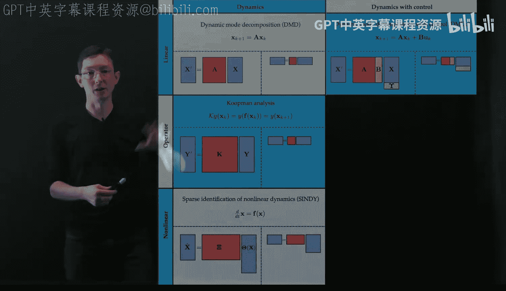

# 华盛顿大学《基于数据的机器学习控制｜Data-Driven Control with Machine Learning 2018》中英字幕 p21 -21-System Identification_ Regression Models.zh_en -BV1BK6MBQEtN_p21-

Welcome back。Okay， we've been talking about data driven model identification for control where you have access to full state measurements okay and we outlined essentially a number of different strategies where you can either identify linear models。

 fully nonlinear models or these kind of hybrid coupman models that are linear representations of nonlinear systems。

And we talked about doing this with data driven regression。

So I like just showing kind of a basic diagram of how I see this all happening。 Okay。

 so here's a picture of the dynamic mode decomposition DMD。

And I've essentially kind of outlined these various data matrices that you would， you would build。

 So I have these blue matrices， X and X prime。 These are measurements of my system evolving in time。

 And I could use linear regression to solveulfur the best fit a operator that maps X to the next time step X prime。

 Okay， this is standard dynamic mode decomposition。 And what I'm showing over here is this idea that。

You know， if I have really high dimensional measurements。

 the first thing I might do is I might do some dimensionality reduction on these measurements X。

 something like a singular value decomposition， and then I might do my little regression on these reduced dimensionality。

 reduced representations over here。 Okay， so the idea is。If I had a big， big data matrix X。

 let's say this was a simulation of a fluid flow evolving。

 so there were millions of records in each column and I only have a few hundred snapshots in time。

 so X is really， really tall and skinny。Then this a would be gigantic。

 it would be million by million and that's prone to overfitting and it's also very expensive to compute so what I might do is I might compute the dominant coherent structures of this data with the singular value decomposition and then do the regression on those reduced coordinates。

 so that's called also in fluids called proper orthogonal decomposition。

And so I might do my DMD regression on POD coefficients， Okay， again， standard DMD。Now。

 you know you can also extend this to the coman analysis so this is what's known as extended DMD。

 where now what I'm going to do is build an augmented set of measurements y。

 so this is even bigger than my original state and this is augmented with nonlinear measurements of my system。

 this is the extended DMD regression and I can get an even bigger regression operator K。

 and again I might want to do this in some dimensional some reduced coordinate system。

And then the third approach for system identification and notice that there's no control。

 there's no plus BU in any of these， so I'm just showing you what exists now and then what we're going to do to extend these to control。

So we also have this Cindy， this sparse identification oflinear dynamics regression。

And so essentially what we do is we build this library of possible right-hand side functions for X dot equals F of x。

 so we build a library and nonlinear library of candidate functions for F of X and then what we do is we find the sparsest set of coefficients。

 the sparsest linear combination of those nonlinear functions that agrees with my data X dot that's just the CIdy algorithm。

 and again you can do this on POD coordinates or SVD coordinates if you have really big data like a fluid。

Okay。And so what we're talking about now is extending all of these methods to include actuation and control。

 so a plus BU。And so here you can see now in the right， this DMD with control。

 if I not only had x prime and X， but I also had this green Opsilon over here。

 then I could simultaneously identify A and B matrices that get this actuated dynamical system。Okay。

 so this is very useful。If you actually can measure your input signal。

 Opsilon or you in time and form it into a matrix， Opsilon。

 you can solve simultaneously for your A and your B matrices。

 and you can disambiguate the effect of the dynamics。

 The A matrix from the effect of actuation and control， the B matrix。

 so that's very important extension is DMD to DMD control。

 And that's actually the first extension that happens。 So Josh Proctor did that。

Early on， an extended DMD to handle inputs and control。

And since then it became pretty clear that you could also do this in the Coupman and Cindy frameworks。

 so again， if you have these Opsilon measurements， you can augment your libraries with the control inputs U and you can simultaneously find not just the internal state dynamics but how control affects those and similarly down here in the Cindy framework。

 I can build a library of candidate functions not just of x but of u。

 so instead of functions of x like x x squared x cubed I can have joint functions of the state and control like x u and u squared and cosine of x plus U。

 things like that， and I can find the sparseest linear combination， x dot equals f of x comma U。Okay。

 so this is kind of just a pictorial overview of how。This data-driven regression framework works。

 I can have linear models， I can have these linear representations of nonlinear systems or I can have fully nonlinear models。

 these all exist and were developed in the past but now what we're going to do is extend these to handle inputs and control over here。

 and then we're going to use those models， for example。

 with model predictive control for actual high dimensionmenional complex， possibly nonlinear systems。

Okay， thank you。