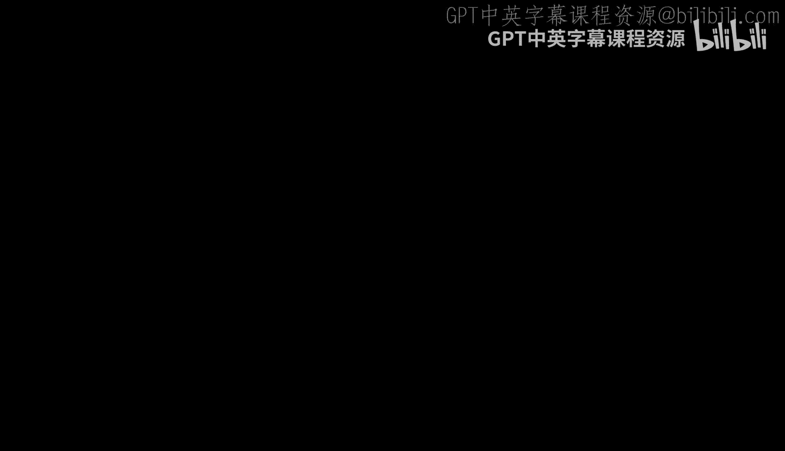

# 华盛顿大学《基于数据的机器学习控制｜Data-Driven Control with Machine Learning 2018》中英字幕 p22 -22-System Identification_ Dynamic Mode Decomposition with Control.zh_en -BV1BK6MBQEtN_p22-

Welcome back。 Okay， so we're talking about system identification for control where we have access to full state measurements。

 So the first thing I'm going to tell you about is essentially linear system identification using dynamic mode decomposition with control。

 So let's just actually spell this out。 dynamic。Moode。Decomposition。With control。

And this is work primarily by Josh Proctor。Along with myself and Nathan Ktz so Proctor at all 2016。

 this is a scads paper so you can read about this。This method there。

 but the basic idea is that I can have measurements of my system evolving in time。

 measurements of my control input put U as it evolves in time。

 and I'm going to use regression to solve for these A and B matrices that best fit the observed measurements so I'm going to find the best fit linear dynamical system that agrees with my measurements。

So in general， this is going to be framed in a discrete time setting。

 so we could do this in continuous time， but in lots of experiments we're actually going to have measurements sequentially in time。

 so I'm just going to modify this to be x at time K plus 1 equals a X at time K plus B U at time K。

So this is just a discrete time version of my dynamical system。And what I'm going to assume。

 kind of the input。To this method， we're going to assume that we have access to measurements x。Okay。

 so this is measurements X， let's say X at time1。 I'm going to make this look like a tall vector。

 exit time 1， exit time 2， dot dot dot x at time n。Okay， I'm also going to assume that I have this。

 so this is called my snapshot matrix of my snapshots of my state in time as it evolves in time。

 So this is time going from left to right。 I'm also going to assume that I have what's called x prime and x prime is just the snapshot matrix shifted1 Delta T in the future。

 So it starts at x2 x3 and it goes to X。M plus1。Okay。

 so this is the same basic assumption that I start with with the regular dynamic mode decomposition。

But then what I assume I also have， I have access to a snapshot history of my control input。

 and I think Josh called this。Oopps salon， so let's see if I can actually get my os salon to look。

 okay。 And this is U 1， U2 dot dot dot U M。 in， so that's also a a matrix of my input measurements in time。

Okay， so X and X prime are the original inputs for DMD。 Now I have this ooppsilon。

 which will help me interpret and disambiguate the effect of actuation and the natural dynamics。

 Okay， so this is the input to the method。And essentially。

 what I can do is I can write this discrete time dynamical system directly in terms of these data matrices。

 Okay， so this is kind of， you know， I could plug in x1。X 2 and U1。

 or I could plug in x 2 U2 and x 3。 So essentially， these are my X and oopsilon。

 And this is my x prime variable。 So I can write this in terms of my data matrices。As x prime。

The matrix of snapshots equals big A。Times big x plus b times this matrix， Opsilon。

And you can work this out， this is now a matrix system of equations。

 but all of the dimensions match okay so I can multiply big x times my a matrix and it essentially multiplies all of these columns and multiplying by the a matrix advances them one delta T in the future so I get x prime if I take a times x plus b times epsilon and again I'm assuming you already know how the dynamic mode decomposition works。

 which is essentially just if you had x prime equals ax but now we're going to add this plus B ooppsilon。

Okay。So there are a couple of interesting cases here， I guess case1 is a little bit more trivial。

So in case one， we actually know what B is。 Let's say we know。We know what the B matrix is。 Okay。

 so A is unknown， but we know what B is。 We know how we're affecting the system。

 but we don't know the dynamics A。If we know the matrix B。😡，Essentially what we can do。

Is correct for this known B， We can essentially subtract it off to the left side and we say， okay。

 we have x prime minus B Opsilon。So these are all things we can measure。And that equals。A times x。

 where now this is the only unknown。Okay， so in this case， if you know B Opsilon x and X prime。

 you can essentially subtract this over to the left hand side and this becomes like a new。X prime。

Okay， you can essentially do this the original DMD procedure。

 but using this new modified x prime this X。 and you can solve for a in particular。

 if this is really high dimensionional， you can solve for the leading eigenvalues and eigenvectors of a for reduced representation。

 which is the normal DMD So case1， if we know the B matrix。

 And we also have these these measurements of what the control input is in time。

 we can just subtract this over and solve for a just like we would in regular DMD。

 So this is kind of the easy case。 Okay， this is easy。So the slightly harder case is case two。

And in case two， we don't know B， so we don't。No B， so in the case that we don't know B。

 we have to be a little bit more clever。And so what Josh did in this case was essentially。

He stacked this up and I hope I can actually get the matrices right。

 but he stacks this up into a problem x prime equals。

 and then what he does is essentially build this into a big A B matrix。

 so he builds this concatenated matrix times a big X Uppsilon data matrix。Okay。

 so essentially he augments。He splits this up so that you have one big matrix of unknowns and one big matrix of knowns。

 so we know these。And these are unknown。And then essentially。

 he has a procedure where you do dynamic mode decomposition。

 you run the dynamic mode decomposition algorithm on this framework。

 and you simultaneously using data driven regression solve for this big matrix that contains both A and B。

This involves taking a singular value decomposition of this matrix。

 doing a pseudo inverse and breaking up the pieces until you get an a matrix and a B matrix。

 so there's a little bit more math involved here， you can read about it in this 2016sads paper but basically in either case if I know B then it's very easy to solve for the dynamics A kind of this low order representation if I don't know B。

 I have to simultaneously solve for a and B and then I can do the regular dd trick of finding the leading eigenvalues and eigenvectors of a so that's kind of the mile high view of dynamic mode decomposition with control you assume that you have quite a lot of input data of your state as it evolves in time along with your control input U and then either if you have B or don't have B。

 you can solve for for the unknown matrices and build a linear reduced order model now a couple of things I think are really。

Interesting about this method。One thing is。If you didn't take into account this plus B U。

 you would essentially have。You would essentially just apply regular DMD to solve for an a matrix。

 but that a matrix would be contaminated by the effect of control that you're not taking into account。

 so we'll do a little MALb demo where we'll essentially compare what happens if you do naive DMD on a system that's being controlled。

 you'll get the wrong answer and then we'll show that if you do this kind of corrected DMD with control。

 you can get the correct a dynamics taking into account B。

And one way I like to think about this is essentially， if I was doing feedback control。

 if I said U equals K X， okay， so we often do U equals Kx， then if u equals Kx。

I essentially have my dynamics as。X K plus 1 equals。A。X，k。Plus， B， K。X， K， that's my plus B U。

And that equals A plus B。K。Xk。So what I'm getting at is if I naively just do DMD on the data X without taking into account the data U。

 the input data， then I will get the wrong dynamics。

 I'll get essentially the modified dynamics and not the original A and B matrices so there's a fundamental ambiguity here。

Where if， if I actually have a system that's being actively controlled， U equals KX。

 I can't tell the difference between this dynamical system with just an a matrix with no forcing。

And this dynamical system with an A and a B matrix in this feedback law。 So in terms of regression。

 those are both valid solutions to the data if my system is being controlled。

And so often what I have to do is I have to add some kind of a noise signal or some kind of some kicks to my system where I actually kick the U occasionally to measure transients in the dynamics。

So let me just recap， okay， we have a procedure to identify models A and B from data。嗯。

If my system is actively being controlled， U equals Kx， then there's a fundamental ambiguity。

 If I plug in U equals Kx here， I get another dynamical system with a different a matrix and this is equally valid to this。

 So if I have a system that's being actively controlled with a feedback signal。

 I have to kick the control every once in a while， I have to kick you to get a little bit more information out to get information out of the system to disambiguate A and B。

Okay， so we're going to code this up in an example， we'll see how it works。

 you can use these models directly for model predictive control or to understand the underlying dynamics and sensitivity of your system Thank you。

