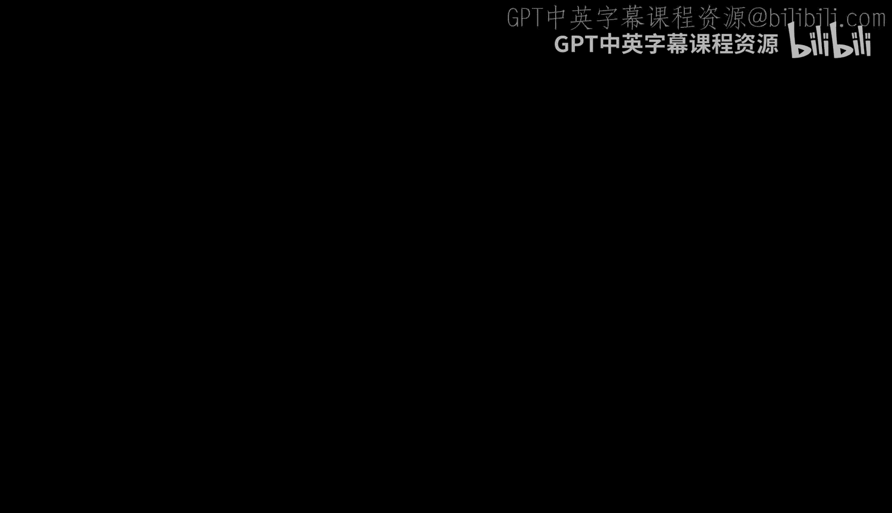
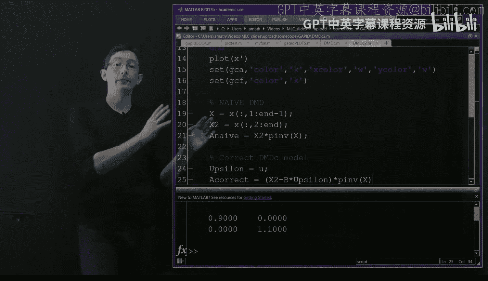

# 华盛顿大学《基于数据的机器学习控制｜Data-Driven Control with Machine Learning 2018》中英字幕 p23 -23-System Identification_ DMD Control Example.zh_en -BV1BK6MBQEtN_p23-

Welcome back。 Okay， we've been talking about dynamic mode decomposition with control。

 and I thought it would be fun to code up a really simple example to demonstrate what can go wrong if you naively apply DMD and how you actually implement the corrected DMD with control。

 So this example is actually directly inspired from the example in Josh Proter's DMD with control paper。

 And so I'm going to walk you through it。 Okay， so what we have here is a discrete time system where the a matrix is 。

9001。1。 So maybe I'll just。😊，Run this and show you what we get， okay。So this is the a matrix 0。

9 and 1。1 in the diagonal， since this is a discrete time system。

 we actually see that this is unstable because one of the eigenvalues has radius bigger than1。

 so the x2 components is going to get bigger and bigger and bigger as it iterates through this a map。

And I'm assuming that I have a B matrix， which is 01 so I can affect that unstable eigenvalue。

 and then I have a controller or some feedback control， which is u equals minus Kx。

 where I have this gain matrix K。And so my closed loop system。

 if I actually apply that feedback control， u equals minus Kx， then my closed loop system。Is stable。

 so notice I literally just subtract 03 from this eigenvalue and I have two stable eigenvalues in my closed loop system enacting that feedback control。

Okay， so what Josh Proctor realized and he actually realized this in the context of disease control where maybe you have some really complicated natural dynamics。

 maybe they're unstable， maybe they're stable。But you can't afford to turn off your control strategy so that you can do a system identification that's that's kind of inhumane to just stop vaccinating and stop treating disease so that you can get a model of the system。

 And so what he wondered was can you get a model of the underlying dynamics and disambiguate the effect of the underlying dynamics from the actuation without actually turning off this control law。

 Okay， so that's what we're going to do here is。We're going to measure the system with the closed loop control。

 and we're going to compute naive DMD on the data， and then we're going to compute the corrected DMD with control to try to figure out what the true A matrix is。

Okay， so that's the basic setup。 We have an a matrix a B matrix and some feedback control U equals minus K X。

 Let me just put that in the comments。 U equals minus K times X。

 And so I'm going to generate some data with an initial condition， 10，10。

So my x vector at time1 is 10，10， and then I'm going to go through 10 iterations of this dynamical system。

 so I'm going to say my feedback control at time step K is u equals minus Kx at that same time step。

And then my next time step， x K plus 1 is A Xk plus B UK。

 in case a very simple four loop to just step the system forward in time， discrete time dynamics。

And then what I'm going to do is I'm going to plot my x variables in time。And you're going to see。

 in fact， they do decay kind of linearly， so because I have this feedback control。

 I can't see that one of these is actually unstable dynamics because the controlled system is giving this stable decay。

Okay， good。嗯。Alright， so now what I want to do is two things。

 The first thing I'm going to do is I'm going to code up a naive DMMD where I don't know that there's a control input。

 I'm just going to do DMMD on this closed loop system。 And so to do that， remember。

 DMD is super easy， I just say X equals。The first one to M-1 snapshots，1 to n-1。

And x2 is going to be x2 to n。 So I'm taking the the first columns in x。

 everything up until the the second to last column。 And for x prime or x 2。

 I'm taking the second through the last columns。 So x 2 is just a times x。 Okay。

 at least that's what it should be。And then I can compute a， let's call this a naive。Equals。

X two times the pseudo inverse of x。 Okay Now， if I was doing real DMMD on a high dimensional state。

 I'd have to do some additional steps。 I'd have to project this onto singular vectors and extract the modes But since this is a two state system。

 and I have more measurements in time than states， I can just do this simple pseudo inverse。

And so when I run this， what I find。Is。The naive a estimate is my closed loop A model with stable eigenvalues。

 So if I only do this on controlled data and I don't take into account the fact that this U is actually stabilizing the system。

 then my DMD A matrix incorrectly identifies the closed loop dynamics and not the actual original unstable A matrix。

Okay， but we can actually correct for this， so let's now make a new one called correctect DMDC model。

And so now what we're going to do， we have the same x and the same x2。

 Now we're going to build an Opsilon variable， and that's just my U Okay。

 so're just the time snapshots of U。And now my correct a， let's say a correct what I'm going to do。

 since I know my B vector， I'm going to assume that I know what my B vector was。

 I can correct for that in x2。 So now I can do x2 minus B times opsilon。

 That's my new kind of corrected x 2。And I can now do pseudo inverse of X。Okay。

 so all I've done is because I can measure my actuation U and I know what my B vector is。

 I can get this corrected dynamics。 I can essentially subtract that plus B U off onto the left hand side。

 and I have x prime minus B osilon equals a times x。

 And so now I'm going to pseudo inverse x to find my best a matrix。And when I do this。

 my DMD with control， this is the DMD control a matrix。

 I get the correct original system model with a stable and unstable eigenvalue okay so this is just kind of a very。

 very simple toy example， this is the one that Josh Put in his paper to illustrate what can go wrong if you naively apply DMD and how you can correct for it if you know oopson your control inputs and you know be your actuation signal。

Now， if I didn't know B， this would be a little bit more complicated。

 There would be more steps in here， and I would also have to to give my system a few more kind of kicks or some add some white noise onto my control input to simultaneously discover A and B。

 But you can see that in this case where I know the B vector， it's really。

 really easy to get the true underlying a matrix。 And I might want to do this because。

If if I did DM naive DMD on my data， I might think I didn't have any problem that there was no instability and I might not understand the basic underlying physics of this unstable system。

 whereas if you do this corrected DMD with control procedure。

 you learn very quickly that your actual system has an unstable eigenvalue。

 and so if you were going to change your control strategy。

 you should take this into account so very simple to cook up an example in MATLAab where regular DMD doesn't work because you're forcing the system。

 but where DMD with control gives you the correct underlying dynamics。

Okay， thank you。