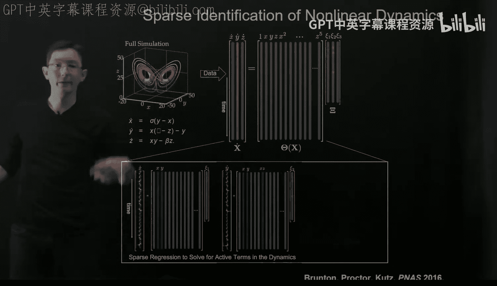
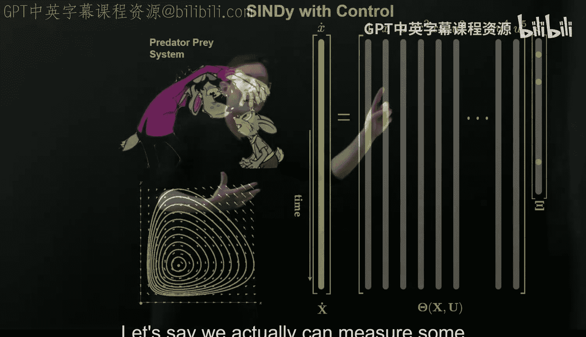
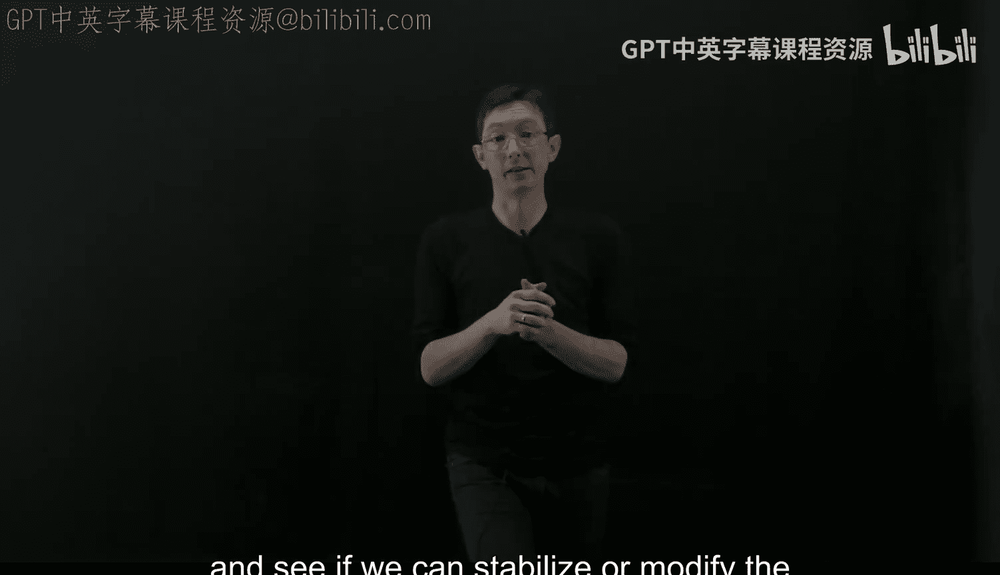

# 华盛顿大学《基于数据的机器学习控制｜Data-Driven Control with Machine Learning 2018》中英字幕 p25 -25-System Identification_ Sparse Nonlinear Models with Control.zh_en -BV1BK6MBQEtN_p25-

Welcome back。Okay， so we've been talking about data driven regression to obtain models for model predictive control。

 So we're doing system identification based on data。

 we're finding best fit models that fit the data using regression。

 and we're going to use that for control。We've talked about DMD with control Coopman with control now I want to tell you about the sparse identification of nonlinear dynamics with control。

 so this is essentially a framework to get fully nonlinear models X dot equals f of x comma U fully nonlinear models purely from data that you can then use in this model predictive control optimization so。

I'm just going to give you a very， very quick overview of the original Cindy method。

 the basic idea here is if I have some measurement data of my system。

 let's say this is the Laent system， that should not be a box that should be I think a row。

 that should be a row anyway if I have some measurement data of some nonlinear dynamical system。

 what I can do is I can form this data。Into these tall columns that evolve in time。

 so my three state variables， x， Y， and z in time and x dot y dot and z dot。

And what Cindy does is it essentially builds this nonlinear library theta of x of all of the candidate functions that could be in these right hand side dynamics。

 so these can be evaluated with data。And then it uses sparse regression to find the fewest columns in this library that give you X dots。

 the fewest columns that give you Y dot， and the fewest columns that give you Z dot using sparse regression。

And then what you end up recovering is a dynamical system that agrees with your original system and it identifies the correct nonlinear structure okay。

 so this is pretty cool method of nonlinear system identification purely from data。

It's formulated as a linear regression problem， so we essentially build all of the nonlinearity into this theta matrix。

 and then we do sparsity regularized linear regression to find the fewest columns that agree with x dot y dot and z dot okay so this is really just a big AX equals B solve once we've built this library。

Now， a couple things of interest。 you can definitely do this in discrete time too。

 This doesn't have to be x dot Y dot Z dot。 This could be。X。

 Y and z at time step K plus1 as some nonlinear function of those variables at time step K。

 so you can do this in discrete time。Now， what I'm going to tell you about is how you can use this Cindy algorithm。

 this sparse identification of nonlinear dynamics to not only identify。Unforced dynamical systems。

 but now to identify systems with actuation and control。So if you want to know more about this。

 I'll point you to a video in the comments where you can learn all about Cindy。

 but now we're going to apply this to Cindy with control。Okay。

 so this is a modified version of Cindy where now instead of just building a library of functions of x like x。

 x squared x cubed and so on， now what we're going to do is allow our library to include cross terms that include the actuation U。

 so my library includes X U， x squared x U and so on and so forth。

This library is only limited by your imagination， so this doesn't have to include polynomials it can have cosines and signss。

 tangents， best functions， whatever you want， but the idea with Cindy with control。

I we're going to apply that same sparse regression procedure to find the best fit X dot。

 the fewest columns of this matrix， that degree with the time derivative of my measurement， vector X。

 Okay， and so essentially I build this library from data。

 I'm going to illustrate this on a pretty simple system。

 So this is the classic predator prey lockca Volta。

Where you essentially get these oscillations and predator and prey populations。

 these kind of phase lag oscillations。 So， you know， bunnies grow and then wolves grow to catch up。

 The wolves eat all the bunnies。 So their population collapses。 Then the wolves have no food。

 So they die off。 Then the bunnies grow and so on and so forth。 So this evolves in time。Okay。

 so what we're essentially doing， original Cindy could identify the lock of voltro dynamics with no problem。

 just from this data， Cindy could identify those nonlinear dynamics。

But now let's say that I have some actuation and control。

That I'm actively modifying the system with some feedback control。 So for the example。

 in the case of， of population dynamics， maybe I'm actively going and hunting wolves。

 And this actually happened back in the， I think this was the Appalachia。Traping records。 they would。

 there were records of links and hair。 So you had a predator and a prey。

 but they were actively trapping these animals for their pelts。

 And so there was this active feedback control modifying the dynamics of the system。

 Okay so that's kind of the test case here。 Let's say we actually can measure some actuation U that's modifying these dynamics and see if we can learn those the nonlinear dynamics and the effect actuation。

In this case， I just write down the equations with some control input。

 I simulate them to generate my data。And the idea here is。From time 0 to 100。

 I have one control strategy。 Maybe here， I'm you know， aggressively trapping wolves。 Okay。

 so that's1， one control strategy。 And then at time step 100， my control strategy changes。 So my U。

 that input vector U changes at time step 100。Okay， so kind of 0 to 100 is my training data。

 100 to 200 is my validation data。And what you can essentially see is if I do naive Cindy。

 if I do regular Cindy， but I don't take into account the fact that I'm actively controlling my system。

 then I can agree quite well in my training period。But then when I switch my control input。

 my Cindi model starts to diverge because it fundamentally doesn't capture the fact that there's this control variable U that's forcing my system。

 whereas my Cdi with control model knows that there' is this U that's affecting my system。

 And as long as I measure what that U is， I can accurately trace different control strategies in the future。

 so the blue agrees well with my validation。Okay， so that's kind of the high level view of Cindy with control is basically you build this augmented library that has not just your state dynamics。

 but also takes into account the actuation。So that when you measure your dynamics and train the model。

It disambigus the internal nonlinear dynamics from the effect of actuation and control so that if I change my control strategy at some point。

 my Cindy with control model is able to compensate whereas an a naive CID model would fail。Okay。

And here's a nice diagram that Ericka Kaiser made in this archive paper for the Loent system。

 So this is basically that big Cindy Cindy picture。 But now with control。 So here we have our our。

Lorenz dynamics with some actuation U in the first state X， so now I have my data collection。

 X Y and z and U， and now I do this sparse regression in this augmented library that includes nonlinearar functions of my states and control and what you find is you can simultaneously identify the unforced dynamics and the effective actuation。

Okay， so Cindy with control is a powerful data driven regression technique that allows you to identify input output models that are nonlinear okay。

 so some nonlinear dynamical system and the possibly nonlinear effective actuation。Okay。

 so what we can then do is take those Cindy with control models and wrap a model predictive controller around it and see if we can stabilize or modify the behavior of a strongly nonlinear system。

 Okay， that's all coming up。 Thank you。

