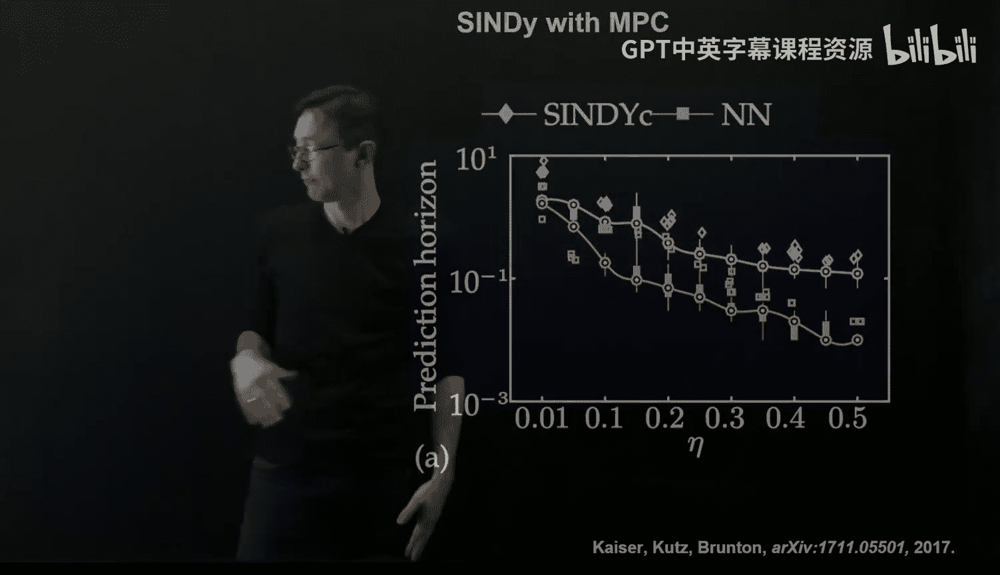

# 华盛顿大学《基于数据的机器学习控制｜Data-Driven Control with Machine Learning 2018》中英字幕 p26 -26-Sparse Identification of Nonlinear Dynamics for Model Predictive Control.zh_ -BV1BK6MBQEtN_p26-

Welcome back。Okay， we're talking about nonlinear system identification for control purely from data。

 okay， so we've been using data- drivenriven regressions to obtain both linear and nonlinear system models and we've talked about how you can use model predictive control once you have those system models to optimize your control strategy for nonlinear control so that's what we're going to talk about now is essentially how do I combine model predictive control with something like Cindy a sparse identification of nonlinear dynamics with control model。

Okay， so this is kind of the overarching model predictive control framework。

 this is in the context of a reference tracking problem and this is you can read more about this in Orika Kaiser's archive paper on model predictive control with Sprse nonlinearar models。

嗯。Here's kind of the block diagram of what model predictivedative control is doing。

 You essentially have some reference value you're trying to track。 You have some predictor。

 This is the model of your system。 So this is where your Cindy with control model is going to be。

 And essentially at every time step。 What you do is you use this model to optimize your control input over some short time window。

And then you use that control input， that that first value of your optimizing control signal。

 you enact that， you see where your system goes， and then at the next time step you rerun an optimization。

 so for every time step you're running an optimization into the future based on your model and you're picking the first actuation signal and using it。

 then you reinitialize your optimizationr。Pick the next first actuation signal， initialize it。

 and you keep walking forward in time。 That's essentially what model predictive control is doing。

 So over here， you can see this in in a cartoon。 you have your actual state。

 trying to track some set point。 This is your optimizing。

 This is what your your model thinks is the optimum control and put in the future。

 and you essentially lock in this optimizing control value for the next time step。

 your system steps forward， and then you reinitialize your optimization。

 you move this window over and you redo everything again。 You reoptimize。

 you pick that next control value， you step your system forward。

 you reoptimize and so on and so forth。So model predictive control is extremely flexible， very。

 very powerful。 This is the industry standard。Kind of advanced process control now because it's so flexible and you can include constraints。

 you can do this for nonlinear systems。In the past。

 because this optimization was run at every time step， this was pretty expensive。

 and so often this was only feasible for linear models。 Okay。

 so for linear or linear parameter varying models， but as computers are getting faster and faster。

Essentially， it's getting more and more feasible for us to use nonlinear models in this predictor step Okay。

 so what Uka has done is essentially taken these nonlinear model identification techniques like Cindy Sprse identification of nonlinear dynamics。

 and she's using those directly for online control in a model predictive controller。

So just to refresh your memory， this is the Cindy with control diagram。

 so you have data collected from some unknown system so you measure the states in time and the actuation signal U。

You build a big nonlinear library of candidate functions for the right- hand side of these dynamics and you apply sparse regression to find the fewest active terms in the dynamics that agree with your data。

 so you get this sparse nonlinear system that also includes the effective actuation that's Cindy with control and what ER is doing is now using these identified models。

 these purely datadriven sparse models with model predictive control。

The cool thing about this framework with using these Cindi models for model predictive control is that unlike other nonlinearar system identification。

 because these are sparse models， they only have the fewest。

 necessary terms required to describe these measured dynamics。

 These are actually pretty fast to simulate。 I'm not simulating really。

 really complicated deep neural nets or kind of black box models。

 these are very efficient to simulate because they have the fewest terms required to explain the dynamics and they're also highly interpretable。

 So you can actually read off what terms are active in the dynamics and interpret what the nonlinearities are。

 you can do analysis， you can find fixed points， Anything like that okay but these are especially good for model predictive control because they're very。

 very fast and they can also be identified using very small amounts of data compared with neural networks。

😊，Okay， so Orka has applied this to tons of different systems。

 she's applied it to the Pre prey model， the chaotic Lorent system。

 she's also applied it to flight control of a fighter and HIV suppression in an HIV model so you can use this data-dven model discovery and model predictive control framework in all of these examples。

 you can read about it in her archive paper。And I'm just going to walk you through how this works on the La rentent system Okay。

 so essentially what we're looking at here are the X。

 Y and Z time traces for the La rent system that's that chaotic Laent system we saw before。For about。

 I guess，10 time units for various degrees of noise。 Okay， so this eda is the noise parameter。

 and it starts off small， medium and large。And what we're plotting here is the performance of a Cindy with control model and a neural network model for these time windows and increasing noise。

And what you can see here is for small amounts of noise。

 the CinD model actually qualitatively tracks the true dynamics for a very long time。

 even though this is a chaotic system， it's actually able to capture many of these oscillations and lobe switches of the system until it starts to deviate around here around time 37。

Whereas the neural network model is deviating significantly earlier， even for very small noise。

Now here you can see that as I increase the noise， the Cindi model starts to disagree with the true model more rapidly。

 but the qualitative dynamics， the fact that the system has lobe switching and spends certain amount of time on one lobe and other amounts of time on the other are actually qualitatively captured quite well by the CIdi model。

 even for large noise， So even with large noise， the Cdi model is qualitatively capturing the right dynamics。

 it's just that because the system's chaotic， this noise is causing those two systems to diverge earlier in time。

But you'll notice that as I increase the noise， the neural network model starts to get worse and worse。

 The qualitative aspect of the neural network model is degrading over time for increasing noise。

 even though the Cindi model is capturing these dynamics。

 so we haven't done any model predictive control yet。

 this is just comparing the actual model performance of Cindy with control versus neural networks for the Lorenent system。

 And you can see that because we're doing this sparse regularized regression。

We can essentially get away with cleaner models that handle noise a little bit better。

And because the actual structure of the model is identified instead of a black box。

 the model predictions in the future are qualitatively more accurate。Now neural networks。

 I shouldn't disparage them too much because the CinD model works essentially because I had the right dynamics。

In the library。 Okay， so the actual true Lorenz dynamics were in the library that I used for Cindy。

 If my library didn't include those dynamics， it would be terrible。 Okay。

 and so the neural network model is， in general， more powerful for unknown dynamics， really。

 really complicated dynamics。 I can fit the neural network model。

 whereas the Cindy model really requires that you have the right library to represent those dynamics。

 But if you do it， it performs very well。And so here's a kind of distillation of that first figure where as we increase the noise magnitude eda。

 you can essentially see what is the prediction horizon for how long can I predict in the future before my model deviates beyond an acceptable tolerance。

And you can see that consistently as noise increases。

 Cindy has a larger prediction horizon than neural networks。

 which means that it should be more useful for model predictive control。 Okay。

 so the Cindy model agrees with the actual true measurement data for longer。

 even an increasing noise。

And so here's kind of the overview figure of how Cindy works with model predictive control on the actual laent system。

 Okay so this is what we just saw， this increasing noise magnitude and prediction horizon。嗯。

What we find is that also the execution time so the CinD model executes much。

 much more rapidly than the neural network so the CinD controller runs in about 1。

6 time units whereas the neural network takes 35， so the neural network is much more expensive to simulate and less accurate and the CinD model is essentially giving you these very fast and accurate model predictions for model predictive control。

It also requires way less training data and is much faster in terms of training time okay so the Cindy model is faster and as a function of the training data and it also as a function of how much training data you have。

 Cindy identifies the correct model much much more rapidly so what we're trying to assess is if I only had limited data to train these neural network in CinD models what would I what kind of model would I get so as I increase the amount of training data I have。

 you can see that the neural networks are very slow expensive to train whereas Cindy is fast to train about two orders of magnitude faster。

Actually， maybe four orders of magnitude faster。And in addition。

As I increase the amount of training data available very rapidly。

 the Cindy model has enough data to identify the correct model and the prediction horizon is good。

 whereas it takes much more data for the neural network to identify an equivalent model so it takes much。

 much more data for the neural network to get a good model than for Cindy to get a good model。

And then finally， over here， what we see is you know we had these three different phases。

 so we train our data on this type of data。Then we change the control signal and we see how good our prediction is in this window。

 and then finally what we do is we enact our model predictive controller in this last phase to try to stabilize a fixed point of X。

 Y and Z。And you can see that the Cindy model very， very rapidly is able to stabilize these。

 even for a nonlinear system using this model predictive controller so Cindy is able to accurately and aggressively stabilize the system on these values using the model that learned in this training period。

 just using model predictive controller。So Orka has applied this to many， many more systems。

 just like we talked about。Here she's applied this to Pre prey， fightererje， HIV and Lorenz。

 and so you can read all about this and kind of figure out how you can apply this to your system。

 but really what you need to know is if you have measurement data of the state of your system and the control input you can build a Cindy with control model and then if you have some control objective。

 you can obtain that control objective by using model predictive control wrapped around that Cindy model。

Okay， thank you。