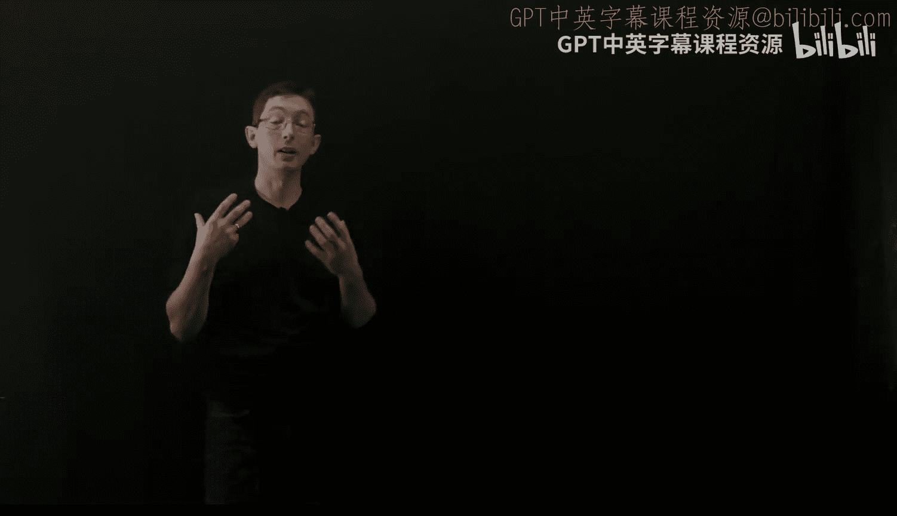
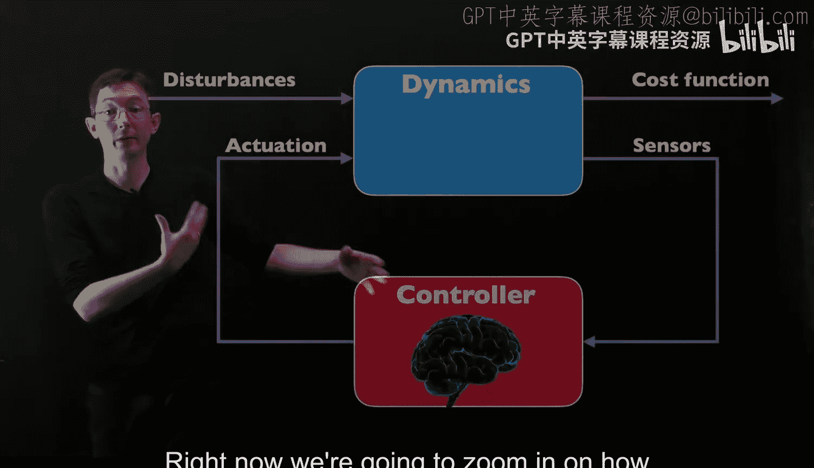
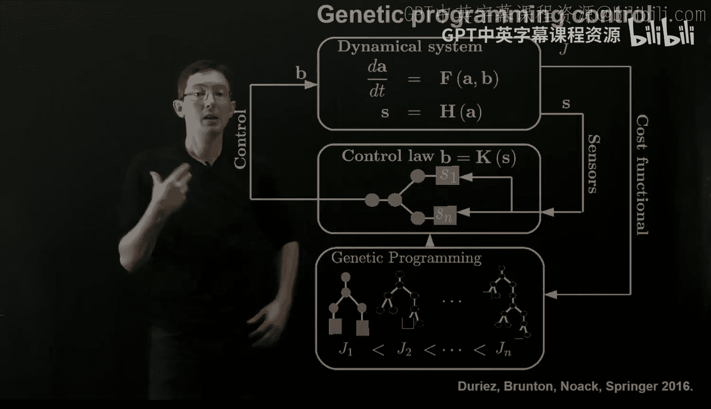
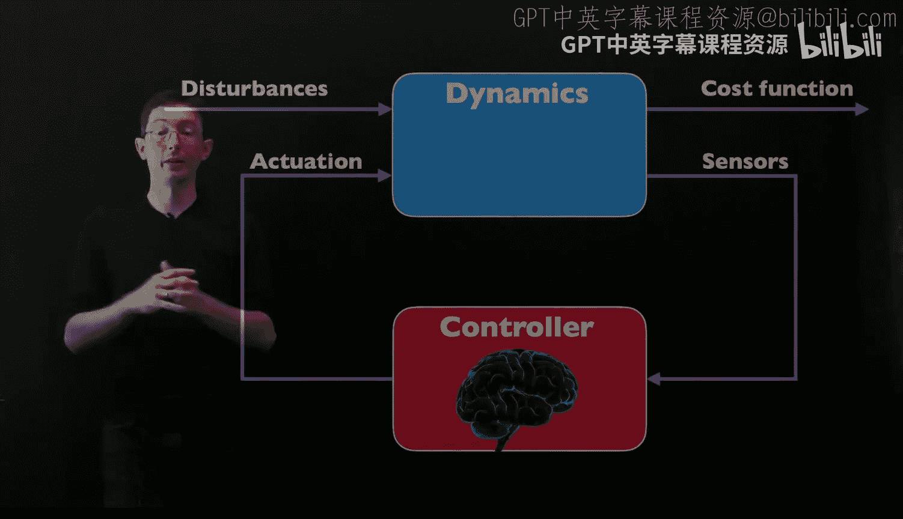

# 华盛顿大学《基于数据的机器学习控制｜Data-Driven Control with Machine Learning 2018》中英字幕 p27 -27-Machine Learning Control_ Overview.zh_en -BV1BK6MBQEtN_p27-

Welcome back， everyone。Okay， so we're talking about data driven modeling and control and in particular now we're going to start talking about machine learning for control Okay。

 so I just want to recall this basic generalized feedback control diagram here。

 you have some dynamical system， maybe it's complex nonlinear multi scale high dimensional。

There are some disturbances to your system， maybe a gust of wind or something unmeasurable parameters that change the dynamics。

 there's some high level objective function that you want to optimize。

 either minimize or maximize and the idea is to design some control law based on sensor measurements of your system that can then drive the system through actuation through your control knobs。

So this is kind of the generic architecture that we've been working with from day one。

 even back in the control boot camp。And what we've been talking about is how to use data driven methods。

 machine learning and other types of optimization， both to design the dynamical system and the controller。

So we spent a lot of time talking about how you would use machine learning for characterizing your dynamical system。

 this is essentially system identification。But with modern methods in data driven optimization or machine learning。

 So you can spend a lot of time。And effort characterizing your system from data and then use that system model to design a control law。

 but what we're going to talk about today is instead of painstakingly characterizing your system dynamics just to design a control law。

 instead what we're going to do is use the statistical and machine learning optimizations directly to design effective control laws that you can then wrap around some unknown dynamical system。

So some of the motivation for this is the following。Dynamics are hard to characterize。

 and it turns out that in a lot of cases， the model that you need to predict and understand a physical system is a lot more sophisticated than the model you need to control the system so we spend a lot of time understanding the dynamics。

 getting a model that's you know really good description of the physical system that might be overkill for a control lot。

 We have robust control that can handle a lot of model uncertainty certainty and missing dynamics。

 So spending a lot of effort on dynamical system modeling might not be the best use of time。

In addition， the whole point of this is to measure the system and then drive it to change the dynamics okay so if I have something like a rocket ship。

 I'm thinking of like the blue origin or SpaceX rocket that they're going to land back on the launch pad or on a moving platform at sea。

 then I'm trying to change my natural system dynamics which are unstable and I'm trying to drive them to be stable dynamics。

 so if I spend all this time characterizing my system。

 it might be that right when I apply the control， the dynamics change a lot and I observe new phenomena that I never saw before。

This is especially true in very complex high dimensional nonlinear systems like you political systems or financial markets or disease modeling where。

Even if I have a great model of the natural unforced system， when I start to apply control。

 if I start to make a regulatory policy or a vaccination campaign。

 I might dramatically change the dynamics and start to see phenomena that I never saw before。

 and my dynamic model might very rapidly break down and start being useless for control。

So instead of putting all of that energy into the dynamics modeling。

 which I actually do like modeling dynamics。Maybe we should be spending more effort directly trying to design effective control laws using data。

And so this is largely inspired by the fact that in modern systems of interest。

 it might actually be possible to try lots of control laws to gather lots of data。

 So the example that we've been thinking about， this is with collaborators like Barrett Noak and others。

Are turbulence control problems。 So that's a very， very challenging dynamical system。

 a turbulent fluid， high dimensional， hard to model。

 very hard to design reduced order models that are suitable for control。

 People have spent decades trying to do this。 And it's very， very challenging。

But in modern experiments， you can try a control law。

 you can try you can write down a controller that you think might work。

 and you can try it in an experiment in a wind tunnel or a water channel in something like 10 seconds or half a minute。

 so in that short of amount of time， you might actually know if your controller was or was not effective at optimizing your objective function。

And so with that kind of a scale， you might be able to apply hundreds or thousands of different control laws and use this data-driven optimization。

 this machine learning architecture to go from kind of this broad sweep。

 the shotgun approach of many candidate control laws and start refining them into these very。

 very highly effective control laws through optimization。

So that's kind of the idea that lots of these systems of interest。

 you can directly optimize your control law if you have a good parameterization of controller space。

 if you have some good set of parameters that define what families of controllers you can try。

You can run data driven machine learning optimizations directly on those controllers and then wrap that around your system。

Now this doesn't necessarily work for lots of systems of interest。

 so for example I don't want to do this in disease modeling because there are ethical concerns with trying 1 thousand candidate control laws。

 knowing that a lot of them are not going to be very effective。

 so that's actually a case where I might want a physical model so that I don't waste energy and time and hurt people trying you know to refine my control law through trial and error through kind of an optimized fancy trial and error。

Another example。Would be， I think， like neural control。

 Like if you're trying to stop someone seizures， you're probably not going to do a trial and error based based control strategy。

 so。A nuclear reactor， okay， I'm trying to control some fusion reactor， some tokaak。

Probably I don't want to do trial and error。you know。

 try a thousand bad controllers where this thing might blow up just to find the one。

 the one good one， okay， but what you might do is you might build a proxy model using kind of machine learning up here。

And then if you had that proxy model， then in simulation。

 you could try this machine learning control optimization approach without actually putting any humans at risk。

Okay， I hope that was clear。 So lots of options here。

 what I would advocate where we're moving in the future in the next， you know 5，10。

20 years is really putting this brain kind of in the middle and doing this hybrid approach where you learn your dynamics and you learn your control law in concert。

 And that's much more like what humans do。Where you have some physical model of the world where you can run these simulations。

 So for example， if I'm trying to play tennis， I have some basic physics simulator in my head that tells me what I think should happen depending on what my control input is。

 and so in the background I can be running this kind of optimization to figure out better and better control laws and then periodically I go play tennis and I actually can refine my strategy with real data and I can refine my model and my control law in in real time。

 so that's where things are going right now we're gonna to zoom in on how to use machine learning for the control that's what we're going to talk about for the next the next few lectures in particular。

 one of the things that I think is really interesting and exciting is the use of evolutionary algorithms and genetic algorithms for control。

 So you have this is kind of a generic diagram like before I have my dynamical system。

 I have my control law， some cost function J。 And what I'm doing is I'm running this meta learning algorithm。

 this genetic programming algorithm where I try lots of different control。

But then I learn。An effective control law after this kind of targeted。

 optimized trial and error procedure over time。 And so I'm going to tell you a lot about genetic algorithms。

 genetic programming and how you use those for control。

 We're going to cook up a few simple examples in Matlab for things like PD control。

 I'm going to tell you how this has been used for turbulence control。 But in general。

 you can also do you can do lots more than this。 I can have instead of this genetic programming optimization。

 I could build a neural network。 Okay， so I could have this kind of neural network model that is that's driving my dynamical system。

 or。I could maybe in some cases， I have a very complex cost landscape J。

 The example I like to think of is if I'm playing chess。

 how do you know what a good board position is， That's kind of your cost function J。

 How do I know it in an instant how good J is， That's a very subjective and difficult to measure。

 measure quantity， So I might actually use neural networks to learn。What my cost landscape is。

 and then I can use something like reinforcement learning or model predictive control once I know something better about my system or my J okay and so that's what people are doing now with deep reinforcement learning and deep model predictive control is essentially they're using you know deep neural networks for the hard to model parts of those control laws。

 which in reinforcement learning， it's this kind of objective function。

 this value function landscape。And so that's another another thing you can do。

 There's tons of options again， I just want to harp on this because it's so important。

 control is optimization that's constrained by the dynamics。

Machine learning is optimization based on data。And the really interesting control problems are nonlinear optimizations。

 and fortunately， machine learning is giving us better and better nonlinear optimization techniques based on the wealth of data we can collect。

So that's what we're going to be doing。 We're going to be talking about how to essentially use machine learning and data drivenri optimization directly to find good control laws without needing models of the dynamics。

 Okay， so that's all coming up next。 we're going to talk about genetic algorithms。

 genetic programming and some applications。 Okay， thank you。

