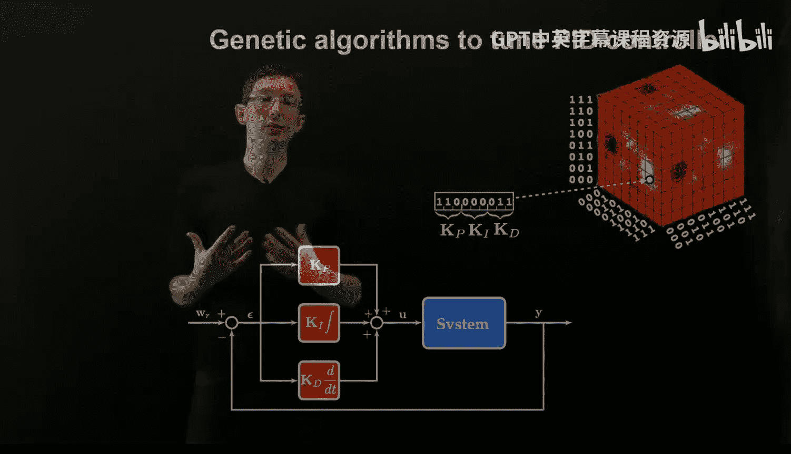
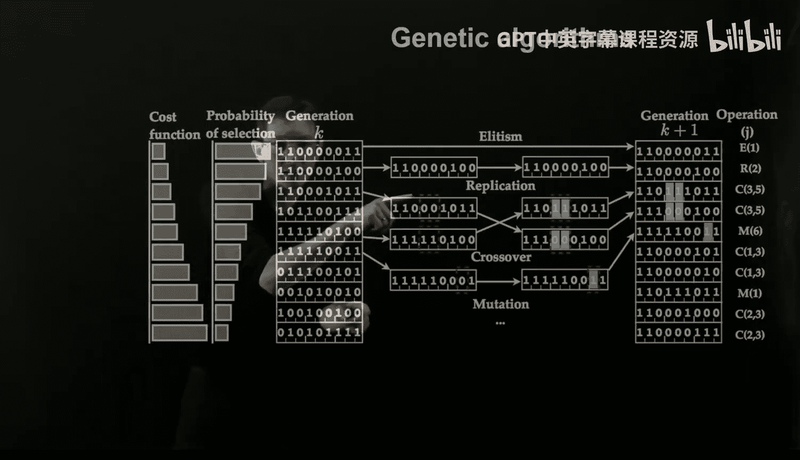

# 华盛顿大学《基于数据的机器学习控制｜Data-Driven Control with Machine Learning 2018》中英字幕 p28 -28-Machine Learning Control_ Genetic Algorithms.zh_en -BV1BK6MBQEtN_p28-

Welcome back。Okay， we're talking about machine learning control and in particular。

 the first sequence of video lectures， we're going to be talking about using evolutionary algorithms and genetic algorithms for designing good effective control laws okay I'm going to start off simple with the genetic algorithm。

 Then we're going jump into genetic programming and we're going to show how you can apply this for both controlling simple systems and controlling very complex systems so evolutionary algorithms are are based on this kind of biological principle of natural selection so you have this this population of control laws。

 you start with an initial population or generation of control laws。 you let them all compete。

 you see how effective they all are you essentially rate them based on their fitness or how good or badly they optimize your objective function。

 and then there are some genetic operations so that that generation。

 the effective control laws from that generation can somehow breed more effective。

Control laws in the next generation。 So there's this idea of natural selection。

 of mutations and evolution。And of kind of coding up the information that makes the control law effective so that you can swap and tune and modify that information So I'm going to walk you through this starting with a genetic algorithm Here's kind of the big picture view of genetic algorithms we're going to walk through this。

 You have some generation of control laws which are parameterized by a sequence of number numbers。

 each of those has some performance on a cost function which gives them an associated fitness which is also related to their probability of selection there are some genetic operations here that give rise to my future generations and the idea is that this is a targeted optimization that selectively improves from generation to generation to get more and more effective control laws。

Now。I'm going to illustrate this on the simple case of using a genetic algorithm to tune a PID controller here。

 I would definitely caution you you should not be tuning PiD controllers in genetic algorithms in most cases。

 There are far simpler ways to do this。 This is an illustration of how you could use a genetic algorithm in a system where we kind of know the answer and we know how it behaves。

 and then you could generalize that's much more complicated control systems。

 So this is an analogy I'm not saying you should tune PiID controllers with genetic algorithms。

 but I'm going to walk through how you use genetic algorithms on this example。

So if I have a PID controller for some system， basically I have some reference value and some measurement y。

 and the PID controller breaks this up into some kind of， okay， so you have this error signal。

 which is the difference between where I want to be and where I am。

And you want to make that error signal as small as possible。

 as fast as possible without a lot of overshoot and ringing and stuff like that。

So the first line of attack is just if I have a big error， multiply it by a number。

 a proportional gain and feed that into the system， so if I have a big error。

 I get a larger control signal that brings me closer and closer。

The other thing I can do is I can integrate up that error。

 so if I've had a lot of error for a long time， my control gets more aggressive。

And I can also have a derivative of that error。 So if I have a big jump in error。

 my control can respond much more rapidly to those fast rises in error。 So simple PID controller。

 you know， this is old old technology we we played around with before。

 What we can do now is use a genetic algorithm to tune this PID control off for some high level objective。

And so what the genetic algorithm does is it assumes a structure for your control law in this case we have locked in。

 we've hardcoded the PID structure， this topology here。

 and we've made it so that there are three numbers that we get to optimize KP， KI and KD。

 these these proportional integral and derivative gain gains and that's all that genetic algorithms knows about is that there are these three numbers that it gets to tune to get better performance。

And so the first step in a genetic algorithm， once you have the structure locked in。

Is to somehow turn those numbers into like a genetic sequence， this is supposed to mirror DNA。

 the DNA of the controller now， and here I'm oversimpling this into bits。

 these kind of three bit representations of KP，KI and KD just for pictorial purposes。

So each of these has three numbers associated with them。

 and I get to tune those sequences to get bigger KP or smaller KP。

 bigger KI or smaller KI and so on and so forth。And so there's essentially this large parameter cube that you're working with in this case for these three parameters。

 I get a cube and what I'm trying to do what I've plotted here in color。

Is essentially my cost function， my objective function， which I haven't defined here。

 but we'll define that later。 I have some objective function landscape。

 and what I'm trying to do is optimize it for these bright hot spots where the parameters are really。

 really good to get the best performance。 And I want to stay away from these kind of red and dark spots where I get really。

 really bad objective performance。And so this genetic algorithm is essentially going to be sampling this high dimensional space。

 trying to hone in on these bright patches of good parameter values to optimize the system performance。

What's nice about genetic algorithms is that these scale pretty well to very high dimensional search spaces。

 so one strategy would be something like a Monte Carlo search if I have a 10 dimensional space。

 I could just randomly。Randomly sample and try to find these these hot spots。

 but as the system scales that becomes less and less feasible。

 you get the curseive dimensionality and the volume of this gets so large that the probability of you just randomly finding these hot spots becomes vanishingly small。

Genetic algorithms is a little bit smarter。 It starts off with an initial population which is kind of a Monte Carlo sample。

 but then if it gets near a hotspot， it kind of you know optimizes around and finds kind of the peak of that hotspot and it also spends more energy exploring the hotspot regions that it finds after the initial search so I'll walk you through what that means in a little bit but basically genetic algorithms is are a set of optimization techniques for high- dimensional search spaces of parameters once you've had a locked structure so we lock in the structure we define a set of parameters we're trying to optimize that defines a high- dimensionsional cost landscape and the genetic algorithm is a way of essentially finding these hotspots of best performance。

In a way that's faster than just a brute force Monte Carlo search。

Okay。So I want to walk you through this genetic algorithm diagram here on this particular example and then next time we'll code this up in MATLb and see how it works Okay so again in this example PID controller I had three parameters which gives me this kind of cube every point can be defined as these kind of nine bit number and what I would do is I would start out with a generation of candidate control laws。

And maybe I would initialize this randomly， I'd just randomly generate， I don't know。

 10 candidate control laws and the size of this population could be bigger or smaller。

 depending on how expensive it is to try these control laws。So in this case。

 I have 10 candidate control laws I chose randomly What I would then do is I would actually run my physical system or my simulation with each of these control laws and I'd run it and see how they actually perform。

 I'd basically measure you know what is the intensity of that particular grid cell of parameter values。

 is it really， really dark low performance or is it really， really bright high performance。

And then what I would get， so I had that kind of initial generation and I would sort them by their performance on this cost function。

 so in this case I'm trying to minimize my cost because you know I want small cost and so here I've sorted all of my initial generation by cost function。

 so this is somehow the best performing control law and this is the worst performing control law。

So now what the genetic algorithm does is it essentially uses these cost functions， the performance。

 the fitness。To determine the probability of each of these control laws advancing to the next generation。

 so these are going to kind of breed in some weird way。

 and I want the most effective control laws to be more expressed in the next generation's genetic pool than these least effective control laws。

And so based on this probability of selection， essentially there are a number of these genetic operations I get to choose from。

 and I'm just going to walk you through kind of the simplest four。

 but there are modifications to these。 So the first one is called elitism and you don't always have to include this。

 but but sometimes it's good if you have a good control law。

 maybe just copy it directly over to the next generation because I don't want to lose this control law。

 you know， randomly get worse over time。 So maybe I'll do this elitism and copy it over and that'll just be hardcoded。

 I always copy the best one or two over。The next kind of step we could do is replication。

 so it's very much like elitism， but it's random， so I may or may not。Decide to replicate。

 And I may or may not decide to replicate any of these based on a coin flip probil。

 So however unlikely it is， I might actually replicate this bad one， but it's unlikely。Okay。

The other genetic operations crossover is kind of like like sexual reproduction。

 so you basically take two highper control laws in this case it's these guys and I will randomly select different portions it's hard to see there's a blue circle here and a red circle so we've randomly selected those snippets of kind of control DNA and we're going to swap them in the future generations so in this crossover you essentially swap some DNA and you get two new control laws。

And so you're essentially trying to take you know the best parts of both control laws and figure out。

 you know maybe this control law was good because of one part and this control law was good because of another part and if I swap them。

 I can get a child who is good in both aspects。 Okay that's this kind of crossover And then finally I have mutation which is basically I take a control law and I pick some portion of this genetic sequence and I just randomly change those values。

So those are the basic genetic operations we have to work with， the way we actually do this。

 the way you actually create this K plus1 generation。

As you essentially go down the list after elitism， what I do is I basically flip a coin and there's some mixture of probabilities。

 maybe I replicate 10%， I do 50% crossover and 40% mutation。

 those are the rates of those genetic operations。So for each of these rows。

 I essentially flip a coin and decide， am I going to do a replication， a crossover or a mutation？

And then once I've decided that， I flip another coin and I figure out kind of which of these。

 you know based on this probability of selection， which of these individuals from Generation K get mutated。

 crossed over or replicated over here， and so then you generate this generation K+1。

 which somehow statistically should be more effective than this generation because you're taking the best。

 most effective performers and mapping them over。So this is essentially a big optimization loop。

To kind of iteratively generation to generation， find more and more effective parameters for control。

And genetic algorithms is not designed just for control， you can use this for any optimization。

 you can do this for sensor placement， all kinds of things。

 but I'm just showing you how you would do this to tune a PID controller。Okay。

 what else do I want to tell you about this？ So crossover generally is more exploratory。 So remember。

 we had that cost landscape。 crossover is going to try new things that you haven't seen before。 No。

 that's wrong。Sorry， that's totally wrong。Crossover is exploitative。

 It's going to take if you have two individuals that are in a hot spot。

 it's going to try to exploit the good features and get a more optimal solution that's closer to the center of that hotspot。

 whereas mutation is exploratory。 mutation， even if I'm near a hotspot。

 I might try something new and hope that I get more optimal so。Mutation serves to explore。

Your parameter space， whereas crossover serves to exploit。

Things you've already found that are successful。 so let me just say that one more time because I said it wrong the first time。

Crossover and mutation have these dual roles， these kind of complementary roles。

 crossover is more exploitative， so it takes known good structures and exploits them to get even better known structures and mutation is moreative。

 It explores your parameter space more， so it takes good parameters and then it kind of mutates them to explore other options that you might not have seen。

Because in lots of these optimization algorithms， if I find a maximum。

 it'll just optimize right up to the top of that maximum and stay there。

 what mutation does is it allows me to jump and maybe find a more global maximum so you have these dual roles of exploit and exploiting and you can essentially change the probability of how often I crossover versus mutate to favor exploration or exploitation more okay so that's the overview of genetic algorithms。

 I've kind of motivated this on a PID control。 We're going to then code this up in MATlab and actually see how generation to generation those control laws get more and more effective thank you。

