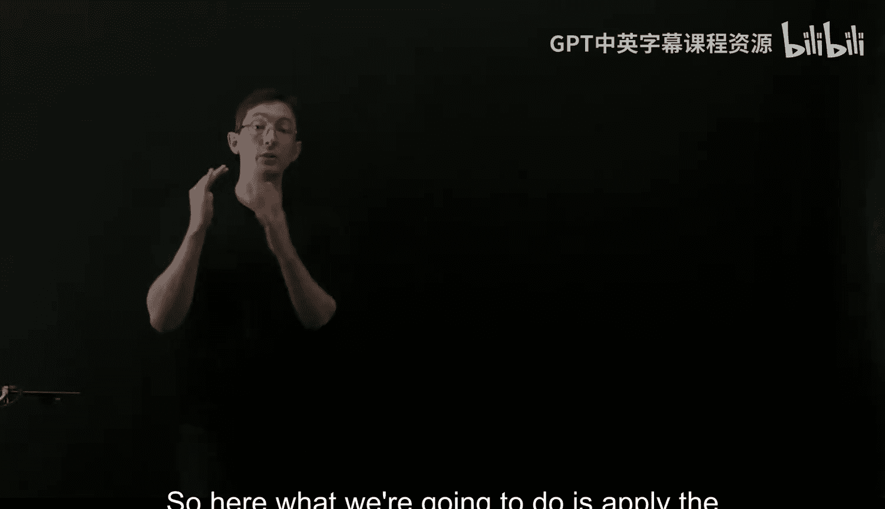
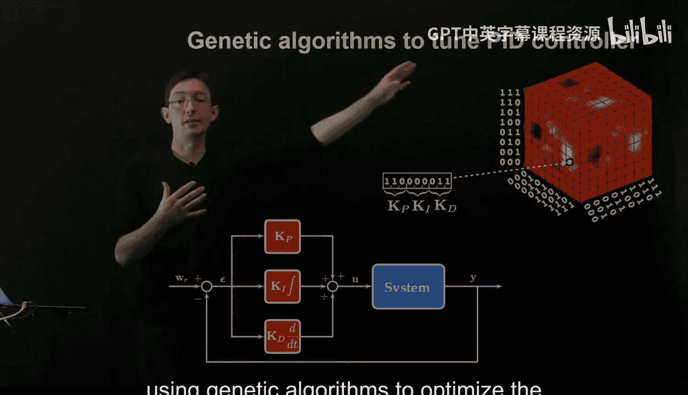
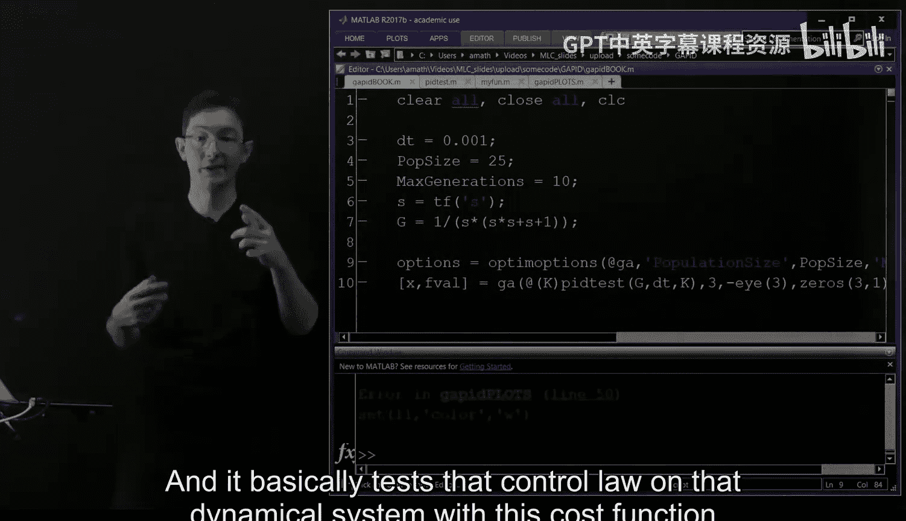
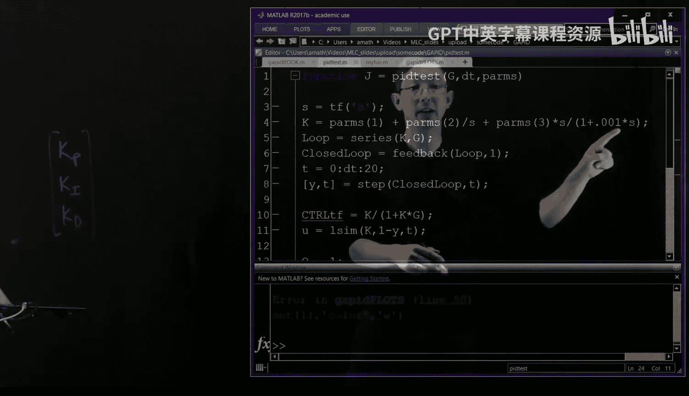
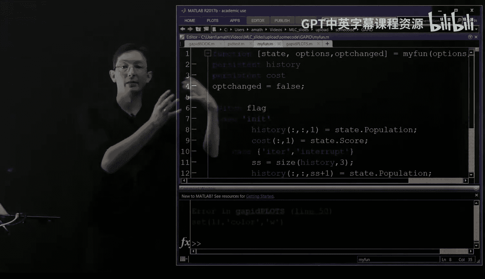
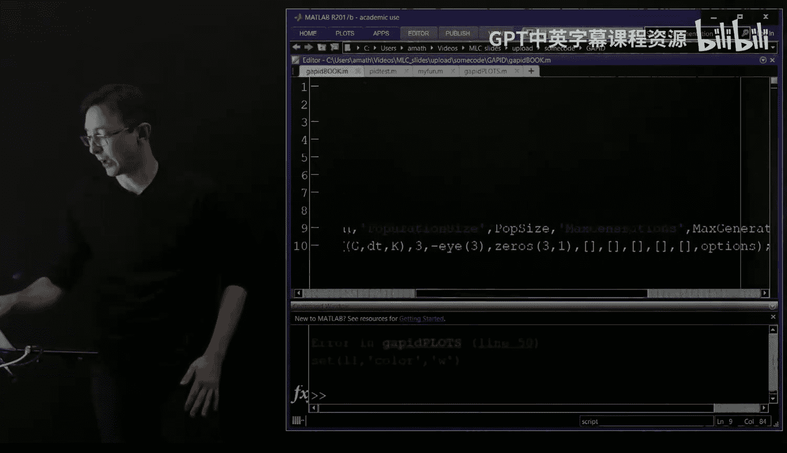
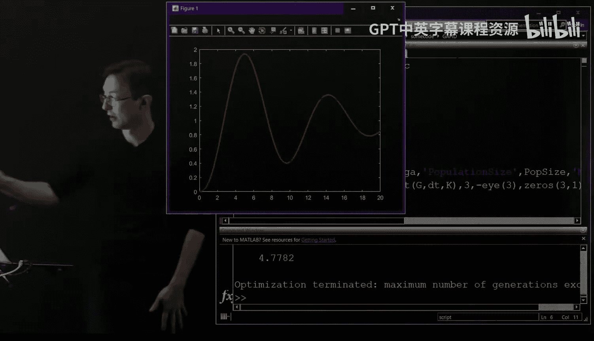
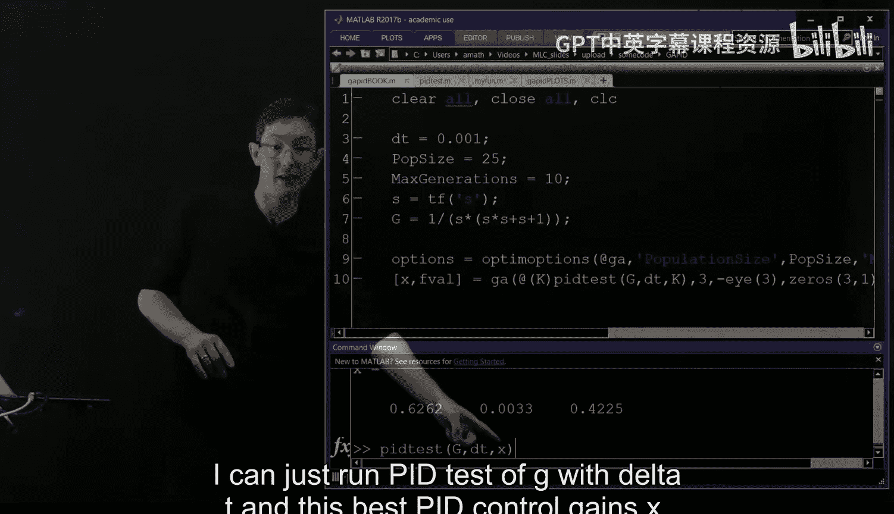
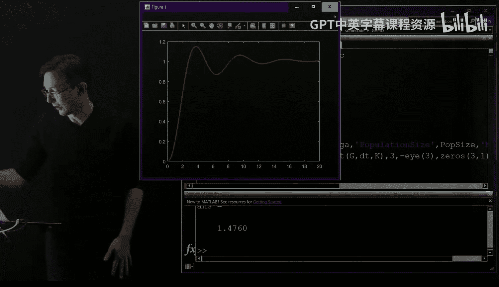
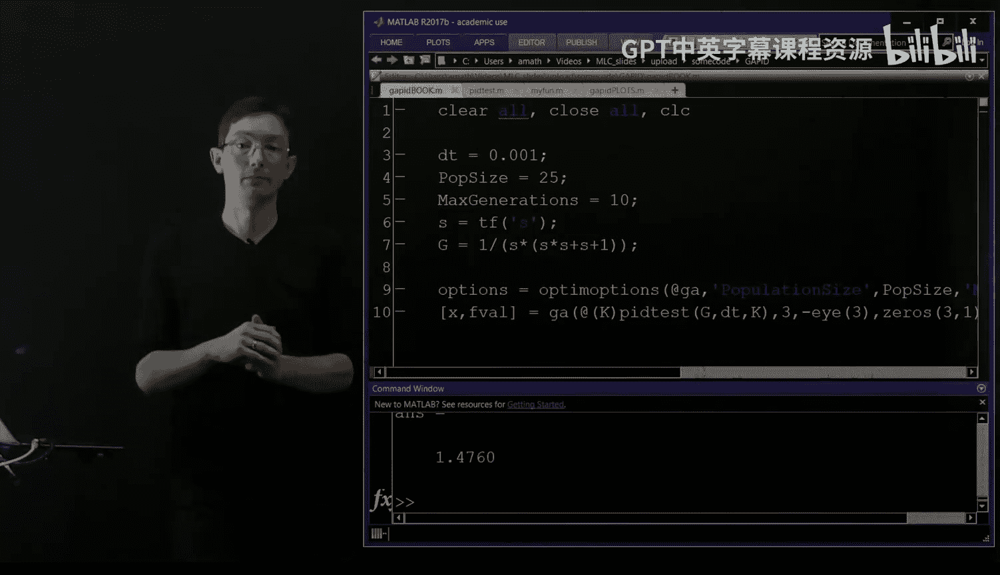

# 华盛顿大学《基于数据的机器学习控制｜Data-Driven Control with Machine Learning 2018》中英字幕 p29 -29-Machine Learning Control_ Tuning a PID Controller with Genetic Algorithms.zh -BV1BK6MBQEtN_p29-

Welcome back。Okay， we're talking about machine learning control， and in particular。

 we're talking about how to use genetic algorithms to tune the parameters of a control log with a known or specified structure。

So here what we're going to do is apply the genetic algorithm to tune a PID controller in MATLab。

 so here's just a quick recap of the diagram so I have some PID controller that I'm going to wrap around my system to obtain some desired objective function I am representing the parameters of this PID controller。

 the proportional integral and derivative terms as this kind of genetic sequence of numbers and I'm going to try to find the parameters。

 these parameters that optimize some objective function basically finding these hotspots where you get the best performance。

So we're going to have to define an objective function。

 we're going to have to construct a kind of control law with this specified structure。

 and then we're going to use the MATLb GA command， the genetic algorithm to tune these parameters using this evolutionary strategy so that's what we're doing right now。

I want to caution you。In real， in real life， you don't want to use a genetic algorithm to tune your PD controller。

 There's lots of other easier， better ways to tune this that it would be less expensive and。

 you know， simpler。 But this is a demonstration of how you use the Matlab GA command for some kind of a control optimization。

 So this is an easy one where there's three parameters we want to optimize。

 You could then take that exact code and apply that to your control system where you have parameters that you want to optimize。

 That's not a PiD controller。 Okay， so I don't want you to think that this is。

 you know only useful or particularly useful for a PiD controller。 You can do this for for anything。

Where you know the basic structure and you're just trying to optimize the parameters。

 So people have done this tons using genetic algorithms to optimize the parameters of a structured control law。

 okay。

So we're actually going to do this in MatTLb， we're going to cook this up in MatTLb。

And so what I'm going to do is a few things， I'm going to define a system。

So I have to define some kind of transfer function。 I'm going to do this in the frequency domain。

 I'm going to define a transfer function。 I also have to define some kind of an objective function。

This is kind of my J function。It's a little hard to read， but this is my J function。

And then what I'm going to do is I'm going to wrap this GA command around this。

 Okay so that's what I'm going to do。So here's a script you can download this the code will be online this is in our book the book Datadriven Science and Engineering Okay so I clear I'll close all CLC I define a time step I define some basic parameters of my genetic algorithm so I'm going to iterate for 10 generations and each generation is going to have a population size of 25 individuals so I'm going to have 25 individuals and I'm going to iterate and advance that for 10 generations。

So I want to define my system that I'm going to be optimizing my PID around。

 and I'm going to start with just a transfer function。

 S is a transfer function S so this establishes my Laplace variable S in the frequency domain。

And my system。Is G equals1 over？S times S times S plus S plus1。 Don't ask me why I chose this one。

 It probably has some interesting properties。 So I have G equals one over。S times。

S squared plus S plus1。 Okay， that's my transfer function that I'm going to use one over S times S squared plus S plus1。

That's G。And now I have to define some objective function J。

So what I decided to do is kind of this interesting hybrid approach。

 So I'm going to define my cost function J， my objective function to be the LQR。

 the linear quadratic regulator cost function， and I'm going to then find PID control law that minimizes that LQR cost。

 Okay so there's this kind of weird hybrid deal。 So here's the transfer function。

 This is my dynamical system。 It's just some input output system that has these dynamics。

And I have this function called PID test and what PID test does is it takes in the dynamics G。

 the time step DT， and a vector K of my control lock proportional integral derivative。

And it basically tests that control law on that dynamical system with this cost function that I'm going to define。

 So let me show you what PDt。 n is。

So in PID test， essentially again， this function takes in the dynamic transfer function G， a Dlta T。

 and the parameters of my PID controller。And so basically。

 it takes the first entry of the parameters。 and that's my proportional term。

 The second entry of my parameters is my integral term。 So it's essentially。This parameter is K。

Proportal K integral K derivative。Kdi。And so what I do is I take the first element and it's proportional。

 so there's nothing multiplying it， I take the second element and it's times 1 over s。

 which is the transfer function for an integrator， and the third term is Kd times S。

 that's the transfer function for a derivative。Now， in MATLb。

 it won't let me build a transfer function and run this control loop with an actual derivative because that would be kind of unstable。

So what I do is I divide it by one plus something really， really。

 really small times S so that at very， very， very high frequencies。

 this derivative term rolls off to 0 and becomes unimportant。 Okay。

 so this is basically a derivative K D times S。 and then normalized by this really， really， really。

High frequency roll off。 So this is basically just actually a high pass filter。

 high pass filter with a very。High frequency。 Okay， so that's。

That's what I'm doing here in this PID test I take these parameters and I build a PID control law。

 this last term here is just a little funky because derivatives are weird in MATLAab。

And then what I do is I build my open loop， I take my my system G and my controller K。

 and I build a series。A series。 I have my system G。I have my controller K。

 and I build a transfer function from。The left to the right。

 and then what I do is I feed back on this loop。Like that。Okay so I build this feedback。

 this is just nice two lines in MATlab， I build a series and a feedback。

And then what I do is I step the system， my closed loop system， and I see what the step response is。

 I want a nice， fast rise time。 So when I step the system， I want to go from zero to1。

As fast as possible with as little overshoot and ringing as possible。Okay。And to quantify that。

 what I'm going to do is I'm going to use an LQR cost function。Okay。

 so this is my control transfer function。I'm basically。Also simulating。

 I want to know what the control input was when I give the step。

 I want to know what my control signal does because I'm going to penalize really big control inputs to you。

And so I build this cost function J， which basically。Addds up how。

 how long it takes my state to get to the set point。

 So basically the error of my tracking squared times Q。Plus， how expensive it was U squared times R。

 That's just the matlab way of doing this。 I take my vector of outputs and my vector of U。

 and I dot square them and sum them up。 So that basically adds them up over time。Okay。

 long story short， what I'm doing is I have the system。 I want to wrap a feedback controller。

 a PID controller around it， and I want to tune the proportional integral and derivative terms to minimize this LQR cost function。

 So I want really good state tracking。 I want to track this step as fast as possible with as little error as possible。

 And I also want to do it with as little control input put you as possible。

and then I have some plotting commands here， again you can download all of this and play around with it yourself。

 but basically I want to actually see what the step response looks like so we can plot on the screen for all of these tests。

Okay， so almost everything up until this point has just been setting up the problem。

 I set up the the transfer function， the input output dynamics that I'm going to control。

 I set up this function PD test that actually tests a P controller and sees if it was a high J or a low J。

 I want small J cost functions。 Those are good controllers。And then the GA command is super simple。

 I run G， and I basically tell it what parameter I'm optimizing over。

 So I take PID test and I wrap it。So that it is only a function of k， these three control parameters。

 and I lock in G and Delta T。So now the genetic algorithm knows that all I'm doing is I'm running PID test。

 and I'm trying to tweak these K parameters to get the best output of PID test possible。

And then there's some other commands here， some other options that you can you can do the GA help and see what to do I think basically this is telling it that you know there's three variables it's optimizing over。

 it gives it some initial condition and things like that okay so you can。

You can look into this yourself。I also have an option for an output function called my my function。

Which basically。At every iteration at every every time you evaluate an individual and every time the generation advances。

 I essentially save some internal variables so that I can plot them later so Im I'm plotting what is what are the three control parameters。

 what's the system response， What's the cost function J and things like that。

 and eventually this gets dumped into。

A file called history。mat so I can load that and after the fact。

 after I've run this genetic algorithm， I can plot a bunch of things and diagnose how it learned the right control。

Okay， so I kind of just want to recap。

There's a system I want to control。There is a function that evaluates a controller and tells me was it good。

 low J or was it bad high J？And all I do is I plug that into the GA algorithm。

 I tell it what to optimize this K parameter and it goes。

 and I have to tell it you know how many individuals per generation and how many generations and I run it。

Okay， so I'm going to hit go and what this is going to do is you're going to see a bunch of step responses plotted to the screen。

And down here you're going to see the cost function for each of those and we're just going to run through all of these 10 generations。

 25 individuals each， so we're going to see 250 control laws， step responses。嗯。

And what we want when we do this step response in time， what we want。This is our set point。

 we're trying to step up here。 I want this thing。To go up as fast as possible and stay close to the set point。

 what I don't want is huge oscillations that take a long time。

 This would be a big state deviation that should give me a bad cost function。

And what would be even worse， this is an unstable system， so if I pick a bad PID controller。

 what would be even worse is if this goes unstable so that would be a huge cost function integrated over 10 time units。

Okay， so that's what we're going to see is these kind of different canonical step responses for different PID control values and then genetic algorithms is going to optimize。

Okay， let's try it up， I think we're ready to go， let's hope there's no errors I'm going to run this code。

Okay， so very quickly we should be seeing a bunch of step responses pop up。

 so these are the step responses， these are the cost functions down here。

You see a lot of them were unstable， kind of blow up。But some of them are okay。

And even after one generation， you see many more of them are going to the set value of one and not blowing up。

 You still have some unstable ones。 But now these cost functions are already getting a lot smaller。

 Now， they're around 1。1 or2。 and only rarely do they get really big。

So this from generation to generation， these control laws are getting better and better and better and finding better and better PID control gains。

And so we're just going to watch this evolve for a little bit。

 now you see it's like kind of just jiggling around these really good solutions。

 Those are the good ones， and it's just you know mutating and crossing over trying to get slightly more optimal solutions。

And we found kind of this， you know 1。4 seems like a pretty good minimum value。

 It's not doing a lot lower than that。 Okay， it's done。

So super fast to evaluate if it's fast to evaluate a control law。

 you can run through hundreds or thousands of these things and really find good optimizing parameters。

Okay， let's see what x and F v。 What's x。 Okay， X is the。Optimizing。

 so this will spit out the single best K， the single best P I D gains。 Those are these。

And the best optimizing function value， this is my cost function J， so F Val。

 the lowest it ever found was 1。476。For these proportional integral and derivative terms。

So if I want， I can just run。PID test of G with Delta T and this best PID control gains X。

 these three values here。

And this is the best the best response apparently， according to the LQR cost function。

 according to minimizing the state deviation and the control cost。

 this is the best response that genetic algorithm found Now I don't know if this is a particularly good one or bad one。

 You can definitely squash down this peak， but it'll take longer to rise。

 and apparently that costs more according to my cost function。

So this is only optimal with respect to the cost function that you select and maybe this was a bad cost function so that's very important is that these algorithms are no smarter than how you set the problem up so if you want different performance then you need to in you know put that into your cost function so if I wanted to squash this peak down。

 maybe I should put a penalty on a maximum peak。What are the cool things about genetic algorithms？

The LQR cost function is this quadratic， smooth cost function。

 and it was chosen that way because there are known optimal closed form solutions。

But with genetic algorithms， this can actually find solutions to nonconvex problems so I could put in hard constraints on you。

 you can never be bigger than a value， I could put in know inequality constraints or I can basically penalize kind of the maximum value that this hits any number of things that would be very hard。

And nonconvex traditionally， you can do in genetic algorithms。 Okay。

 so this is the best control log that was found pretty easy to run。 you know。

 most of the effort and most of the time was actually just setting up the problem and the cost function running the genetic algorithm was super fast and simple。

Okay， so in the next video， we're going to load that history do mat file and actually start to see what this genetic algorithm did under the hood。

 Okay， thank you。

