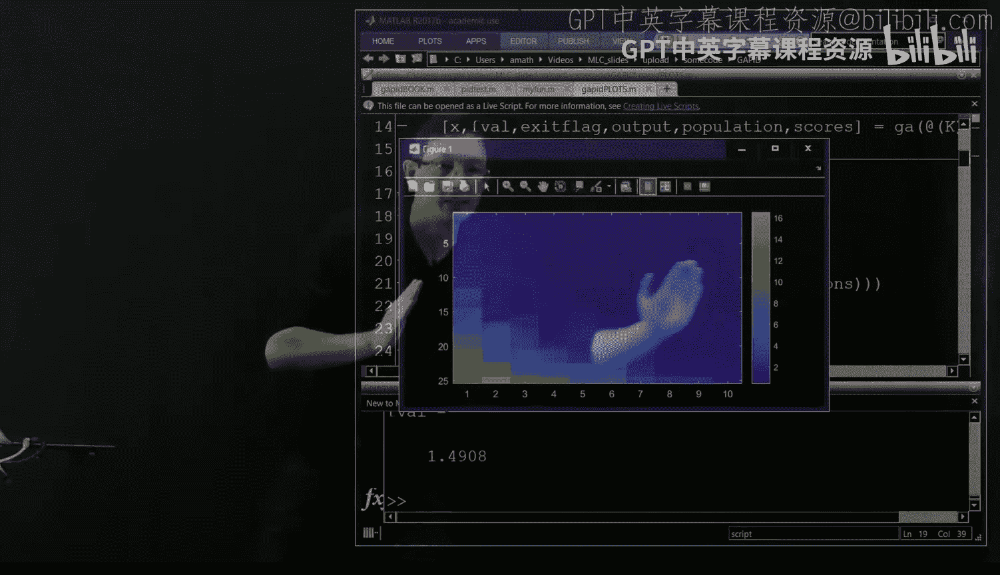
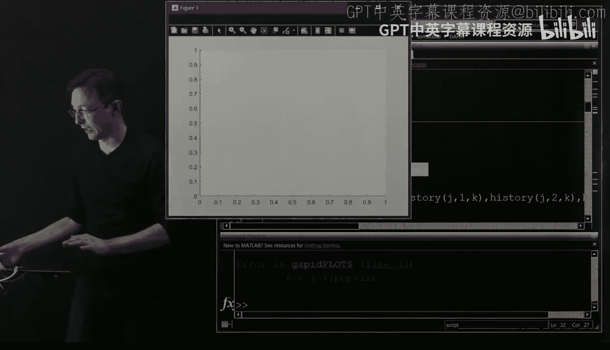
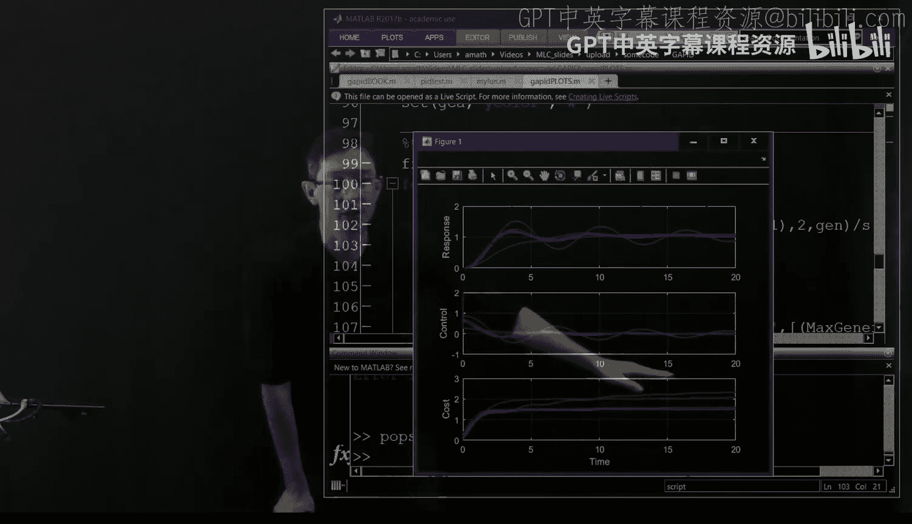

# 华盛顿大学《基于数据的机器学习控制｜Data-Driven Control with Machine Learning 2018》中英字幕 p30 -30-Machine Learning Control_ Tuning a PID Controller with Genetic Algorithms (P -BV1BK6MBQEtN_p30-

Welcome back Okay， in the last segment， we coded up a genetic algorithm to optimize a PD。

 the set of PD control gains， the proportional integral derivative control gains to minimize and LQR cost function for this transfer function G in case so we coded this all up。

 we ran it Now what we're going do is we're gonna there was this output function that saved all the intermediate generations and individuals all of that data。

 So now we can start plotting and analyzing what this actually did over this genetic optimization。

 So just I'm going to rerun this one more time because it looks cool。

 and I want you to watch these 250 control laws being run。 So these are all of the step responses。😊。

It starts off trying a bunch of things with high cost functions because they're random PID gains。

 but then even after a few iterations， a few generations。

 we'll find that this J starts to hone in on much better control laws that are pretty similar and then it tweaks those parameters to get better and better performance so we'll just let this run for a minute。

 we'll see that it is kind of converging into these optimizing values of PID。

Using these genetic algorithm operations， mutation， crossover， replication， and elitism。

Okay so it should finish soon notice that now the cost function is kind of hanging out around 1。5。

 sometimes it gets a little bigger because of the mutations and things like that。

 but really now we're honing in on parameter space where the algorithm is good。Okay， it's done。

And so you know it spits out the best PID gains in the vector X and the optimal output value in F Val。

 so if I do F Val， that's 1。49 in this case， so slightly different than the last time I ran it because there's some randomness to it。

 but around 1。5。And so now if I go to this function， you know， genetic algorithm PiID plots。

 what we can do is load。We can load all of the data from this last run， and I'm going to。

Load my history dot map file and start plotting stuff。 Okay。

 so you can check out this code and see exactly how I call everything and plot it。

 But I just want to walk you through some of these。Some of these outputs。So here what I'm doing。

Is I'm ploting over I'm plotting all of the individuals。

 all 25 individuals for each of my 10 generations and I'm color coding it。

 these are sorted in order from best performer to worst performer in that generation color coded by the cost function so two is small cost functions these are good performers and yellow or bad performers。

 these are big cost functions， very bad control laws。

 and I might have cut this off because some of those objective functions went up in the thousands I might be lumping those all in these super bright yellow ones。

And maybe this is a long plot。 I can't quite remember。 but anyway， the basic idea that you get is。

The dominant trend is that as the generations progress， this becomes more and more blue。

 which means that more and more of the solutions are getting low cost function。

 nearly optimal performance。The first generation had a lot of pretty bad performers because these were random。

 but then even in the second generation I have maybe half as many bad performers then less and then almost none at all。

The next thing we observe is that even though in our initial population we had some decent performing algorithms。

 it's also getting darker blue as you go to the right。

 which means that these are getting more and more optimized from generation to generation。

So sometimes what people do notice that this actually does kind of rely on having at least some good performers in my initial generation。

 so I need some good performers here so that I can kind of breed them and mutate them to get more and more optimal solutions later on。

And so sometimes what people will do is they'll actually start out with a bigger initial population。

 maybe you know two or five or even 10 times as many for the initial population to do a big Monte Carlo search to try to find these hots spots of good performance and then they will decrease over time and essentially have less and less individuals per generation as you start to hone in okay so this is the simplest case where I have this flat structure every generation as 25。

 but maybe I would get better performance if I had the first generation with 50 or 100。

so that's a cool plot we can see in time in generations， it's getting better and better。

 which is quantified by this kind of trend towards darker and darker blue。

Okay， good。Okay， what are we going to plot here， that's not great， population size。

 let's load my Rand pop。Okay。Essentially， this just has some of the parameters from the last。

From the last run， so the population size is 25， pop size， okay。

Pop size equals 25。 Let's try that。I just cleared everything so it didn't know how many individuals there were per population。

 Okay， so now what I'm plotting is red are my initial generations and blue are my later generations。

 and I'm plotting the actual P I and D values for all of the individuals in all of those generations。

 And so here what you can see initially， you know I started in this cube of PD and so my red points initially are kind of scattered everywhere。

 But over time they converge into this hots spot right here。

 which is the best performing kind of group of parameters and so all of the kind of purple and the more blue it gets the later the generations。

 the more it hones into this sweet spot in parameter space where you get the best performance。

 you can see this thing swarming and converging to the parameter values that optimize。Okay， good。

 So now what I want to show you are all of my individuals from generation 1。

 And we're going to compare that with all of my individuals from generation 10。

 So my first generation here。😊，I mean， you can see that it's pretty terrible， right。

 This is my cost and it goes up to 400。 So some of these are kind of blowing up。 Actually。

 this is not cost。 This is my output。 Okay， this is my output response。 So my step response， sorry。

 this is a typo。 this should be why the output of my system is kind of blowing up。

 which would correspond to a very large cost in my first generation So you can't really see it。

 But if you zoomed in， there might be a few stable PD that actually give you a decent trajectory。

 but a lot of the individuals are unstable and terrible in this first generation。

 Those are kind of corresponding to those yellow， really bad cost performance in the first slide。

And now that I think about it， that must have been on a log scale。Okay， let's contrast that with the。

Individuals in generation 10。Again， this is a typo that should be the output response Y。

 But now you see by Gene 10， all of the PD control laws that the genetic algorithm is selecting are stable and actually a lot of them have the same basic you can see this kind of band here。

 These are all just variations on a nearly optimal parameter value。

 And then it's also exploring some other options that are maybe suboptimal。

 but there's a pretty tight band of responses that all have very low cost around kind of 1。

5 to you know， 1。5 to 10。 nothing really， really huge。

 So this is the last generation that's already honed in and found that best set of optimizing parameters。

And then maybe one of the last things I'm going to plot the best individual from each generation。

 so there will be 10 plots， the best generation from the first， all the way to the best generation。

 best individual from the last。And again I'm starting with red as my initial generation and blue as my final generation。

 and so you can see you know the red ones are they've got a lot of variance and a lot more oscillation。

 but eventually they hone in to this very tight band of purple and blue signals。

 these are the responses。My control input is a lot smaller。

 also the blue one's a lot smaller control cost。And then the overall integrated LQR cost here over these 10 generations goes down significantly。

 almost by a factor of two。 Okay， so after these 10 generations， my cost really is reduced。

 and I do get a better。

A better PID output response。 Okay， so this is one of the things you can do if you output your data through these these populations。

 these these generations of individuals， you can then start diagnosing what was my learning rate。

 how how effective was my initial population， how good was my first you know。

 the best performer in my first generation and things like that。

So genetic algorithms are super powerful in MATLAab really easy to apply。

 All you need is a function that evaluates and gives you a scalar output number that should be minimized and this will run through and find find those optimizing values so you can try this on your own control system All of this code is available so you can kind of try this out on this example and probe and make your own plots and see how it works Okay thank you。

😊。