# 华盛顿大学《基于数据的机器学习控制｜Data-Driven Control with Machine Learning 2018》中英字幕 p31 -31-Machine Learning Control_ Genetic Programming.zh_en -BV1BK6MBQEtN_p31-

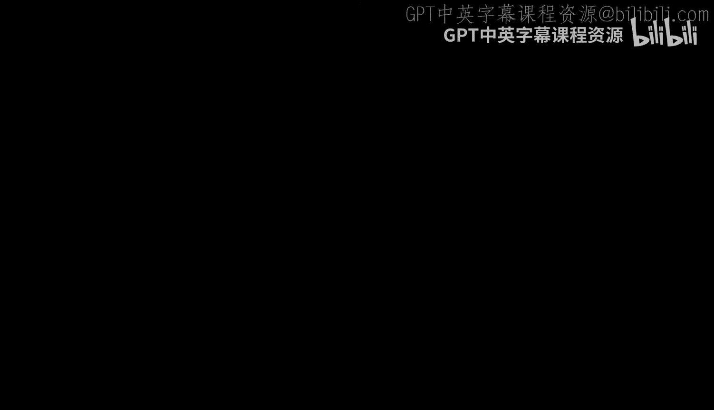

Welcome back。Okay， so we've been talking about the use of evolutionary algorithms。

 genetic algorithms to tune control laws， so this is in the broader framework of what we're calling machine learning control or the use of data- drivenriven optimization to directly find and optimize good control laws to control some complex dynamical system。

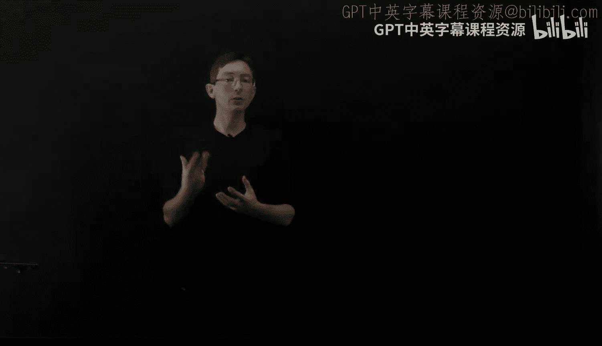

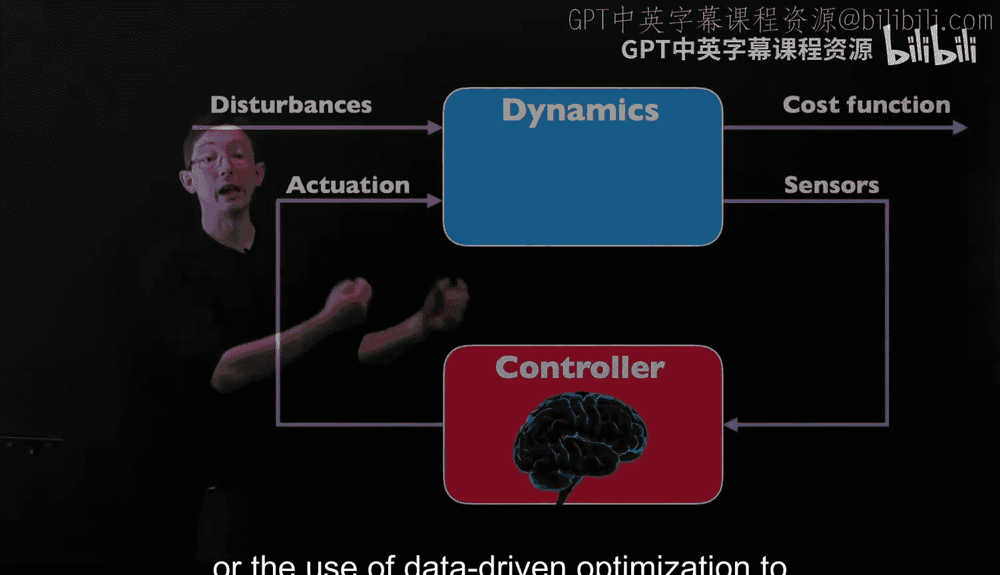

In the last few videos， we've talked about how to use genetic algorithms， what they are。

 and how to use them to tune a PID control law。

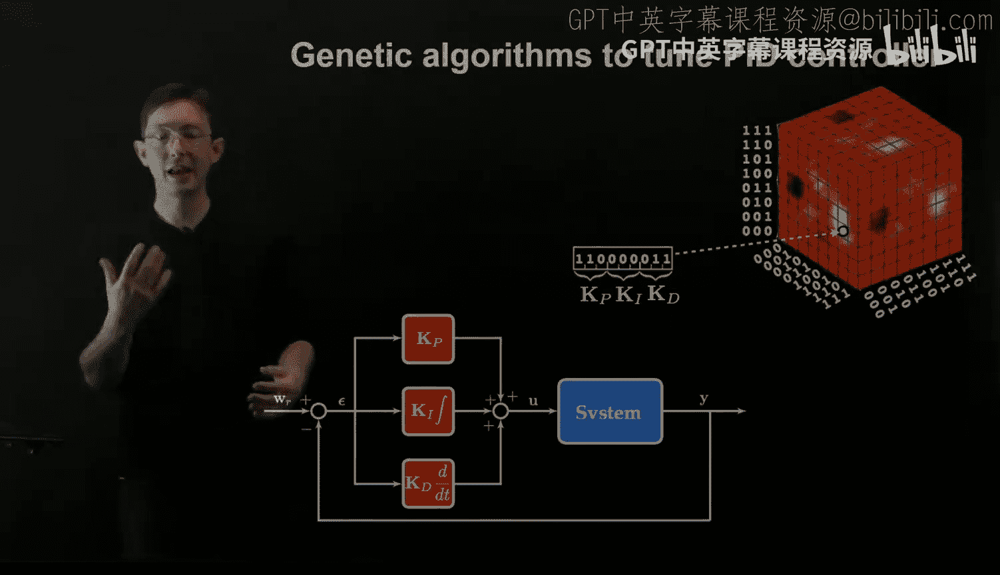

In general， I want us to be thinking genetic algorithms optimize the parameters of known structures so for example I lock in that I'm going to use a PID control law。

 then I can use a genetic algorithm to tune the parameters of that known structure and so genetic algorithms are very useful for parameter identification when you have a fixed structure。

 but in many control problems of interest。I don't actually know what the structure of the control law I want to use。

 I don't know if I want a PID control law or。Some kind of a column and filter。

 like I just don't know what the actual even structure of the control law is that I want。

 And so it's not as simple as a parameter optimization。

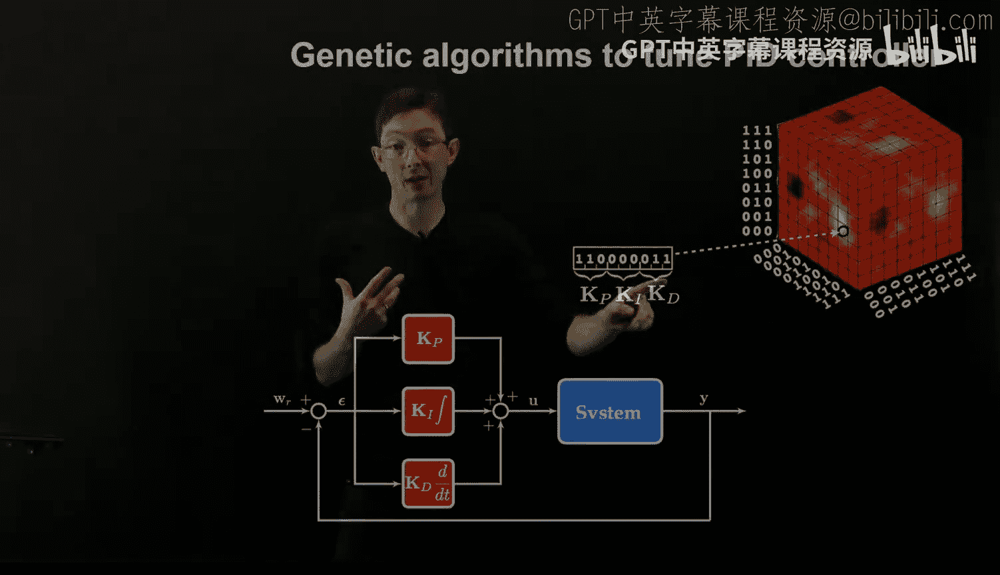

So what I'm going to tell you about now。Is genetic programming control。 It sounds very similar。

 but instead of genetic algorithms， we're using something called genetic programming。

 which is considerably more machinery。And what this does is it simultaneously learns the structure and parameters of an effective control law。

 and so you can read more about this in a book by Tommasterier myself and Barrett Noak。

 the Springer book from 2016 called Machine Learn Control。

Where we essentially develop this theory of how to use genetic programming to design effective control laws and then also how do we apply this to turbulent control experiments okay but the basic idea here is maybe I don't know the structure of my control law so I have to learn the structure of what control structures are actually effective and so I need these kind of bigger machinery of genetic programming。

Okay， so I'm going to walk you through genetic programming， just like genetic algorithms。

 this is a much bigger。Theory than just applying it to control systems。

 So people have been using genetic programming for decades to design programs that write new programs。

 software that write software and things like that。

 all kinds of interesting applications of genetic programming。

I'm going to walk you through kind of the guts of how genetic programming works。

 but in the context of how we would use it for control。And。

So here what we're going to do is we're going to define the structure of a control law。

 There are some sensors。 Y。 these are my measurements of my system。

 and I have some sensors and maybe some constants， some numbers that I get to use and I'm going to define my actuation signal as this nested function tree where the leaves are sensors and constants。

 And then there are these function operations that compositionally give me some some u equals F of of y。

 And so in this case， it's always a little dangerous to do this live。

 but I'm just going to write down what this is。 So here you can interpret this as。U equals y1。Plus。

C3 times。C 1 plus Y 2。 Okay， so that's a little dim。 I hope you can see that this y2， Okay。

 so basically， I can interpret this tree structure as the control law U equals y 1 plus C y1 plus C3 times C 1 plus y 2。

OkayAnd that is a candidate control law that I would then run on an experiment and see how effective it was。

 and I'd got an objective function and some fitness and I could compare 15 or 100 different control laws and see which ones are more effective okay so this is just a way of parameterizing a generic function U of y。

Okay and it's very flexible， so this function tree。

 this recursive tree composition of functions is extremely flexible to take your sensor measurements and determine what combination of those gives me a good actuation strategy okay。

😊，Now， interestingly。People have also used this strategy to。Not just to design a control law。

 but also for system identification to get the X dot equals F of X。

 people have used these genetic programming structures to identify dynamical systems models。

 so Bondguard and Lipsson and Schmidt and Lipsson have done genetic programming to identify governing laws of physical systems。

 in 2007 in 2009 in PNS and in science。Great papers。 You should definitely read them。

 That's how they use genetic programming for for model identification。

 We're going to be focusing our effort on genetic programming for control。😊。

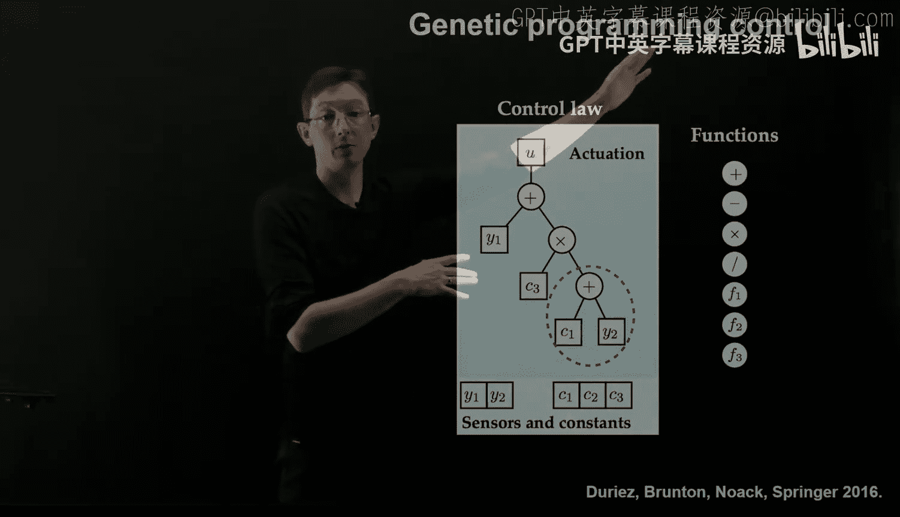

Kep。Okay， so that's the basic idea， you have a control law。

And you evaluate each of those control laws， so I might start with an initial generation of 100 of these things randomly generated。

 I run them all in my experiment and I see which one gives me good performance。

 which one gives me bad performance， and then just like in genetic algorithms。

 I had these genetic operations to get future generations。

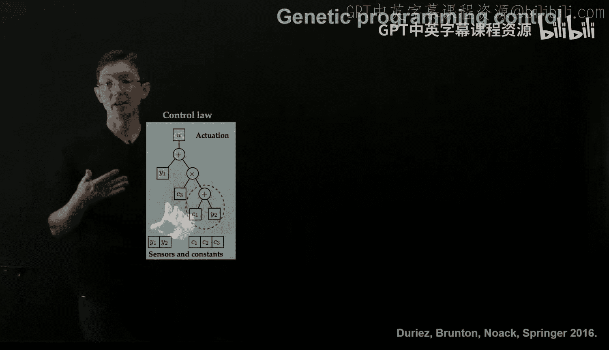

So one operation is crossover， so I take two good performing individuals here。

 and I pick some portion of DNA from each of them and I just swap them。

 so this little branch here gets snipped and this little branch gets snipped and I just swap them。

 So now this guy has the blue group and this guy has the red group so that's this genetic crossover and it's known to have this exploitative property that if both of these are good。

 I'm going to try and perturb these and permute these to get to exploit the favorable properties of both of these。

 now it doesn't always work， but sometimes swapping these will give you even better performance in the children。

Okay， I also have a mutation effect where I can take some random segment of this function tree and just snip it off and replace it with a randomly generated new subte。

 That's mutation。 This has the effect of exploring your parameter space more。

 trying new things that you hadn't tried before。And then as before you had this replication。

 so if a control law is good enough， maybe I just copy it to the next generation directly so that I don't lose that good information。

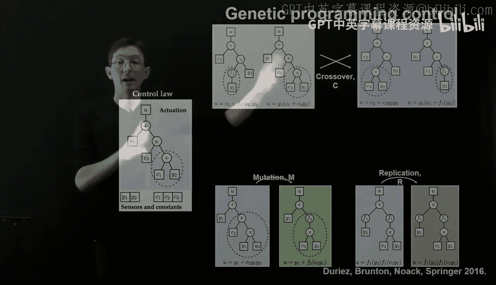

Okay so this is how genetic programming works in general。

And as before you have to pick these basic of probabilities of replication mutation and crossover。

 in this case I've chosen crossover at 70% replication at 10% and mutation at 20%。

 but you can kind of play with those numbers， you know you can move this point and change the volume of these triangles to get more crossover or more mutation or more replication。

And you know， there's kind of a lot of theory that's gone in to how to design how to tweak these parameters to get the best convergence。

 how big of an initial population， how many generations。

 all of that okay so huge business genetic programming， this was introduced by CoOSA。

And so Cos is a super interesting， interesting person you should read about about his introduction of genetic programming and kind of how he used this throughout his career。

 so very interesting story but this goes back decades and way before it was used for control of turbulent systems those are the basic genetic algorithms that you can then use to tweak these control laws and try to refine them over successive generations。

And what we'll then do is we have some dynamical system。

 maybe this as an experiment or a simulation or something where I can test control laws。

And I have it here written down as a dynamical system with an actual F。

 but in general this is a black box experiment and you don't really have a good model for it。

 but you can control it and you can measure it and you can measure in particular this cost function。

 this high level objective in the case of fluids that might be increasing lift or decreasing drag or increasing mixing so I have this black box experiment。

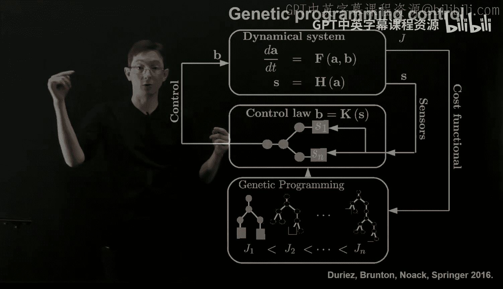

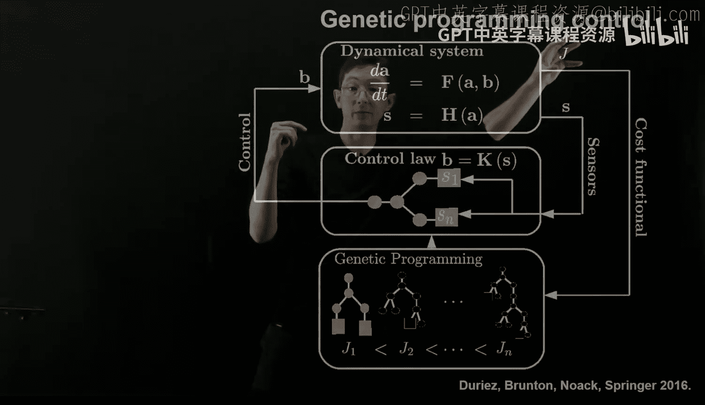

And what I can do is I can write down a bunch of control laws and try them and try them and try them。

 So I'll run this experiment30 seconds later， I get a really， really bad J value。

 That was a terrible control law。 So then I run another control law。

30 seconds later in the experiment。 I find out that was a great control law， really low J and so on。

 I can run 100 of these things over the course of an hour maybe。

And then I use those genetic those genetic operations of mutation。

 crossover and replication to design new generations and iteratively refine this control law until it's more and more effective at controlling this dynamical system。

 Okay， now I will say that this。

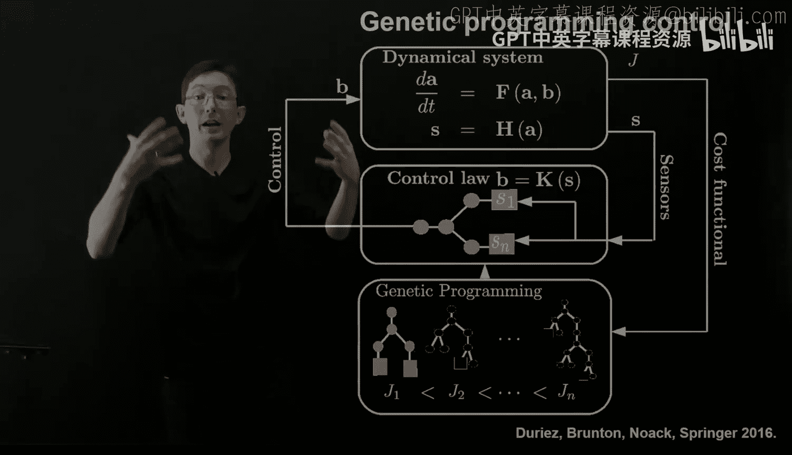

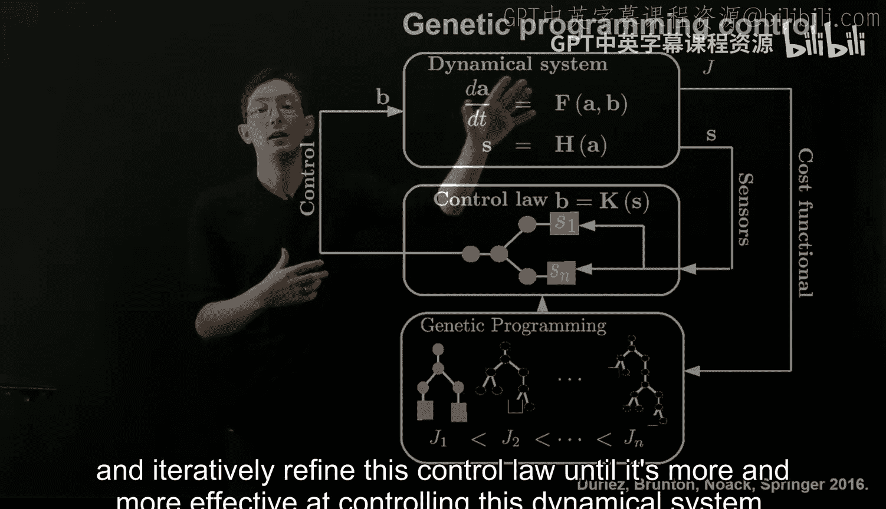

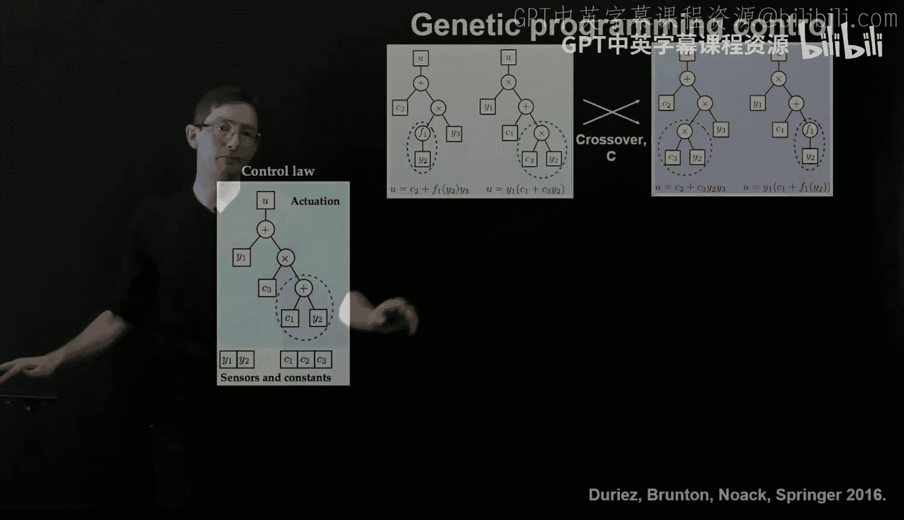

This control law structure， there's a lot more machinery that goes into actually making these than a simple genetic algorithm。

 You have to write this kind of compositional logic to handle these recursive function trees and that there's a little bit of programming overhead to make this infrastructure。

 So a lot of people do this in recursive languages like Lisp or scheme because it's much more natural to write these recursive function calls in a recursive language。

 but oftentimes for really hard control problems where no known control structure has worked in the past。

 you need this extra flexibility of tweaking the fundamental structure of the control law itself。

So something else to point out。You'll notice that this is an instantaneous control law。

 The actuation signal is instantaneously responding to this particular instantaneous sensor measurements and constants。

And that's a little strange because we know。From the control boot camp， for example。

 that if I have limited measurements that don't measure the full state of my system and in a high dimensional example like a fluid flow。

 it's very unlikely I measuring everything。Then I might need a calmman filter to estimate the full state of my system for effective control。

 so it's pretty surprising that you can get such good performance with this instantaneous sensor feedback。

And actually， if you think that that instantaneous sensor feedback is not enough you can augment these functions with transfer functions。

 so instead of just plus and times and divide， I can also have transfer functions like you know integrate this time history with this kernel。

And so that can start to approximate these common and filter ideas where now my Y measurements are getting integrated in time into these time filter functions okay so you can augment this picture with filter functions。

 we've done that for fluids and it seems like you can get some benefit to that。

We've actually found surprising amounts of success using instantaneous sensor feedback though。

 so that's kind of interesting。

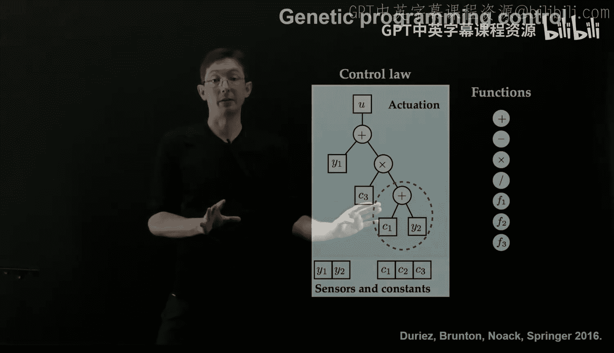

Okay so the big picture here is you have some complicated highdimenional nonlinear system that you want to control。

 you don't want to put a lot of effort into modeling it。

 so instead what you do is this kind of exploratory control optimization using this very。

 very powerful genetic programming control framework and there's other optimizations you can run there's other optimizations you can run to optimize this cost functional。

 but genetic programming is particularly flexible and powerful for identifying new structures of controllers that you haven't seen before。

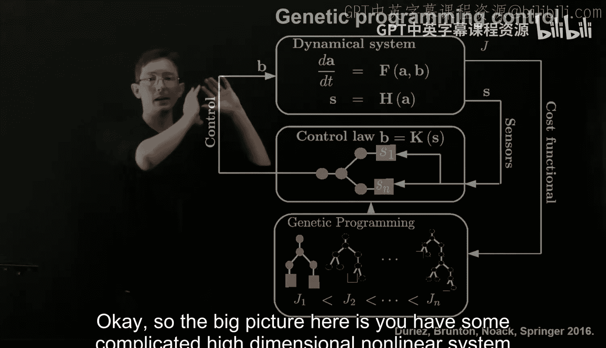

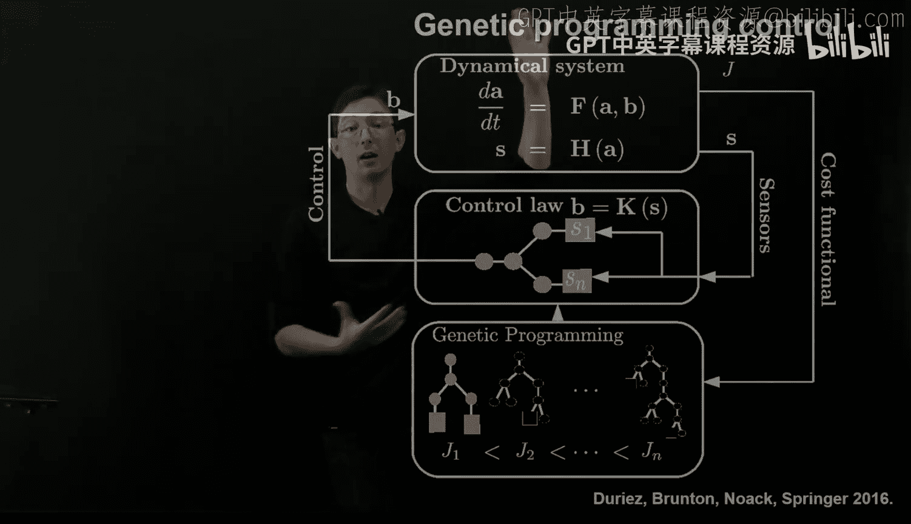

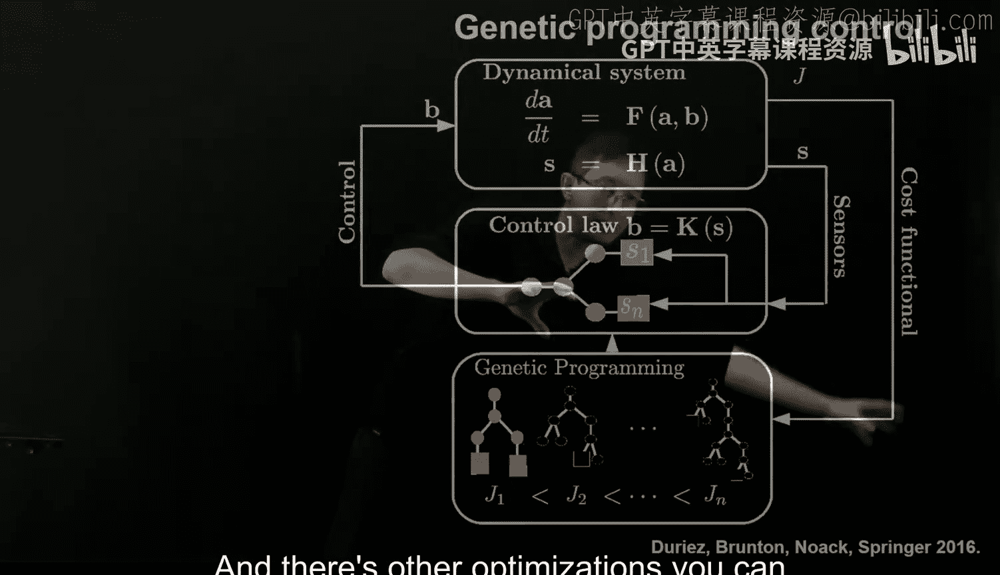

Okay， so next time we'll see how this works on some fluids experiments and we'll talk a little bit more about the practicalities。

 thank you。

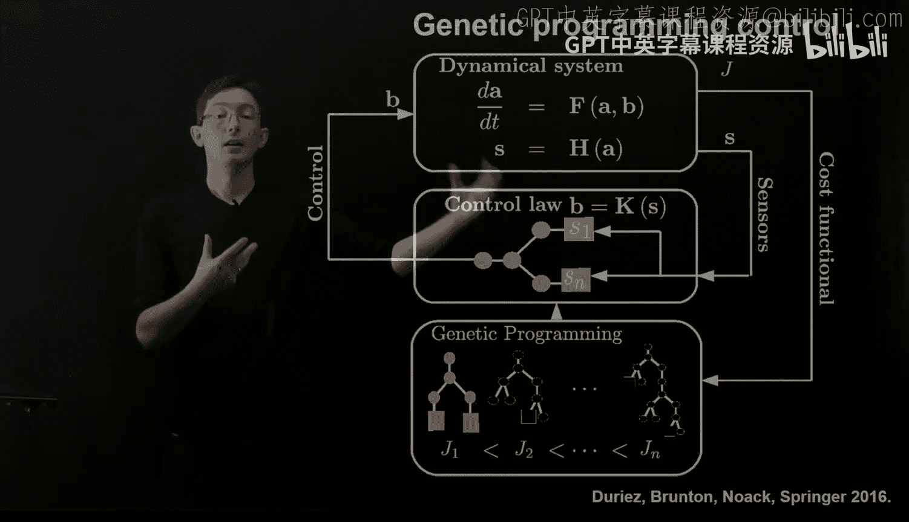

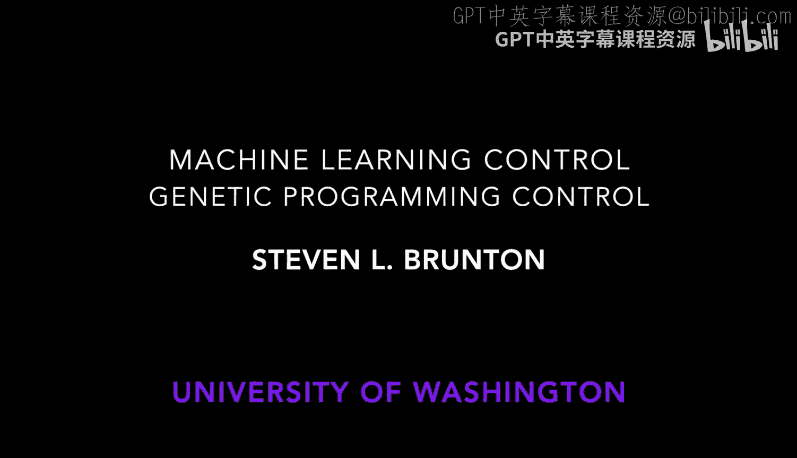