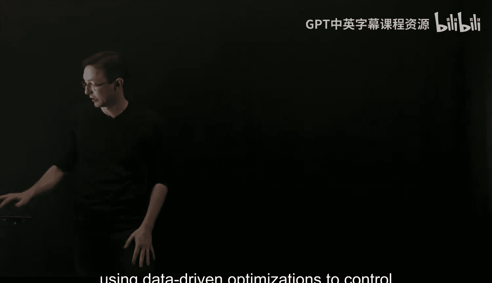
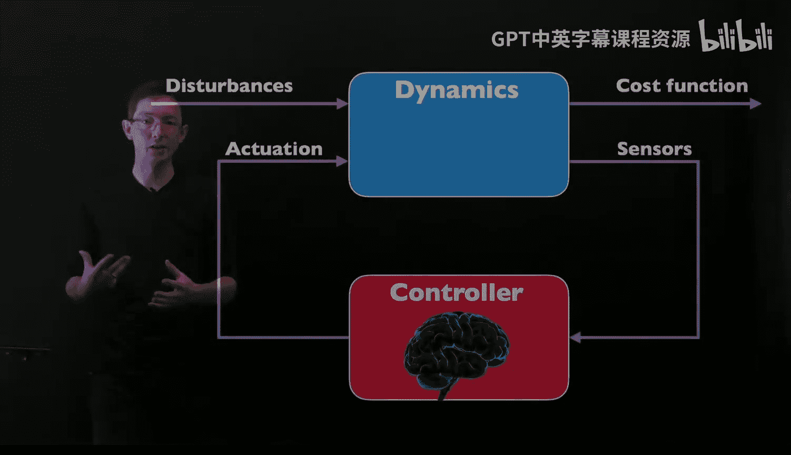
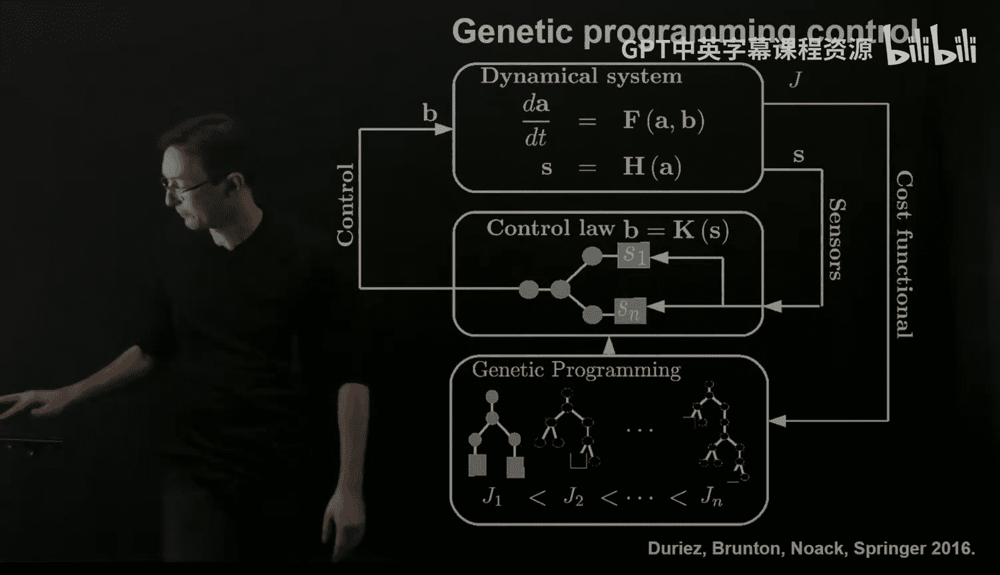
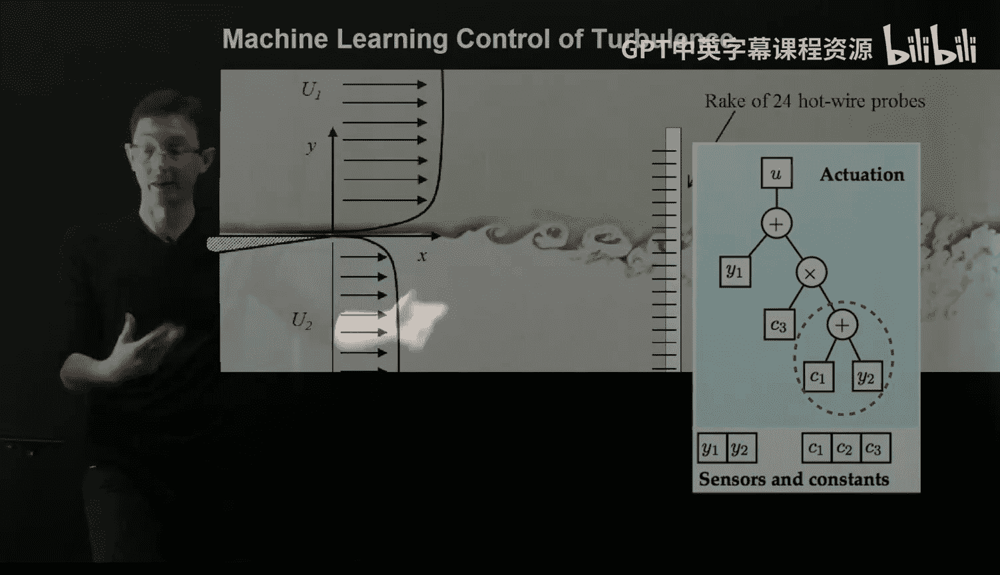
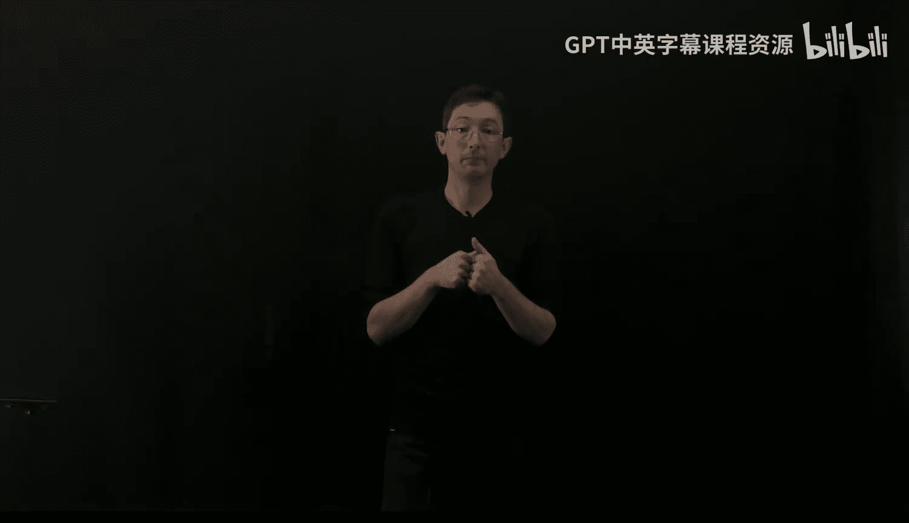

# 华盛顿大学《基于数据的机器学习控制｜Data-Driven Control with Machine Learning 2018》中英字幕 p32 -32-Machine Learning Control_ Genetic Programming Control.zh_en -BV1BK6MBQEtN_p32-

Welcome back。So we're talking about machine learning control using data driven optimizations to control complex nonlinear dynamical systems。

 so that's this picture here。

We've talked about how we can use genetic programming。

 which is essentially this recursive function tree representation。

To iteratively design better and better control law trees to control some unknown black box dynamical system。

And now what I'm going to tell you about is essentially how we have applied this basic architecture of the genetic programming control in particular to control turbulent fluid dynamical systems。

 so this is work that was led by Barrentt Noak and his collaborators in a series of experiments across across Europe and you can read about this in a book by Toma Driier myself and Bart。

But the basic idea is that， you know the kind of big picture goal is machine learning control of turbulence and so turbulent fluid dynamics are a highdimensional nonline multiscale problem okay so they're governed by equations that we do know the Navy or Stokes equations。

 but to simulate or represent the solutions we might need millions or billions of degrees of freedom。

 and that is not amenable for fast real-time control design。

 especially considering that these turbulent fluids have very fast timescales motivating a very fast control decision for low latency high bandwidth control。

So lots and lots of work has and is still going into getting reduced order models of turbulence for control。

 that's a huge field of research， I know Barren and myself have both worked in these reduced order models for fluids。

But what I'm going to tell you about now is essentially instead of trying to model the turbulence for control。

 instead we're going to use these machine learning ideas。

 as genetic programming control directly to find effective control laws to manipulate turbulence。Now。

 I love talking about this because this is one of the grand challenge problems of the modern era。

 so turbulent fluids are at the heart of nearly every trillion dollar industry。

 so transportation right this is a huge industry， transportation is centered around working fluids。

 So reducing the drag on a car or you know the drag behind a ship or an airplane or a train defense。

 okay， so making more agile aircraft and boats and you know so transportation and defense are huge power systems getting energy from systems。

 engines and turbines。Health systems optimizing the flow inside of people's bodies。

 inside their hearts and their veins and their arteries。 Okay。

 so working fluids are at the center of everything。 We live in a fluid。And so if you can get。

Performance gains in turbulence control。 you have the potential to improve almost all of these applications。

 Okay， so you can increase lift， decrease drag， change the mixing in a flow。

 Those are all high level objectives that can directly translate into better performance in these systems。

 So even， you know， improving the mixing in a combustion engine by a few percent might translate to billions of dollars of global savings annually。

 I mean， these are these are huge problems and even a little bit of improvement can translate to big you know。

 big performance gains。Okay， so again， just a shameless plug， we wrote a book on this。

 a Springer book that you can read about machine learning control。

Taming nonlinear dynamics and turbulence， that's with Tomma Driier myself and Barret Noak。

 where we talk about applying these genetic programming controls to some turbulence control problems。

Right now， I'm just going to walk you through one example on a canonical flow that's kind of like this mixing layer here that Bart Noak ran in Potier。

 France a few years ago。Okay。So this is the basic setup of this mixing layer experiment and this was I think。

 run by Vladimir Perizanovvich who was working with Barrent at the time。

 so you have this fast flow on the top slow flow on the bottom with this splitter plate。

 this big metal plate in the wind tunnel and you get this roll up and eventual turbulent breakdown in the mixing layer and in this experiment you can measure 24 hot wire measurements at some location downstream。

And the objective is to try to either increase or decrease the mixing。

 kind of the rate of this turbulent breakdown at some downstream location。

So this is kind of a canonical example that people think of you know for wings or streamlined surfaces like automobiles and things like that。

 so the mixing layer is a canonical flow that people have studied for a long time and if we can increase or decrease the mixing in this problem。

 we might be able to manipulate more engineering relevant problems。And so to do this。

There's actually this splitter plate here。 the splitter plate has 96 pressure ports on the surface。

 This is a very cool experiment。😊，And each of those 96 pressure reports can be independently actuated at very high or low frequencies to pulse air to try to manipulate and perturb this flow to give it either more or less mixing and so throughout this experimental campaign。

 Vladimir and bart and collaborators essentially tried to design control laws to optimize this high levelvel objective function。

 and it turned out that genetic programming control was the most effective strategy that we tried。

So again， you had this kind of control scheme where your actuation。

 what those pressure reports do is some complicated nonlinear function of what you're measuring downstream and feeding that back and learning that control structure with a genetic programming gives you the ability for vastly improved control performance。

And so I'm just going to walk you through what that looks like in this case。So here。

 what we have is called a pseudo visualization， so time goes from left to right。

And what each vertical strip is showing are these 24 hot wire measurements。

 So kind of you know dark or light would be you know， big positive or big negative flow velocities。

 And so you can kind of see the pseudo visualization of those 24 hot wire measurements in time evolving。

 so you can see these kind of big vortex roll up events happening。 It looks really cool。😊。

The top plot here is the natural flow unforced， so this is a flow with no forcing。

 it's just evolving at this downstream location。And what you see in the middle is open loop forcing。

 So basically you take these pressure port and you just pulse them at some periodic frequency。

 That's why you see like dark light， dark light， dark light in this periodic frequency。

 and it essentially just pulses them on and off to try to increase or decrease mixing downstream。

 I think in this case we were trying to increase mixing。

 And you can see that these structures are much broader， much bigger。

 so you get more mixing kind of this broader wake downstream at the hotwi。

With this open loop control strategy。In the bottom， you see this genetic programming control。

 so this machine learning control is in the bottom here。

 and what it was able to do is get similar mixing performance。

 So the amount of mixing downstream is similar to this middle open loop plot。

 meaning that the wake had a bigger width and you had more mixing downstream。

 but notice that it was able to do it with much less control expenditure。

 so white means your control is on。And you can get similar mixing。

 maybe even a little bit better mixing， but you can do it with very， very much。

 much less control signals。 So there's a lot less of this kind of region where the control is on these white regions。

 and it's also not periodic。 So it is a function of what the flow state is instantaneously。

 gets fed back。And it allows you to use the sensor control to get much more efficient mixing increase。

 Okay， so I hope that made sense。 Basically the top is the natural flow。

 The middle is open loop forcing at a periodic frequency， kind of the best periodic frequency。

 This was optimized and the bottom is the genetic programming control。

 which obtains similar mixing enhancement， but with much， much decreased actuation cost。

 you have to blow out of these ports much less of the time。 Okay， so that is kind of the basic idea。

And after this experiment， Bartt Noak and collaborators have applied this to tons of flow experiments all across Europe from drag reduction behind a car to know changing the recirculation zone behind a ramp。

 all kinds of examples， I think， boundary layers you name it very flexible architecture。

 and it's particularly well suited to experiments where you can get data very quickly to assess。

 was this a good control law or a bad control law。 I don't know exactly how long this time range is。

 but I think this was something like two seconds。 So within a very short amount of time。

 you can tell was this a good control law or a bad control law。

 you can try hundreds of individuals in a generation， dozens of generations in the matter of a day。

So you can get the data you need to do this machine learning optimization。

 this genetic programming control in a matter of hours if you have a fast experiment。Okay。

 so that's kind of an overview of how genetic programming control has been used。

For turbulence control， very important application， incredibly hard problem that's occupied many。

 many， many experts in the field for decades， and there's some hope now this is only one strategy of using machine learning to optimize a control law to manipulate this system。

 but there's this increasing opportunity with better data methods， better optimization techniques。

 faster computers to really start doing this optimization on on really important problems at scale and I'll also point out that improved sensors and actuators are also key。

 so having the ability to perturb your flow and in exploit flow sensitivities with actuation and having better sensors to measure what your flow is doing are also driving progress in this field。

Okay， thank you。