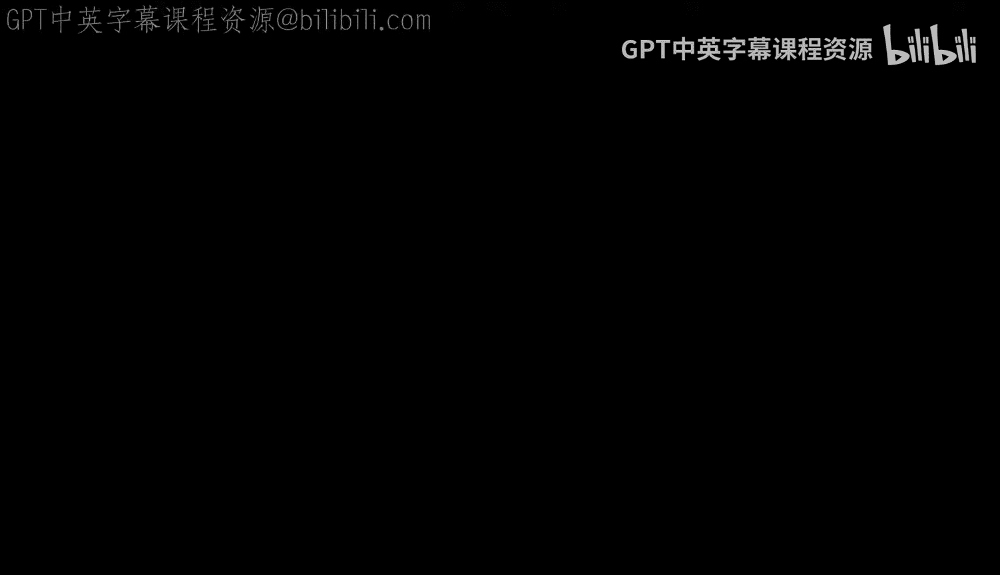
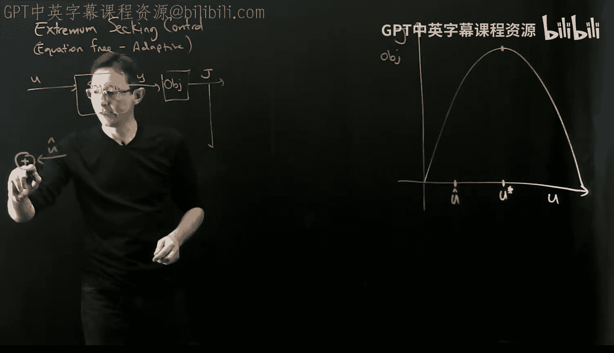
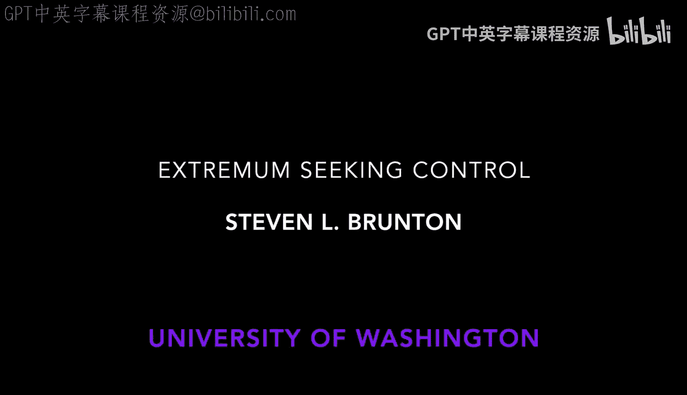

# 华盛顿大学《基于数据的机器学习控制｜Data-Driven Control with Machine Learning 2018》中英字幕 p33 -33-Extremum Seeking Control.zh_en -BV1BK6MBQEtN_p33-

Welcome back。We've been talking about data drivenrive control and in particular how we can use machine learning and related optimization techniques to either discover a model of the system or to directly discover effective control laws using data and optimization what I'm going to tell you about right now is an adaptive control strategy called extremetum seeking control。

So extreme seeking， extreme。Seeking。Control。Is an equation free control law。

 so this is equation free。Or adaptive。Meaning that it doesn't require you to have a model of the system and it can adapt to slowly changing parameters right so if I have a system that ages or it changes over the course of a day。

 then this extremetre seeking can control is going to be able to compensate for those parameter changes even without modeling or measuring them。

And。Extreme seeking control is an extremely useful。

 powerful and effective method of optimization for control that I use quite frequently。

 So if there's ever a problem where I don't want to model the system。

And I have a control knob and there's some kind of overarching objective function or cost function that I want to maximize or minimize。

 Then I usually will try extreme seeking control， at least in my first round of things that I try so extreme seeking control was largely developed by Miralav Christtiitch at UCSD。

 And so I suggest that you go read some of those foundational papers and I'll give you some links links to those papers in books。

 Okay so I'm going to walk you through just the simplest。

 simplest example of an extreme seeking controller making a bunch of kind of assumptions that make it easy to explain。

 but then we'll break down those assumptions later。So in general。

 we're going to assume that we have some kind of system。

The system is going to have inputs U and outputs y。

 and those outputs are going to feed into a cost function。Or objective function。

 maybe let me call this an objective function because I'm going to want to maximize the objective。

 not minimize a cost， okay。So some objective function， J。And I'm basically assuming that if I move U。

 I can get a measurement of J okay， I can measure the measurements that feed into my objective function and then extreme seeking control is going to feed back that measurement and do something to try to optimize U to maximize maximize J。

Okay， so。The general theory of extremets you can control applies to dynamical systems。

 systems with changing parameters， lots and lots of cases。

 What I'm going to do is I'm going to consider a massively oversimplified case to start with where。

My cost function or my objective function， J。Let's call this my objective。J as a function of u。

Is just a static function， it's a static。P aboloid。 okay， And so that means， essentially。

That the system dynamics respond instantaneously to a new actuation signal。

 U give me some measurements Y and some corresponding cost function J。

 So I'm assuming the simplest case where there is a single global maximum to my objective function and that my dynamics respond instantaneously to actuation U。

 Now that doesn't have to be the case， but this is just to illustrate how extreme seeking control works。

 So in this diagram here， what we notice， first of all。

Is that there is an optimal control value U star， which corresponds to the peak in my objective function。

 So what I want to do is I want to steer whatever my U is。

 I want to find U star and track that U star。 So even if this J slowly varies over the day and this peak moves。

 I want to track that optimal U that gives me the maximum in my objective function。

 That's what extremetrem seeking does。So let's do a thought experiment。

 the basic thought experiment here。Is that I'm going to have some estimate for what my best control law is。

 And let's call that U hat。 So I have some estimate for my control law U hat。

 and I'm just going to draw U hat here。 So let's say I have， I think that it's U equals 2。

What I'm going to do or what extrem seeking control does is it adds to that best estimate。

It adds a sine wave perturbation。 Okay， so it adds some a sine。Omega T to that。

And that's what my actual U is， so I take my estimate for the best control。

 the optimizing control you hat。Let's draw a dashed line。 This is U hat。

 And what I do is I add on that。A sinusoidal perturbation。

And what I what the sinusoidal perturbation does is it essentially probes what the slope of this this objective function is at that particular value of U hat。

 So let's walk through this this thought experiment okay so。

So I'm at this U hat and if I held that U hat constant。

 my J would be constant I just have this value of J。But if I swing my control， if I swing my。

Let's say my U hat， when I swing it positive or negative。

 when I swing U hat in the positive direction。My objective goes up。

So I get a bump in my objective function， so my objective function goes up when my U hat goes to the right and when my U hat goes to the left when it's more negative。

My objective function goes down。 so I measure this decrease in my objective function J。given。

That you had。Now this j has some average value that's not zero because it's way up here。

 but if I made it so that it was zero mean， if I subtracted out the mean and then multiplied these two。

What I would end up getting is a signal that is nearly purely positive。

Because if I multiply two sine waves that are relatively in phase。

 I'll get something that is mostly positive plus times plus is plus minus times minus is plus。

And so what this tells me is that if I am to the left of my optimum so that the slope of the cost function is positive。

Giving this little perturbation signal and measuring the output perturbation。

 If I multiplied those two， I would get a signal that's mostly positive。😊。

And that mostly positive signal tells me， hey， I should be moving that way。

 I should be moving to the right。Okay， let's see how works this works over here。

 let's say now I'm to the right of my objective。t dot dot， similarly， I'm going to add a sine wave。

 I'm going to go up here。And now I'm going to do the exact same thing I have my J function。

And I have， let's draw my U down here， my U。Signal。So now， if my you。Swings to the right。

 So if my U swings to the right here， I measure a decrease in power。 Okay。

 so now these are out of phase。 And if I swing to the left。

 I measure an increase in objective function。 I sometimes I say power because I use this to optimize power in systems。

And so now I get a J and a U that are out of phase。 And if I multiplied these。

 let's do this in orange。If I multiply these guys。Then I would get a signal that is mostly negative plus times minus is minus plus times minus is minus。

 And so what that orange signal tells me is， hey， I'm in a place that has a negative slope。

 I better go to the left。Okay so the basic idea here。

Is that I inject some perturbation sinusoid onto my best estimate of my control U hat。

I measure what the sinusoidal perturbation on the output J is。

 and it can either be in phase when I'm to the left of the optimum or out of phase when I'm to the right of the optimum。

And if I added this multiplied signal to my U hat， if I integrated that multiplied signal。

 I would tend to move in the right direction。 So let's work that out in this control diagram here。

 Okay， so remember， this J did not have a zero mean。 so I had to subtract out the mean。

That's pretty easy to do by just applying a high pass filter。 Okay， so high。Pass filter。

And in a frequency domain in the Laplace transform domain。

 that would look something like S over S plus some high frequency omega H。Okay。

And then remember what I'm doing is I'm taking that high past filtered。

 so only the high frequency stuff， not the DC or steady state component。

 I'm high past filtering that。Let's call that high pass filtered signal row。

I'm taking rh times my perturbation signal， a sine omega T。OkayAnd I'm multiplying the two together。

 So I want to multiply。This with my sinusoidal perturbation。A sign。Omega T。

And sometimes in some extreme seeking controllers， you phase shift this a little bit to get it to line up better okay and so this is kind of a tuning parameter that you can play with。

 usually I start with this equal to zero and I just use my input sign and I directly multiply it by this highpa filtered output。

Okay， and this essentially gives me the orange signal。 So at this point。

 I multiplied my sinusoid by my high pass filtered output。 and I have this kind of orange。

This is called a demomodulated signal。Demodulated。And it's generally mostly positive when I'm to the left and mostly negative when I'm to the right of the optimum。

 And so what I actually want to do is I want to add， I want to integrate this。

 I want to add that to you hat。 So basically， I'm just going to continually。😊，Integrate。

 what's right， integrate。This into my best estimate。

 and an integrator in the frequency domain is just one over S。 the laplace variable S。

 Maybe I multiply this by some gain K Okay， So this is actually completely。

The extremetrem seeking control diagram， this is basically all there is for this simple example。

You might ask what happens when I actually get to the top of this this objective function。

 when I actually move this system to the right and actually get to U star。

 let's look at what that output signal looks like so if I had now a sinusoidal input about the optimal frequency。

Then the output function J。So J or kind of this demomodulated row。

Let's see I swing to the right of you。 Well， if I swing to the right， I go down。

 but only a teeny tiny amount。 Okay， so I swing down a little bit。And if I swing。

 so that was if I had a positive swing in you。 Now， if I have a negative swing in you。

 I also go down。 And this is kind of interesting。 So you basically either direction， if I jiggle you。

 I go down because I'm at the peak of J。😊，And if I multiply this with my signal U。

 basically I get something which is。Averages out to be neither positive nor negative。

 So I get something that's a little bit positive here and a little bit negative there。

 And basically this signal， when I add it to this best estimate， it doesn't move。Okay。All right。

 so I want to walk you through this one more time now that we have the diagram and we have all of these sine waves okay。

What does extrem seeking control do， Extrem seeking control is an optimization technique that jiggles your input signal U。

 it jigles that input signal。 And if it measures when it swings when U swings positive。

 if J goes up and if U swing positive js goes down， then it adds a little positive number。

 it integrates that little positive number into my best estimate， U hat and I step to the right Now。

 if I was to the right of my optimum， and I did the same thing， I jiggle my U sinusoidily。😊，Now。

 if I swing you positive and I measure a drop in J and if I swing you negative and I measure a bump in J。

 that tells me this demomodulated signal tells me that I need to move left and this demodulated signal。

 sometimes we call thissi。This isi sci。Ex， okay， so the basic idea is extremely seeking control just jigs the input U。

 and that probes the slope of this objective function。 If it's a positive slope。

 you take a step in the positive direction。 If it's a negative slope。

 you take a step in the negative direction。 The nice thing about this also。😊。

Is that if I'm in a region that has a higher slope。

 this is a bigger sinusoidal swing and this C signal will be bigger so I will take larger steps when I'm in a region of really。

 really big slope。 And then when I get to regions of really， really minor slope。

 this sinusoid gets smaller and my steps get smaller。

 So the farther away I am with a higher slope from my objective。

 the bigger step I'll take the faster all approach。

 And then as I get to the top kind of everything slows down and I just hang out around there。

So this does rely on you having access to your control signal and being able to put in this little sinusoidal jiggle to probe the system。

This is really， really closely related to another older method called perturbine Ob。

 which is basically the simplest thing you would think of to optimize to find this U star。

And what perturbban Ober does is it basically takes little discrete steps。 It says， okay。

 I'm going to take a discrete step in U， did my power， did my J go up or down if it went up。

 take another step， if it went down， take a step in the opposite direction。

Extreme seeking control is essentially a continuous time version of perturbine observe。

 but instead of just taking fixed， discrete delta U steps。

 it can take bigger or smaller steps depending on on the slope or the gradient of this cost function J。

 So it's kind of a generalization， which is faster tracking because it takes bigger steps when you have higher slope。

 and there's also provable guarantees on when this will and will not converge for dynamical systems。

 So very， very useful。 This is just kind of the。Simplest illustration of what's happening here for a static objective function with instantaneous dynamics。

Okay。Now there's a few assumptions I made here， and these assumptions are true even when you're applying this to dynamical systems。

So extremely seeking control， if all you were doing was just finding some optimum point in a static objective function。

This wouldn't be that impressive。 There's lots and lots of methods to do that。

But let's say over time， this system is actually depends on some parameters。

 So let's say that this is some curve that changes over the course of a day。 Okay， so over 24 hours。

 this this curve might move to the left and move to the right slowly。And so that U star。

 my maximizing input U is also going to be moving to the left and to the right。

So as long as those disturbances or those parameter variations are slow compared to this sinusoidal jiggle。

 this extreme seekinging control law will be able to track that optimizing controller over time and keep your system performing at peak performance that's really useful so you assume that the disturbances to your system。

 the slow parameter variations are the slowest time scale。

The next faster time scale are these sinusoidal perturbations that you're adding to the system。

 so these are faster than the parameters and the disturbances of your system。

And then the absolute fastest time scale， you assume that the system dynamics respond faster than the sinusoidal input perturbation。

 So you basically assume that as I'm jiggling the system left and right。

 the dynamics of the system are very rapidly kind of。

Equilibrating and you can measure some objective function for each point in the sine wave。

That's basically the assumption of extremelyremly seeking control。Now。

 I will point out this is fundamentally a local optimizer。 Okay， so if my objective function。

 instead of having just one peak， if it had， let's say， two peaks like this。

If I started to the right， I'm only going to converge to this first peak because it won't allow me to go down to go to a more global optimum so I think it's very important also to recognize that this is a local local optimizer and so if I have a very complex cost landscape with you know global maximum and local maxima I have to be careful where I initialize this extreme seeking can control where I start my best estimate you hat so that I can climb that hill。

And get to that peak performance。Okay。So this does generalize to dynamical systems。

 We're going to try this out on some examples。 I'm going to show you lots of real worldor applications where this works。

 and we're also going to code this up in MatTlab for this simple example。

And see how everything works， okay， thank you。

