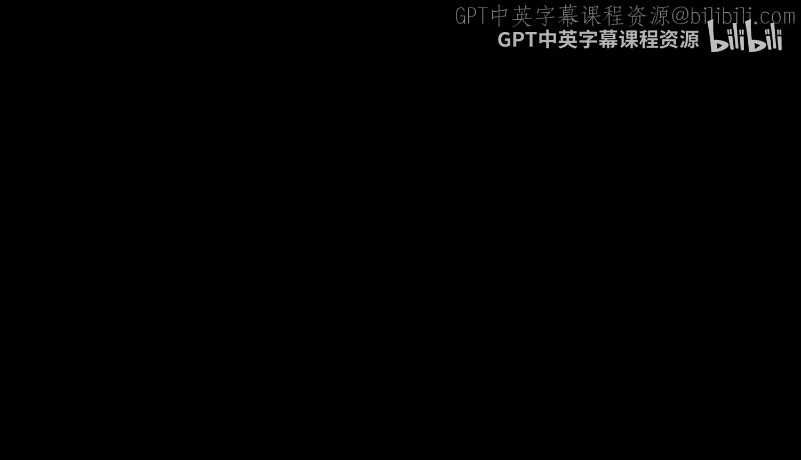
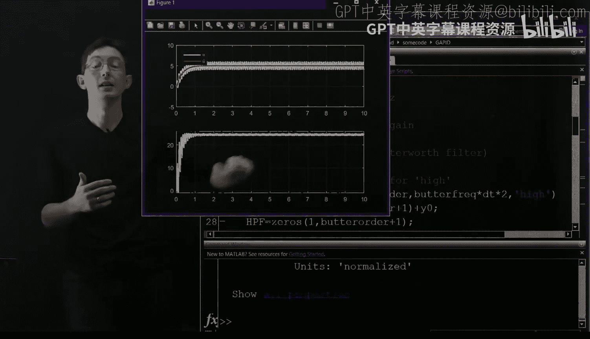
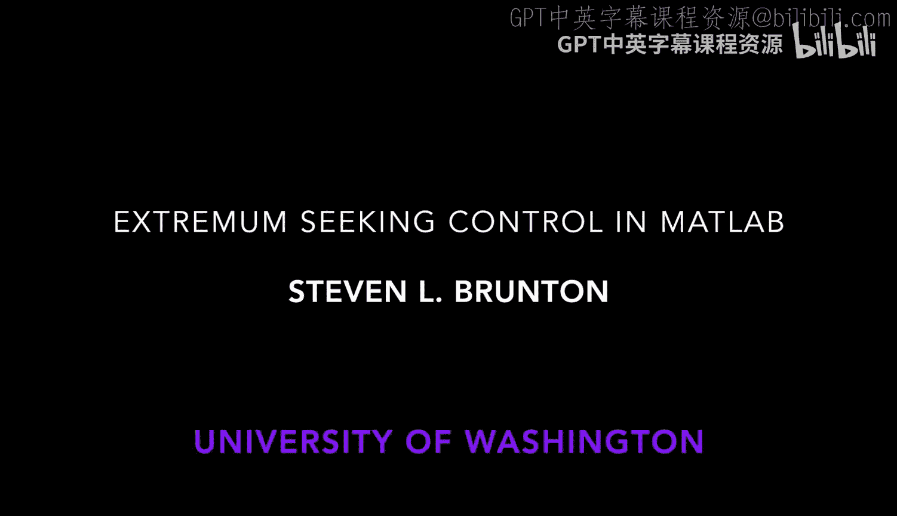

# 华盛顿大学《基于数据的机器学习控制｜Data-Driven Control with Machine Learning 2018》中英字幕 p34 -34-Extremum Seeking Control in Matlab.zh_en -BV1BK6MBQEtN_p34-

Welcome back， everyone。In the last video， I gave you kind of a brief overview of how extremerem seeking control works on a really。

 really simple example of a static objective function you're trying to optimize with some control and put U。

 So we had this picture here with some objective function J。

 some quadratic objective you're trying to maximize here。

The X axis is your control nobbu that you get to jiggle and the basic idea of extremetism seeking control is even if you have some best estimate you had。

 you want to be adding a little bit of a sinusoidal perturbation to that to probe this objective function and if that objective function。

 if when you swing your control to the right if your objective goes up。

You should have a signal that tells you go more to the right。

 And if you're to the right of the objective function and you swing to the right and your objective goes down。

 you should have a correcting signal saying， hey， move more to the left because that's where your optimum is。

 Extrem seeking and control is really that simple。 But there is a lot of depth when you apply this to dynamical systems。

 So Miralav Christtiitch and collaborators at UCSD have developed lots of。

Kind of guarantees for when extremetm seeking control will and will not work when it's applied to dynamical systems。

 so very powerful， very useful basic diagram here for a static objective function。

 but this also applies to dynamical systems。And then here is kind of that diagram that I drew before where you have some kind of an input perturbation。

 some sine omega t where omega is faster than the slow disturbances to your system or faster than this cost function is changing in time。

 but where this omega is slow compared to the internal dynamics of your system。

 so you want your system to respond fast to these sinusoidal perturbations， but you want the。

The objective function you're trying to track to be slow in time。

And so basically you put in this additional sinusoidal perturbation to your best estimate you hat。

 you get some corresponding sinusoidal output J， you have to highpas filter that to get rid of this mean component here。

 this average component， so you high passss filter it just to get the purely oscillatory part in row。

You multiply that by your sinusoidal perturbation， possibly with a phase shift that gives you this demomodulated signal C and C is the quantity that is more or less positive when I'm to the left of the optimum and negative when I'm to the right of the optimum。

And I continuously integrate that C， that deulated signal C into my best estimate you had using this integrator block here。

 So if I'm to the left of this optimum point， then C is positive and I integrate that up and I move to the right。

 I move to the right， move to the right until I converge if I'm to the right of the optimum。

 then C is negative and I integrate that negative value moves to the left moves to the left moves to the left until I hit this optimum。

 And so in both cases， if I have this simple picture here。

 I converge to the globally optimum solution。 sorry this optimum solution， and then I stay put。Now。

 if there were multiple peaks to this， you would only converge to a local optimum that you're closest to。

 so that's a caveat。And what this looks like， this is for a simulated example that we're going to cook up in a minute。

 I have this basic quadratic landscape here。And what I'm going to do is I run my extreme seeking control starting from the left of the optimum。

 and you see that very rapidly there's a sinusoidal perturbation on top of my best control estimate you had。

And that sinusoidal input gives rise to a sinusoidal output in the objective function。

 and what happens is over time because I started to the left， this jiggle walks me to the right in U。

 it walks me from zero to I guess5， and5 appears to be the optimizing control input。

 which gives me the maximum of J。And one thing that's really interesting。

 notice that these oscillations in J are bigger the farther I am from the peak。

 so the higher the slope， the bigger the oscillations in J and the faster my U increases。

 and then as I get close to the optimum， U increases less rapidly because the slope is tailing off。

And also notice that my perturbation output in J becomes very， very， very small。 In fact。

 it becomes on the order of a squared where a is the magnitude of this input ripple。 Okay。

 so this input ripple has amplitude A， then as you approach the peak。

 if this is a quadratic cost function， then the J oscillation goes like a squared。

 So if this is a small perturbation，Then essentially， what happens is as you approach the peak。

 your sinusoidal input also doesn't give you much loss in performance because you wouldn't want this J to be oscillating a bunch around the optimal value。

 So it's nice that as you approach the optimum value， these perturbations in J decrease。

 that's really good。 so you get this kind of rock solid peak performance in a very short amount of time with this sinusoidal oscillation。

Okay， so this is the basic architecture of extreme seeking control on a data set。

 Now what we're going to do is we're going to code this up with this type of cost function and we're actually going to reproduce these curves。

 So that's what we're going to do now。so let's do this in MATLab。

In Matlab I have a script here you can download this from the internet。

 this is also in our data drivenven science and engineering book。

 what we're going to do is basically cook up our own cost function， which is static。

And then we're going to write the extremetm seeking control algorithm to optimize for the static objective function。

 So in this case， my objective function J is 25 minus5 minus U quantity squared I have this as a function of u and T so that in the future what I can do is I can make this set point time varying so I can make it move in time。

 but for now this is just static in time。Okay， so let's actually run this。

And now let's also plot what that objective function is for u between minus5 and 15。

 u between minus 5 and 15。And I'm plotting it。On a black background here。

 but basically you can see that this this objective function J has a peak value at U equals 5。

 and then it quadraically falls off as u goes away from 5。 so this is a very。

 very simple cost function well behaved， but illustrates the points。Okay。

 so now what we're going to do。Is we're actually going to start designing an extreme seeking control。

 Okay， so what do I need to design an extreme seeking control， I need to design。

The the sampling frequency。 So I need to know what how fast I'm actually sampling the system。

Essentially I'm going to act like this is a discrete time system where I take samples at fixed Delta Ts。

 so DT equals1 over the frequency， which I've chosen to be， I guess， 20 Hertz。

I need to pick a time for how long I'm going to run my simulation， so in this case t equals 10。

 I need an amplitude of my sinusoidal perturbation that's big a here， so 0。

2 and then what I need is an omega which is my frequency in hertz so omega is 10 times 2 times pi or I guess 10 hertz here。

And I'm going to use zero phase remember when I injected my sine wave and then I multiplied by that same sine wave。

 there was that little plus phi that phase， I'm going to choose phase equal to zero in this case。

 and I'm going to have an integration gain of five for my integrator。Okay。

 so basically I picked my oscillation frequency to be 10 hertz。 I have an integral gain k equals5。

 if I make this bigger or smaller， I'll track faster or slower so if this gets too big your system will go unstable if this is too small your system will track too slowly so this is one of the parameters that I would actually play around with is this K I would also play around with this omega frequency。

 I'd make it another faster or slower depending on the system and then I have to build that highpa filter。

Remember I have these sinusoidal outputs in my objective function。

 but they're at some steady state mean and I want to subtract that mean with this high pass filter so I'm going to design a butter wolf worth filter first order with a cutoff frequency of 2 Hz so my omega frequency was 10 Hz and so I'm going to design my high pass filter to cut off anything that's lower than 2 Htz。

 so it's going to only give me back my output oscillation。Okay， in MatTlab， you can read about。

You can kind of play with this code or read about the butter in the help files。

 but basically I'm just designing a discrete time butterworth filter here。

And now I'm going to set up my loop。 This loop is basically a big four loop where I'm walking through each delta T of the simulation。

 So for each I， you know， up until the the final duration of my simulation。

 what I'm going to do is I'm going to measure。What J is at that particular value of U。

 and then I'm going to do this sinusoidal jiggle， I'm going to highpa pass filter the output。

 multiply them and integrate that into my U hat。So this is basically just a big four loop that does everything that that diagram described before。

 so I have a high pass filter。 I have to update my filtered estimate here in this loop。And。

I have to design I have to build this C， this demo modulated。 So my high pass filtered output。

 I multiply by my sine wave， and then I integrate that。

 I add C times my integral gain times Delta t to my best estimate to get my new best estimate U hat。

 So I'm jiggling this thing。 And if C is positive， I add that positive value times k times Delta T to get a new U hat。

😊，And then again， I add my sinus little perturbation at the end and everything loops through。

So this is just a for loop。For the extremetm seeking can control。

 you could also design this in simullink， which I'll show you later。

 it's actually easier to do this with blocks and simullink， but I wanted to show you the for loop。

Basically， you can have this code running at every Delta T of some discrete time controller so I can build a little discrete time controller。

 I can clip it onto the inputs and outputs of my system。

 and this would be running in the background in every delta T。

 so that's why I want to show you that you can write this in discrete time。 I just ran it。

 It runs super fast。And now。I'm just going to run some plotting commands， so I'm going to plot。

The the best estimate you had in red。 So this is the best estimate tracking in time。

 I add to that my sinusoidal perturbation， this little jigly white curve。

 And here is my objective function J evolving in time as well。

 So this is just showing that you can quickly reproduce these results with， you know。You know。

 about 50 lines of code。Now it's kind of cool about this， I'm using something called in MatTLb。

 it's called link axes， so my subplot one， I call axis1。my subplot two i call access two。

And then I run this command called。Link axes， so I link access 1 with A 2 and I link their X axes。

So what I can do if I want。Is if I zoom in on one of these。

 let's say I want to zoom in on this first three seconds。Up here。It zooms in the x axis on both。

 This is super cool and so now when you zoom in， you can actually see this red curve。

 the best estimate U is just increasing and to that I'm adding this sinusoidal perturbation and I get my sinusoidal output perturbation here for my objective function and the magnitude that is bigger when I'm at a higher slope so I walk up faster and then as the slope becomes closer to zero these decrease and my U changes less rapidly。

😊，Okay， so。Takeaway here， extreme seeking control is very easy to code up。

 you can do this in discrete time so I can basically have this running every little delta T of some digital controller。

All I need is to design a frequency filter， I need to inject a sinusoidal input at some given frequency。

 at some magnitude， and I have some gain and K that I can play with。

So I told you that this would change if I changed k equals 5， let's try that。

 let's say I make this integral gain one， so I make it five times smaller。

What do you expect will happen？Well， I expect it should track slower。I'm going to run this。

 I'm going to go back down to my plotting commands。Okay。

 and you see that we are approaching u equals 5， but we're doing it much， much。

 much more slowly because。My update to UHt， I'm multiplying it by a smaller number。

 so I'm being less aggressive when I update UHAT， and so it takes a lot longer。

But this could be dangerous。 What if I we know， for example。That in lots of systems， if my。

 if my integral gain is too large， I can destabilize it。

 So let's see what happens if I make K equals 10。So I made it bigger than it was before。

 Now I'm going to run this。 Okay， now I get super duper fast tracking。

 but it's looking a little wonky。 It's not pure sinusoids anymore。 So we're actually moving faster。

Then our high pass filter can filter out the change。

 So that's what's happening here is our high pass filter now is allowing some of this fast rise in J。

 and it's going to eventually mess everything up。So let's try this again。

 I actually don't know when this is going to break or how it's going to break。

 So let's try it K equals 20。Okay， now things are going crazy。

 just like lots and lots of stuff happening， but it does track this very rapidly。

 And I'm I'm guessing at some point I can actually destabilize the system。And boom。

 it blows up to infinity。 Okay， So long story short， this is a knob that you actually get to tune。

 So I tuned it to K equals5 because it gives nice， smooth increase without any of that jagged stuff in the beginning。

It would also be interesting to try。And change these frequencies So I could change my sinusoidal perturbation frequency。

 I could change the phase。 I could change the amplitude。 These will all have a different effect。

 So let's say I want to make my amplitude bigger。 I make it amplitude instead of 02。 I make it1。Okay。

 so now again， I have faster rise because I have a much bigger signal telling me what to do except now。

It's such a large。Perturbation that even when I'm at the optimum value。

 I can see my J function is swinging a lot more than it used to。 So these are big perturbations。

 And so that might be something I want to avoid is having a really big A。😊。

So there's a trade off between how big your ripple your sinusoidal perturbation is and the integral gain with which you accumulate that new information about moving right or left。

 So I'm going to move this back down to02。So you basically see these are the knobs you get to play with。

In the real world， in practice， mega might be kind of determined by the dynamics and time scales of your system。

 so if I have system dynamics that are fast and I have disturbances or parameters that are changing slowly。

 I have to choose my sinusoidal perturbation to be somewhere in the middle of those two so that one is usually kind of determined by the time scales at the system sometimes in power electronics。

 you have a sinusoidal perturbation at 60 Hz anyway。

 and so you kind of have to use that 60 Htz perturbation。

And so sometimes this frequency omega is given to you and maybe also in that case the amplitude A is also handed to you。

Okay， so very simple architecture based on this kind of feedback， you perturb your input。

 you measure your perturbative output， and then you walk your best estimate of U hat in the right direction to seek that optimum。

Okay， thank you。

