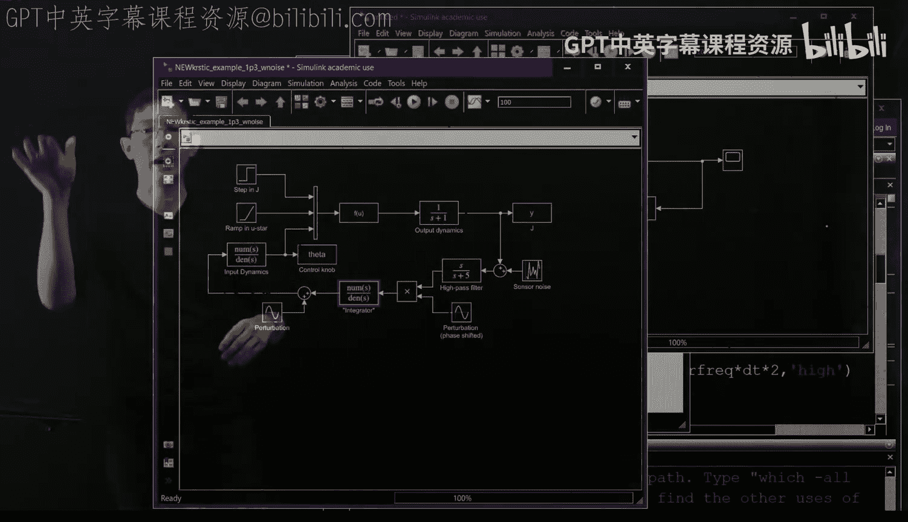
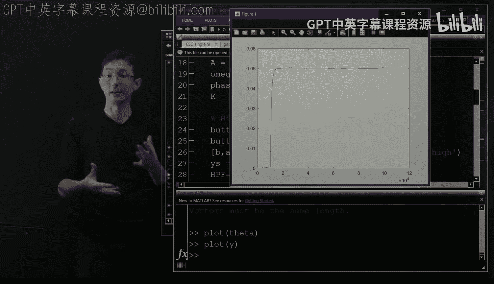
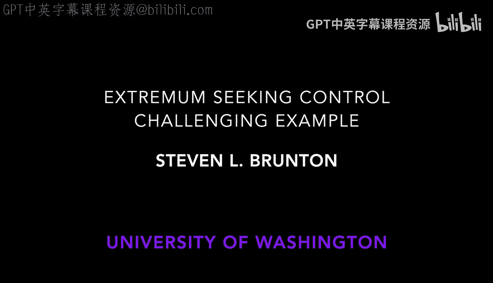

# 华盛顿大学《基于数据的机器学习控制｜Data-Driven Control with Machine Learning 2018》中英字幕 p36 -36-Extremum Seeking Control_ Challenging Example.zh_en -BV1BK6MBQEtN_p36-

Welcome back everyone so we've been talking about extremet seeking control and we've been applying this in MATLb with some simple system here。

 we basically took a static objective function and built a very。

 very simple extm seeking controller to track to optimize that optimizeimizing control and put you that maximizes this objective function we also wrote a script to essentially show what this would look like in a digital loop。

And now what I'm going to do is I'm going to show you how you can apply extremet seeking control to a very challenging dynamical system that would be very hard to control。

 This is an example that's actually from Kik and Christtic's book on extremetrem seeking control from 2003 Wi。

 so I encourage you to go check that out if you want more details on how they actually chose the system and designed it。

 but this is basically a system。That was designed to be about as nasty as possible。 Okay。

 so you have some objective function F。 basically， you know。

 we're going to step our objective function。 There's some ramp in the the optimizing control U star。

 So the the U that optimizes the subjective function is ramping linearly there's going to be a step。

 a discontinuous step in the optimum value of J。And in addition to that static objective function where the U star is varying。

 NJ has the step in time。This gets multiplied by input dynamics and output dynamics。

 So there will be actual dynamical systems， some Odes。

 some transfer functions on the inputs and outputs here and here that give this thing its own internal dynamics and timescales making it much。

 much more challenging to control。In particular， I think that they've given this thing a right half plane zero。

 which makes it very difficult to control。 so that means that this will be non-minimum phase if I ramp my U。

 my system actually turns in the wrong direction for a little bit before it then goes up and so I think this is a very。

 very hard system if you were going to even have the equations it would be hard to design a good control law。

 but here we're going to assume we don't actually know what the equations are and we're going to like tune this thing to control it。

 so this is a kind of a power demonstration of extremetremum seeking control on a very challenging control problem with a right half plane zero。

 a changing optimum U star and a discontinuous jump in the dynamics in this objective function at some time。

But the basic architecture is the same， so here what I'm doing is I have my output function plus these dynamics。

I have a bunch of blocks that dump data to the workstation to the， to the。

To Matlab's environment so that I can plot theta， which is the optimizing U。

 I can plot the cost function J。 I have this thing to add my sinusoidal perturbation。

 And then basically， this is all the same as what we've been doing before。 I have a high pass filter。

 I have an integrator。 I multiply a phase shifted version of my input sinusoid。😊。

But here I'm adding some sensor noise。 So I'm assuming that my measurement of this objectiveive function is a little bit noisy。

 So it's it's an imperfect measurement。 I have sensor noise。 And in this case。

 Carik and Christstic actually showed that you had to phase shift this demomodulating sine wave to get it to work。

 So this is a really hard example where you have to phase shift it。

 Their integrator is also not just a one over S simple integrator。

 It's more of like a washout low pass plus integrator。 Its a funky integrator。 I'm going。😊。

Actuallyual， zoom in and look。 So it's50 s minus200 divided by s minus00 one。Okay。

 so it's not a perfect integrator， but it's got these kind of a big。Gain and some other dynamics。

Long story short， you take the basic extrem seeking control loop where you highpass filter。

 demulate and integrate with some sinusoidal perturbation， and mostly nothing changes。

 but you tweak the integrator a little bit and you phase shift the perturbation signal。

 and those allow you to kind of tune the system to control this very， very challenging system。Okay。

 so I'm just going to run this， we're going to see what the output is and see that it actually works。

This is also the code for this is online， this is also in in our book。

 my book with Nathan Cus on Data drivenriven science and engineering so you can see some of the output figures and run the code yourself。

OkayI'm going to run this。 let's hope everything works。 it compiles， it's running， it's running。

 it's ready。And so I've dumped all of this stuff to the。To the。What is it called the workspace。

 So now I can plot the control knob theta。 So theta is my。Theta is the。

The control that that the system is actually commanding。 It should be a ramp。

 The optimizing control is a ramp。 and we can also plot the output Y when it tracks this， this step。

 So let's， let's just play around with this a little bit。 So I'm going to try。

Let's see。 plot。Let's see if I have a T variable。 I'm not sure if I there is such a T。

 Let's plot theta。Okay， so this is that control knob and basically it's trying to track this linear ramp and it's actually doing a decent job。

 so notice that this big hiccup right here。That's where the the cost function had a big jump from a step from 0 to1 at time 1。

 Okay， so the control is doing its thing。 There's this massive change in the system dynamic。

 So there's this huge correction to you。 but then it actually gets back on the right track pretty quickly and tracks this linear ramp。

 So that's very impressive， I think， especially considering that this is non-minimum phase and it has a right half plane 0。

Let's also plot Y the output， so this is the objective function。This is also pretty cool。

 so the objective function， the optimal J goes from 0 to 0。

05 at time 1 and you can see that even though this thing has nasty nonlinear dynamic sorry not nonlinear。

 butmin phase dynamics， sensor noise， all of this nastiness。When the system changes at time1。

 the controller almost immediately compensates and nails very like rock solid。

Objective function output， even though the control is doing this crazy trajectory and it's tracking。

 this ramping U star， the optimizing control input is changing。 It's drifting。

 but the output doesn't notice any of this。 So， so even if I had this really nasty system。

 If I clickped on this special extreme seeking control law。 as far as the output is concerned。

 when the system changes， I immediately track and maintain optimal performance。

 even though under the hood， the controller is just like massively compensating for these dynamics。😊。

So I think this is a very， very cool example。 I love that this was you know one of the showcase examples in Carartik and Christtic's book because this is a super hard system。

 they took their method and applied it to just a really， really nasty problem。😊，And it it works。

 it works great。 So play around with this。 You know， honestly， it'll take a little time。

 even understand why their， their system is so hard to control。

 try to design a different controller for it and then play around with some of the knobs， Change the。

😊，You know， change the filter frequency， change the integrator again。

 change all of those things and see how this performs。Okay。

 so that's it you've seen extreme seeking control on a simple static objective function as an illustration。

 but now you've seen it applied to a very nasty hard to control system and I think you're ready to start trying this on your own systems of interest okay。

 thank you。

