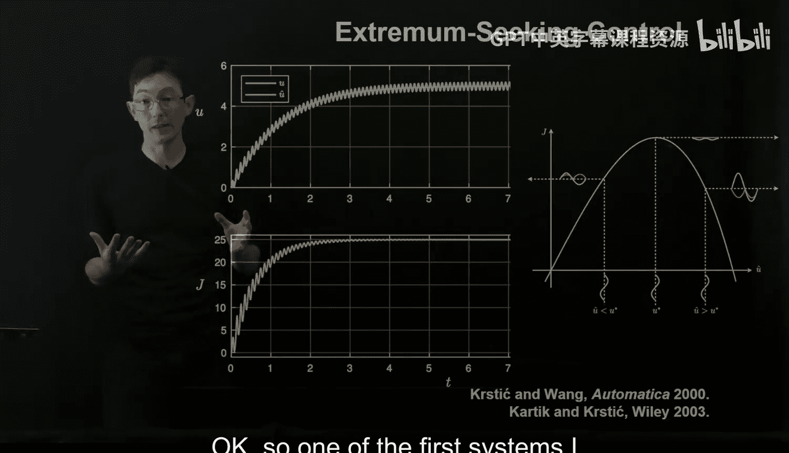
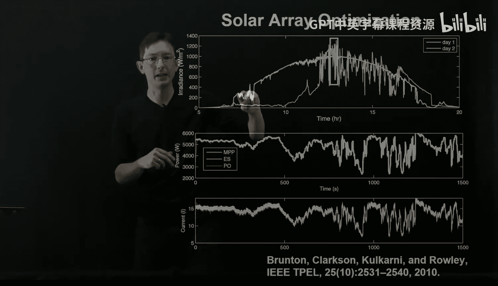
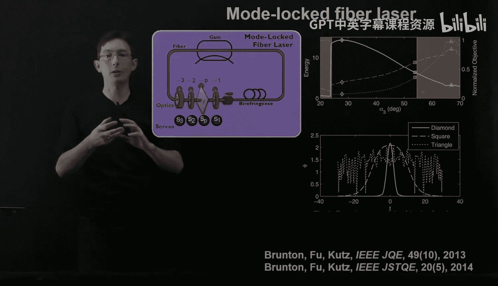
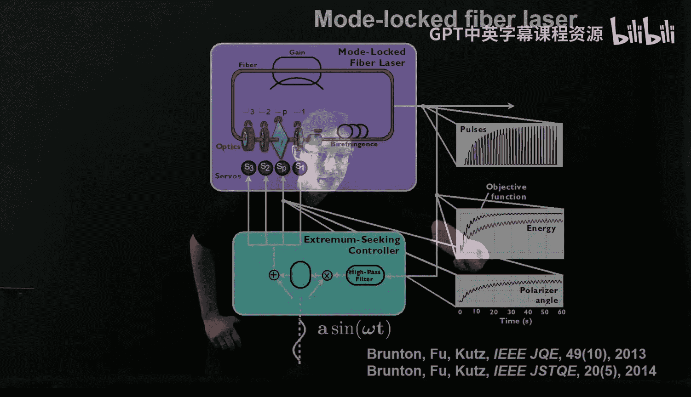
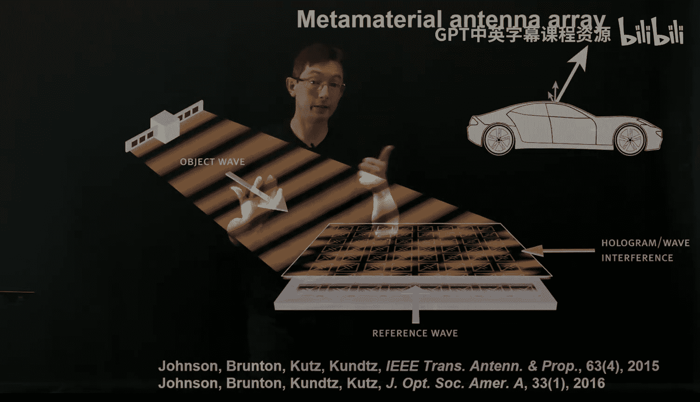
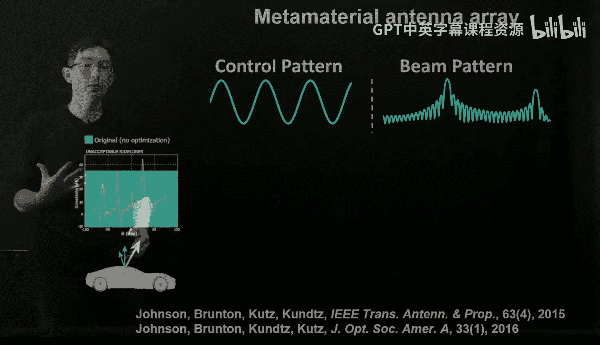

# 华盛顿大学《基于数据的机器学习控制｜Data-Driven Control with Machine Learning 2018》中英字幕 p37 -37-Extremum Seeking Control Applications.zh_en -BV1BK6MBQEtN_p37-

Welcome back。So we've been exploring the extremetm seeking control algorithm。

 which essentially is a smart version of perturb and observe where you jiggle your control input。

 you measure some kind of corresponding jiggle in an objective function。

 some high level objective you want to maximize and you steer your best estimate for what the control value should be based on that information that you get from the sinusoidal perturbation so here we have a cost function that's quadratic。

If I'm to the left of the optimizing value in this case， U equals5， when I jiggle。

 it tells me I should increase you if I was above， then it would tell me I should decrease you and essentially you can track this。

This optimum value of your objective function J。Pretty easily just by adding the sinusoidal perturbation。

Now extreme seeking control is particularly interesting when your system has dynamics when it's not just the static quadratic cost function。

 but there's some dynamical system that gives rise to the subjective。

 like a fluid or some power electronics or something like that where there's actually dynamics。

And what's also interesting is when there are disturbances or parameters to your system that are changing over time that you can't measure。

 so what would be more interesting in this case is if this objective function was actually moving around based on some unknown parameter that's hard to measure。

So what I'm going to tell you about now， I'm just going to go through a few examples of how myself and my collaborators have used extremetre seeking control in the past to control actual real world systems。

 So we're going to start working through the practicalities of this。Okay。

 so one of the first systems I applied to extremetrem seeking control to was solar array optimization。

 so this is a solar array， actually a pair of solar arrays that we had outside of our lab in Princeton when I was a grad student。

You can read all of the details in this paper down here。But the basic idea is that。

When you're operating a solar panel array， an array of solar panels。

 you have to change the operating conditions。 You have to change kind of the set current or the set voltage。

 depending on the time of day or the cloud cover basically the amount of solar irradiation that hits these panels will change the optimal set point where you should be maintaining your power inverter。

 So these are tied into the power grid using what's known as a grid tied inverter。

 It basically takes this Dc power chops it up a bunch reforms it into these sine waves that it then feeds in as AC current into into the power grid。

 I'm oversimpling a bit。 I'm not a power electronic guy。 but that's basically what's happening。

 These output you know Dc and a power inverter chops them up and reforms them into Ac current。

 which it feeds into the grid。The process of chopping it up and feeding it into the grid actually creates a sinusoidal perturbation。

Which we can then use for extremetrem seeking control， so that was what we did here。

So you can model your array using this basic diagram here， there's some capacitance。

 some inductance and so on and so forth。And what you're really trying to do。

 So these are the power versus voltage and power versus current curves。

 So you want to maximize the power。 That's what you're feeding into the grid。

 You want to maximize the power by setting V or I to be at this peak this optimizing value。Okay。

And this is as the irradiance as the amount of sunlight changes。 Okay。

 so the lowest curves here are for low solar irradiance and the highest curves here are for very high solar irradiance。

And in the middle of Princeton， New Jersey， know you have clouds coming over in the day。

 you have this massively varying solar irradiance even over the course of minutes or seconds。

 let alone hours and so the idea is that you're going to have to move。 this is normalized。

 So you're going to have to change your set voltage or current throughout the day to maintain this peak power or else you're going to have suboptimal performance。

Okay， now again。This grid tie inverter that we were using at the time by nature of the fact that it's chopping this up into you 60 Htz AC sine wave means that。

Means that we get this natural sinusoidal ripple on top of our control signal and we can measure did our power go up or down based on those swings in the rippling input signal。

 and so we use that to design an extremely seeking controller to maintain peak performance in this array。

And what you can see here， these are actually the solar aradiance。

 basically how much sunlight is hitting those panels on two consecutive days in New Jersey。

So on I don't know which one's day one and day two。

 but in one of the days you see that it's a pretty nice curve。

Over the course of the day。 So basically， the sun comes up。

 It gets brighter and brighter and brighter and brighter until peak。

 and then it gets dimmer and dimmer and dimmer and dimmer。 Okay， that's this first curve here。

And even in that case。We still have to adjust our either our current or our voltage continuously over the course of the day to track the optimizing power condition。

But then on day two you can see this is an example of kind of real New Jersey weather。

 so in day two there's cloud cover， the cloud cover breaks sporadically and you get lots of sunlight then the clouds roll over。

 you get lots less sunlight and this is very highly variable over the course of you know minutes or seconds so I'm zooming into this little box here on day two and you can see kind of the power output is wildly swinging over the course of。

😊，know， just a matter of minutes or hours， and this is the optimizing current。

 the control current that we have to continuously adjust to maintain the maximum power condition。

Okay， so what we're doing here， you can't really see it because this is so fast it's 60 Hertz。

 but there's this incredibly fast sinusoidal ripple on top of this current and we're using that signal to measure the power go up or down and what we're doing is essentially adjusting this current。

 so when there is the opportunity to gain more power we modify。The set current。

 and we maintain the maximum possible power。And I don't know if you can see here。

 but actually there is the theoretical maximum power which is this blue line。

 and then there's our extm seeking controller on top of that。

 and so basically it's almost perfect ability to track this maximum allowable power by jiggling this current in real time。

Okay， so you can apply this to solar array optimization that was kind of my first experience using extremetm seeking control。

Since then we've applied it to lots of other systems。

 so one system that I think is really interesting is。Self tuning fiber lasers。

 so this is work with Xing Fu and Nathan Cuz at UW。

So the idea here is that I have some kind of a fiber laser， this is like a fiber optic laser。

And what you want to do is you want to get the maximum energy pulses out of this laser possible。

And you have some optical components that you can tune。

 so there are these four you know essentially optical components。

 wave plates and polarizers that you get to turn to filter out different aspects of this this laser pulse to allow it to synchronize into this mode locked high energy pulses this is kind of old technology in laser physics。

But what is really interesting is if you have one of these lasers in your lab。

 you go into the lab in the morning， you turn this laser on and it's not Mo lockeded。

 it doesn't have these high energy single pulse outputs that you want。

And so what you have to do is you have to tune these waveps and polarizers and an expert can do this pretty quickly。

 you basically tune these until the system becomes mode locked and has these high energy peak pulses that you want。

Now what confounds the issue？Is that this， this fiber has an unknown and very difficult to measure quantity called the byrefrriingants。

 If I twist the fiber， the biorefringance changes。 If I heat up the fiber。

 the biorefrriance changes and this。Has a huge impact on the mode locking and the output of this laser。

 So over the course of the day， if the room gets 5 degrees warmer， this biofringance changes。

 and I need to continuously modify or， you know， maybe a discrete instances out throughout the day。

 I'll need to retune the system to keep it mode locked。 even worse。

 let's say someone bumps into the laser table and it knocks this fiber into a new biofringance value。

 I have to start all over again and ret the system。

So we thought this was a perfect example to apply extreme seeking control。

And so what we were trying to do， what you see here are essentially the wave shapes。

 these are the shapes of the actual pulses for different conditions of these wave plates and polarizers。

 what we want was this solid peak here， kind of a narrow high energy pulse。

That corresponds to this diamond， this diamond here。Now。

The dash line here is the raw energy output of this laser。 And so what you can see is that as I。

 if I just did extreme seeking control purely based on the energy。

 what would happen is I would walk up this curve until this point here。

But this gray region is where my mode locking fails。So something really important。

 I think everybody who does optimization should know is that very often often I can optimize myself off of a cliff。

 even though I get more energy， it's this chaotic solution here where basically it's more energy。

 but it's not a coherent wave pulse， so I don't want to just maximize energy instead what I do is I divide by the kosis of the signal。

 this higher moment here。To penalize。Just energy。 And to instead favor energetic solutions that are also narrow。

 Okay， that are these narrow pulses。 So basically， what I'm telling you is in this mode locked laser case。

 We had to use expert knowledge to design an objective function that gave us the pulses that we wanted。

 We thought maybe just maximizing energy would work。

 we found that we would optimize ourselves write off a cliff into this chaotic nonm lock solution。

 So we had to design an objective function。In this solid curve here that promoted pulses of the shape that we actually wanted。

And then what we did was we put a little sinusoidal perturbation onto all of these wave plates and polarizers and we allowed those jiggling measurements。

 we could measure the output， and we applied the extreme so you can control law to essentially bring the system into mode locking and keep it there even when the bioreefingnges changed in time。

And so that's what this looks like here， you essentially can measure your objective function。

 you feed that objective function back into our extreme seeking controller。

 which has the sinusoidal perturbation， and then you apply those kind of jiggling signals to some servo motors that actually move these wavelets and polarizers。

And so what I'm showing you here is actually just modifying this polarizer angle， you could do this。

 you could juigle all of these servos， but now we're only kind of jiggling this polarizer and what you can see is that very rapidly it finds a good set value that increases the energy increases the objective function and increases the power output for each of these pulses so it's kind of what we want we want these pulses to be narrow and high power we obtain that it's measurable by our objective function which increases and we also increase the energy per pulse just by applying this equation-free ex se controller。

This is particularly nice because modeling this laser is pretty challenging。

And measuring and modeling the biorefringations might be impossible。

 so there's this unknown disturbance that I don't want to measure。

 all I want to do is compensate for it， so I jiggle this extreme seeking control signal and even if this biorefrriance is changing in time。

 I can track those optimal settings that give me high energy mode lock solutions。Okay。

 another example we've applied this to this was an experiment run by Barrett Noak in Potier France and Vladimir Perizanovvi and collaborators designed the control laws and ran all of the experiments of this。

 and essentially what we did was we applied extremet seeking control to try to increase or decrease the mixing in a fluid mixing layer。

So what we had here， there's the splitter plate and above the splitter plate there's high speed flow and below the splitter plate there's low speed flow and what you get are these Kelvin Helmholt's instability and vortex roll up。

 which eventually break down at this downstream location where we can measure the flow。

And what we're trying to do， there are these little pressure ports that you can blow air on the side of the splitter plate。

 we're trying to design a strategy for blowing out of those ports to either increase or decrease mixing downstream。

Very hard nonlinear control problem， you definitely don't want to try to model this system。

 so equation free methods are ideal。And we applied to extreme seeking control to get either better or increased or decreased mixing in this。

Now， in this example。We found it interesting because the flow is so nonlinear。

 there's actually lots of local optimum solutions， local optimum strategies based on the parameterization of the control law。

 and so extremet z can control was only able to find a local optimizer and not the global optimal solution。

Okay， so that's a caveat right if you have a really complicated cost landscape。

 you have to be careful that you're not just finding a local optimizer。Okay。

 the last example I want to show you is work that we did with Michaelya Johnson and Nathan Kuntz from Kaedta。

Where we essentially optimize the performance of a metamaterial antenna array to get better beam steering with less side lobes。

 So I'll tell you what this means in a minute。 Okay， so here's our schematic。 Basically。

 this metamaterial antenna can sit on top of the roof of a car and talk to satellites。

 and the satellite is pointing in this main direction。

 So you want to focus all of your energy into maintaining an antenna beam in that direction。

 So based on the nonlinear physics of this this metamaterial。

 you essentially get these side directions， energy and side directions， which are， are not helpful。

 So， first of all， they waste your power and energy。😊。

But also there's rules from the FCC about how much you can pollute sidebands。

 so if I'm trying to listen to my satellite， but I'm essentially polluting the airwas with all of these side frequencies。

 then I can get shut down so there's this need to track this main beam and bring down these side lobes to be compliant。

And so what this looks like essentially is you have some control pattern that you establish on this metamaterial antenna and it gives a beam pattern here。

 So this is the main beam pointing to the satellite。

 but this is some kind of a side lobe interference that I want to bring down as much as possible so that's this picture here with the car。

 I have a lot of energy in the main beam， but I also have a lot of energy in these side lobes。

And so essentially what we do。

Is we add another kind of corrective control pattern with some。Some you know frequency and amplitude。

 And the idea is what we want to do is we want to add on something that a negative side lobe to cancel out the side lobe and give us this purple curve down in the bottom。

 And what we're trying to do is we're trying to sweep through these parameter spaces to find the right control pattern that brings this side lobe down as much as possible。

 And that's what Michaela was able to do with extremetum seeking control was essentially to reduce the side lobe significantly by optimizing these parameters to find the best side lobe cancellation。

 so this is another example where the electronics themselves are pretty fast compared to these perturbations。

 and you're able to actually bring down this side lobe using this extremem seeking optimization。😊。

So in all of these cases， you're essentially able to account for unknown disturbances in the case of the metamaterial antenna array。

 we simulated warming so the physics changes when it gets hotter or colder and so what we did was we simulated antenna warming over the course of a day and we used the ex seeking control to essentially track that optimal objective value in yellow here。

 and if we didn't have our extreme seeking controller as the antenna warmed up。

 we would actually lose performance over what is possible so in all of these cases what we did was we used extreme seeking control on a system where the internal dynamics equilibrated relatively quickly compared to the perturbation and we used that perturbation to optimize our control strategy for some high levell objective and in the case of the solar array。

 we wanted to maximize the array performance。In the case of the fluid。

 we wanted to increase or decrease mixing for the laser， we wanted these high energy narrow pulses。

 and in the metamaterial we wanted to decrease our side lobe as much as possible。

And in all of those cases， with this perturbative signal。

 even without having any equations or dynamics， without knowing any of the equations for the dynamic。

 we were able to obtain performance increases just based on this kind of extreme seeking control perturbative strategy。

Okay， there are tons more applications。 I'm just showing you what we've done kind of with myself and collaborators on a few systems。

 people have applied this to。Combution problems to make combusters quieter to optimize formation flight。

You name it people have applied extremet seeking control optimization。

 so it's a go to method you should definitely try it out on your own systems。

 but beware it can give you local opt optimum solutions so you have to have a good initial initial guess to get more globally optimal solutions Okay。

 thank you。