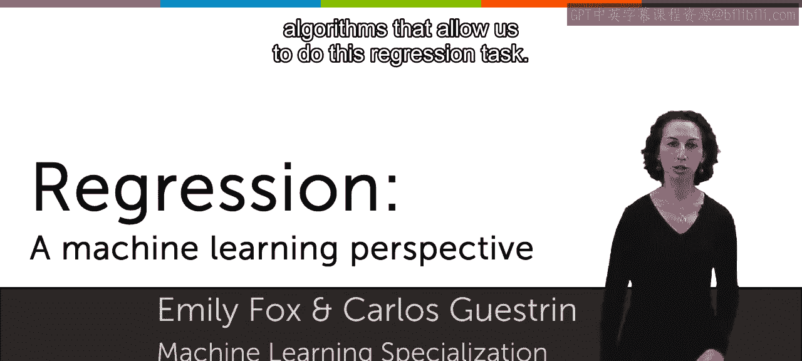
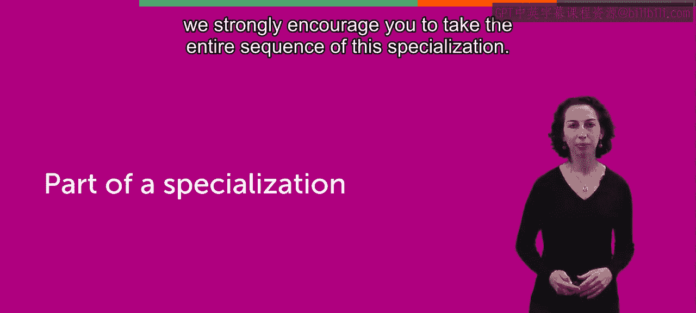
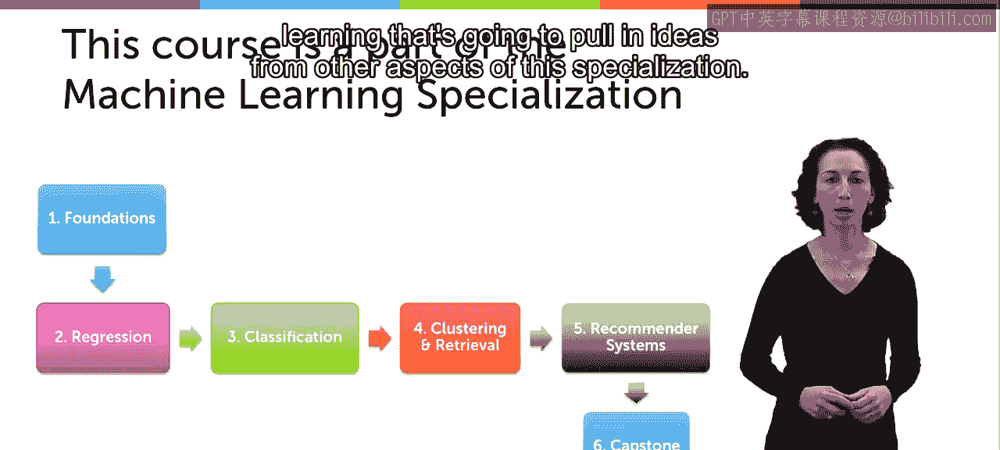

# 华盛顿大学《机器学习（回归，第2课⧸共4课）｜Machine Learning》中英字幕 p01 0_欢迎.zh_en -BV11b421H7XL_p1-

。

Welcome to the regression course of the machine learning specialization so regression is one of the most widely used statistics and machine learning tools for deriving intelligence from data。

 and the methods allow you to do anything from predicting the price of stocks to understanding gene regulatory networks and in the first course of the specialization。

 we talked about regression at a very high level and implemented some of the methods but in this course we're going to go into a lot more detail and really look inside the hood at what are the underlying models and algorithms that allow us to do this regression task。

This course is a part of the machine learning specialization that's designed to be taken in a certain sequence。

 so although you can take this course as a standalone course in order to get the experience that we intended。

 we strongly encourage you to take the entire sequence of this specialization。 So in particular。

 we're assuming that you've seen the content from the foundations course。

 which provided a very high levell overview of all the content that we're going to see in the specialization and gave you some hands-on practice with the different methods。

In this course we're focusing on regression， but as a part of this course we're going to teach you a bunch of very general concepts that are useful in many different aspects of machine learning。

 so although we're going to be describing things in the context of models and algorithms for regression some of the concepts are going to carry through in the rest of the specialization so subsequent courses that we're going to see include a course on classification。

 clustering and retrieval， recommender systems and then all of this content will conclude with a capstone project。

 involving deep learning that's going to pull in ideas from other aspects of this specialization。

