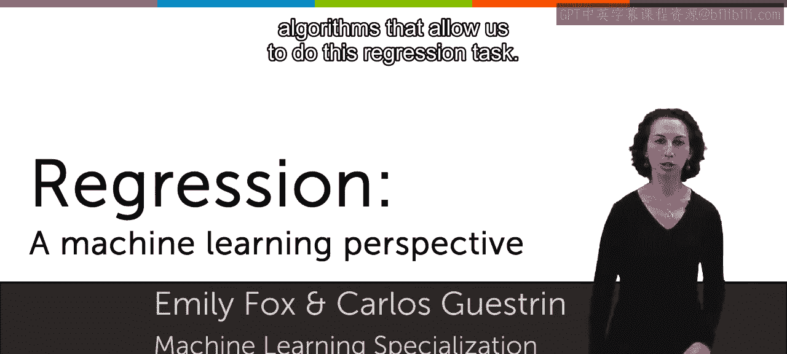
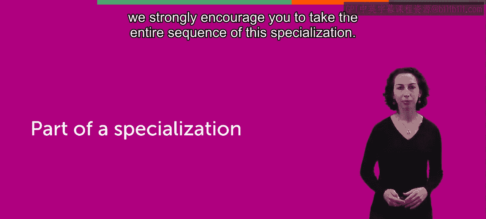
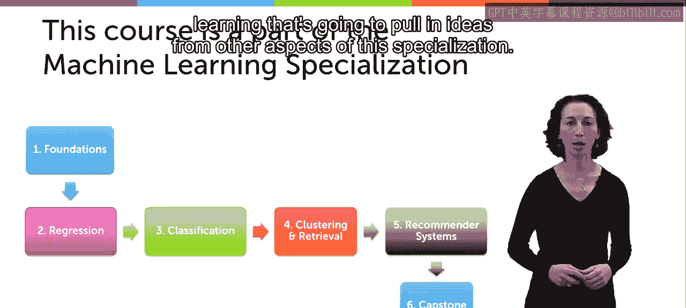

# 机器学习专项课程：第2课：回归课程介绍 🎯

在本节课中，我们将要学习回归分析，这是从数据中提取信息最广泛使用的统计学和机器学习工具之一。我们将深入探讨其背后的模型与算法，而不仅仅是停留在表面的应用。

---

欢迎来到机器学习专项课程的回归部分。回归是从数据中获取信息最广泛使用的统计学和机器学习工具之一。其方法应用广泛，从预测股票价格到理解基因调控网络均可实现。

在专项课程的第一课中，我们从宏观层面讨论了回归并实现了一些方法。在本课程中，我们将深入更多细节，真正探究支撑我们完成回归任务的底层模型和算法。

---

本课程是机器学习专项课程的一部分，该系列课程设计为按特定顺序学习。虽然你可以将本课程作为独立课程学习，但为了获得我们预期的完整学习体验，我们强烈建议你按顺序学习整个专项课程。

具体来说，我们假设你已经学习了“基础”课程的内容。该课程对本专项将涵盖的所有内容进行了宏观概述，并让你对不同方法进行了实践练习。

---

本课程聚焦于回归分析。作为课程的一部分，我们将教授一系列在机器学习多个领域都非常有用的通用概念。虽然我们将在回归模型和算法的背景下描述这些内容，但其中一些概念将贯穿整个专项课程。

后续课程将包括分类、聚类与检索、推荐系统等。所有这些内容将以一个顶点项目作为总结，该项目涉及深度学习，并将融合本专项其他方面的知识。

---

本节课中，我们一起学习了回归课程的整体介绍、它在专项课程中的位置以及即将学习的核心内容。我们了解到，回归是一个强大的数据分析工具，本课程将深入其原理，并学习对后续机器学习领域至关重要的通用概念。