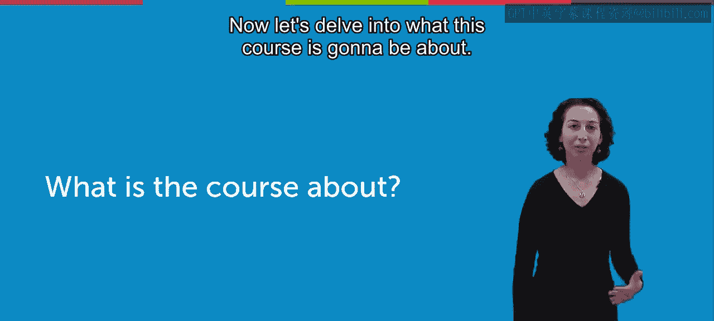
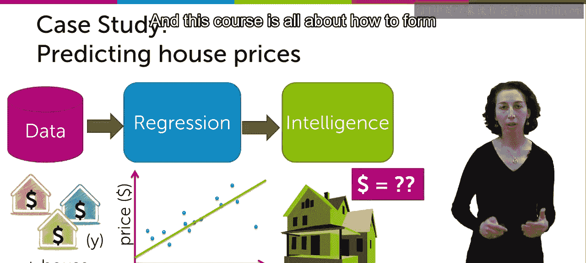
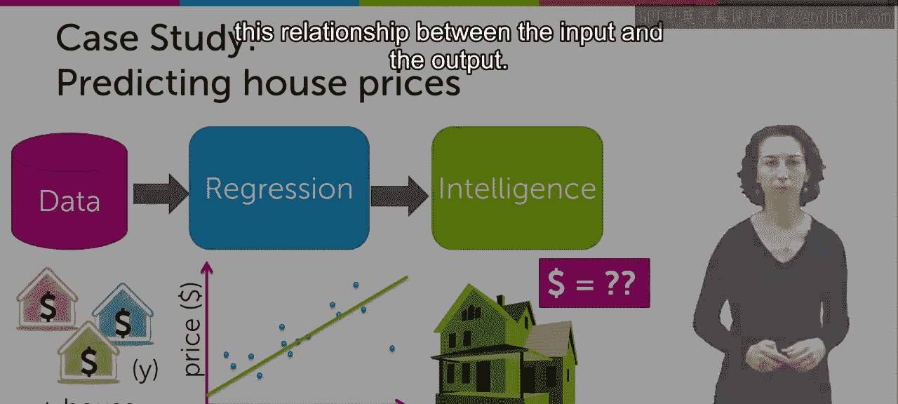

# 华盛顿大学《机器学习（回归，第2课⧸共4课）｜Machine Learning》中英字幕 p02 1_课程内容是什么.zh_en -BV11b421H7XL_p2-

。

Now let's delve into what this course is going to be about。

Well in the foundations course， we talked about how machine learning is about deriving intelligence from data and in this course。

 the machine learning method that we're going to focus on is regression and in particular what regression is going to assume is that we have some features that are derived from our data that are the input to our regression model and then our goal will be to predict some continuous valued output or response to the input。

 and the way we're going to do this is by learning a relationship between our inputs X and this output Y。

For example， maybe you're interested in how taking this machine learning specialization is going to pay off for you in the end。

 so you're sitting here you're doing a lot of really hard work。

And you wonder where this is going to land you well。

 maybe a question you might be interested in is what will your salary be after taking this specialization？

And so we can think about predicting what your salary is based on things like what your performance was in the various courses。

 the quality of your capstone project， how many form responses you were participating in and different features like this。

 so this would be the input to the regression model and the prediction。

 the output that we're trying to predict would be your expected salary at the end of this specialization。

Another example is predicting the price of a stock， and to form this prediction。

 maybe we expect that this would depend on the past history of the stock。

 as well as perhaps recent news events， in addition to the trends in other related commodities。

Or maybe you tweeted something。 and you want to know how many people are going to retweet what you tweeted。

 Well， this might depend on how many followers you have。

 how many followers followers have local structure of your follower network what hashtags you used。

 how many retweets you've had in the past and other features like this。

 Another example that we're going to talk about in this course is a really cool example of reading your mind where you go and you get some kind of brain scan could be FMRI or MEG and for our sake。

 we're just going to think of it as producing an image of your brain。

 even though the truth as it produces something more complicated。

 but we can think of all the different pixel intensities as inputs to a regression model where the goal of the output is to predict whether you felt happy or sad in response to something you were shown when you were getting that brain scan。

 So it's reading your mind because we want to guess how you're feeling just from an image of your brain。

But in this course， we're going to focus in on a case study of predicting house prices。

So in particular， a question we're going to ask is what's the value of a given house。

 maybe you want to sell your house and you want to figure out how much to list that house for and so we're going to derive this intelligence by looking at some data and the data we're going to look at include。

Other house sales so we're going to have the sales price associated with a bunch of other houses as well as the house attributes of these other houses and from these inputs to the house attributes。

 we're going to learn this relationship between house attributes and the output。

 which is the sales price and use this learned model in order to make the prediction of the value of your house。

And this course is all about how to form this relationship between the input and the output。

