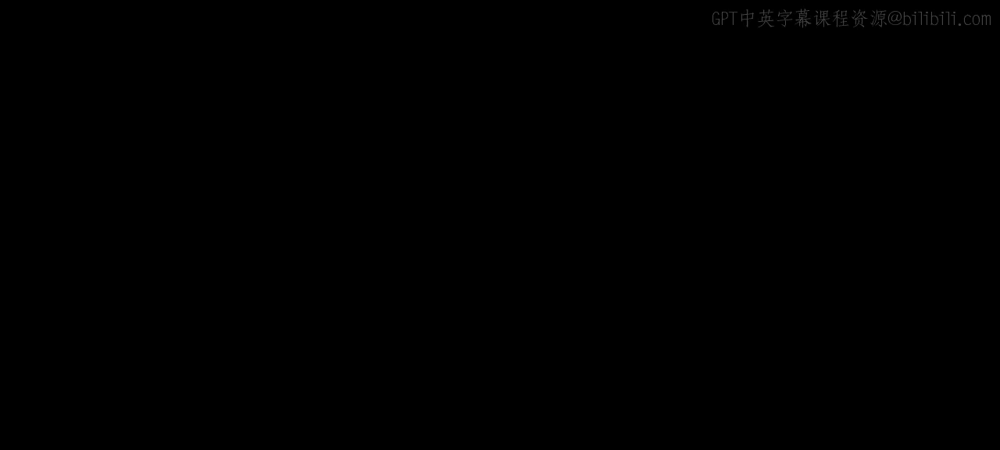
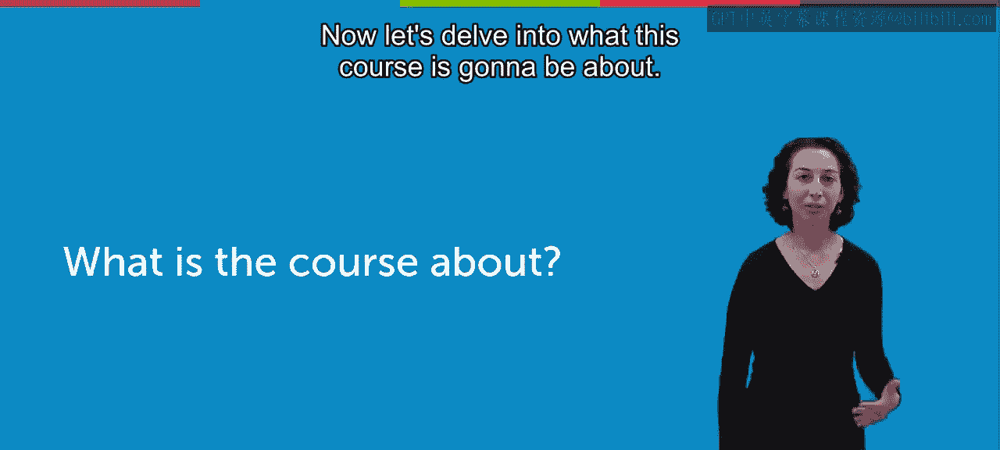
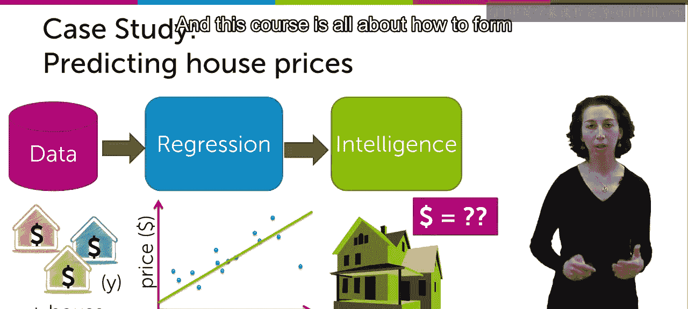
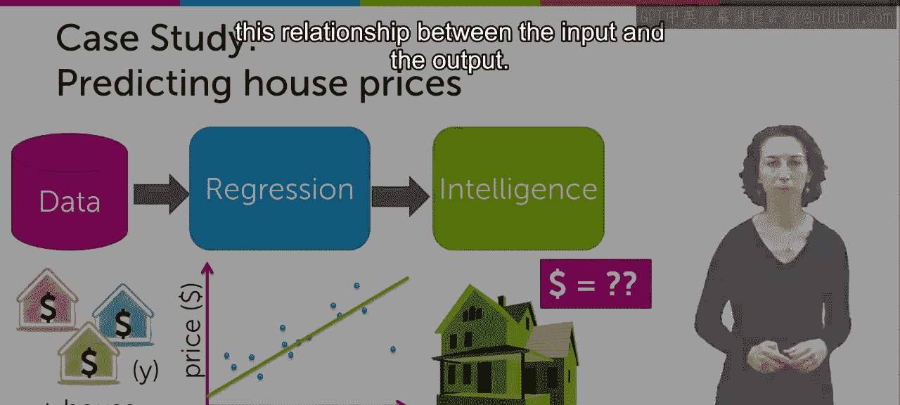

# 机器学习（回归）：第2课：课程内容是什么 🎯

在本节课中，我们将要学习回归分析的基本概念及其在机器学习中的应用。我们将通过具体案例，理解如何利用数据特征预测连续值输出，并初步了解本课程的核心案例——房价预测。

---

现在，让我们深入探讨本课程的主要内容。

在基础课程中，我们讨论了机器学习如何从数据中提取智能。在本课程中，我们将重点关注的机器学习方法是**回归分析**。回归分析的核心假设是：我们拥有从数据中提取的某些特征，这些特征作为回归模型的输入；我们的目标是预测一个连续的数值输出或对输入的响应。

我们将通过学习输入 **X** 与输出 **Y** 之间的关系来实现这一目标。

---

例如，你可能想知道学习这门机器学习专项课程最终会为你带来什么回报。你正在投入大量努力，并好奇这会引领你走向何方。一个你可能感兴趣的问题是：完成此专项课程后，你的薪资会是多少？

我们可以考虑基于以下特征来预测你的薪资：你在各门课程中的表现、你的毕业项目质量、你参与了多少次论坛回复等。这些特征将作为回归模型的输入，而我们试图预测的输出则是你完成此专项课程后的预期薪资。

另一个例子是预测股票价格。要形成这个预测，我们可能预期它会依赖于该股票的历史价格、最近的新闻事件以及其他相关商品的趋势。

或者，也许你发布了一条推文，想知道会有多少人转发。这可能取决于你的粉丝数量、你粉丝的粉丝数量、你的粉丝网络结构、你使用的标签、你过去获得的转发次数等特征。

本课程将讨论的另一个非常酷的例子是“读心术”。当你进行某种脑部扫描（如fMRI或MEG）时，我们可以将其视为生成一张你的大脑图像。我们可以将所有不同的像素强度作为回归模型的输入，而模型的输出目标是预测你在接受扫描时，对所展示事物的感受是快乐还是悲伤。这之所以是“读心术”，是因为我们想仅从大脑图像中猜测你的感受。

---

但在本课程中，我们将聚焦于一个具体案例研究：**预测房价**。

具体来说，我们要回答的问题是：一栋给定房屋的价值是多少？也许你想出售房屋，并需要确定挂牌价格。我们将通过查看数据来获取这种智能。我们将查看的数据包括：

以下是用于预测房价的关键数据输入：

*   **其他房屋的销售记录**：我们将获取大量其他房屋的销售价格。
*   **这些房屋的属性特征**：例如面积、卧室数量、地理位置等。

从这些房屋属性输入中，我们将学习房屋属性与输出（销售价格）之间的关系，并利用这个学习到的模型来预测你的房屋价值。

本课程的全部内容就是关于如何建立输入与输出之间的这种关系。

---

本节课中，我们一起学习了回归分析的基本目标：利用输入特征预测连续值输出。我们通过薪资、股票价格、社交媒体互动甚至“读心术”等生动例子，理解了回归的广泛应用。最后，我们明确了本课程将围绕**房价预测**这一核心案例，学习如何从房屋属性数据中建立模型，以预测其销售价格。在接下来的课程中，我们将深入探讨实现这一目标的具体方法。