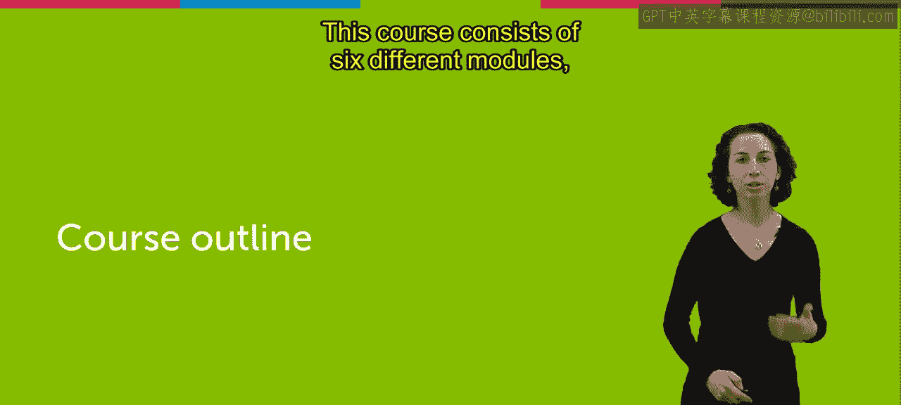
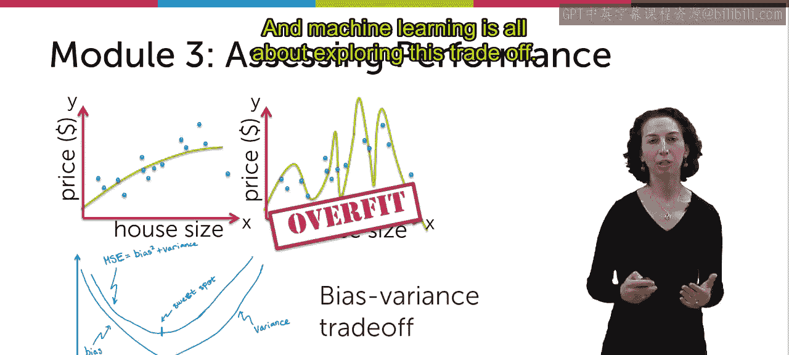

# 华盛顿大学《机器学习（回归，第2课⧸共4课）｜Machine Learning》中英字幕 p03 2_课程前半部分概述.zh_en -BV11b421H7XL_p3-

。

This course consists of six different modules and let's preview what these are about。

To start with， we're going to talk about simple regression and why is it called simple regression。

 that's because we're going to focus on just having a single input， for example。

 the size of your house。And when we think about defining the relationship between the single input and our output。

 the house sales price， we're just going to look at fitting a very simple line to this data。

 and that's why it's called simple regression。And one thing we're going to need to do in order to discover what the best fitted line is is we're going to need to define something called a goodness of fit metric that allows us to say that some lines fit better than other lines。

 and according to this metric， we can then search over all possible lines to find the one that fits the data the best So in the context of this goodness of fit metric we're then going to discuss some important optimization techniques that are much more general than regression itself。

 So this is an example of one of these general concepts that we're going to see again。

 many times in the specialization。 And the method that we're going to explore here is something called gradient descent。

 So in the context of our regression problem。 and we have just a simple line， a question is， well。

 what's the slope and what's the intercept of this line that minimizes this goodness of fit metric。

 So this blue curve I'm showing here is showing how good the fit is where lower means actually a better fit。

And we're going to try and minimize over all possible combinations of intercepts and slopes to find the one that fits best。

 so this gradient ofcent algorithm is an iterative algorithm that's going to take multiple steps and eventually go to this optimal solution that minimizes this metric measuring how well this line fits。

Then once we've found this minimum， so we found the best intercept in slope。

 what we're going to talk about is how to think about interpreting these estimated parameters and then how to use these parameters to form our predictions。

We're then going to move from simple regression to multiple regression。

 and multiple regression allows us to fit more complicated relationships between our single input and our output。

So more complicated than just a line as well as to consider more inputs in our model。

 so for our housing application maybe in addition to a measure of the size of the house we have something talking about how many bedrooms there are。

 how many bathrooms， what the lot size is， what year the house was built and we might have a whole bunch of different attributes of the house that we want to incorporate into forming our predictions and that's what multiple regression allows us to do。

Having learned how to fit these models to data， we're then going to turn to how to assess whether the fit is any good。

 for example， in forming predictions。For example， this fit shown here between house size and house price seems to be pretty good。

 but if we go to a much more complicated model， we see that it's doing really crazy things but if you look carefully this function。

 this fitted function is actually explaining our observed data these circles really well but what it's not doing is it's not able to generalize to predictions of new houses that we haven't observed because at least I wouldn't use this to form predictions of my house value。

 I wouldn't really believe that this is a relationship between house size and price。

 so question is what's going wrong here and this is something that we call overfitting to the data and we're going to talk about this in great length in this module of the course。

In particular， we're going to define three different measures of error， one called training error。

 one is called test error， and the other is called our generalization or truee error。

 and that's actually the error we really want to form。

 but we're going to show that that is something that we can actually attain and we have to use proxies instead。

 and we're going to look at these measures of error as a function of model complexity to describe this notion of overfitting。

Then we're going to discuss these ideas in the context of something called the biasvariance tradeoff and what this describes is the fact that simple models tend to be really well behaved but they're often just too simple to really describe the relationship that we're interested in。

 on the other hand， really complex models are really flexible so they have the potential to fit really intricate relationships that might describe pretty well what's happening with the data。

 but unfortunately these really， really complex models can have very strange behavior。

 and so this leads to what's called this bias variant tradeoff and machine learning is all about exploring this tradeoff。

