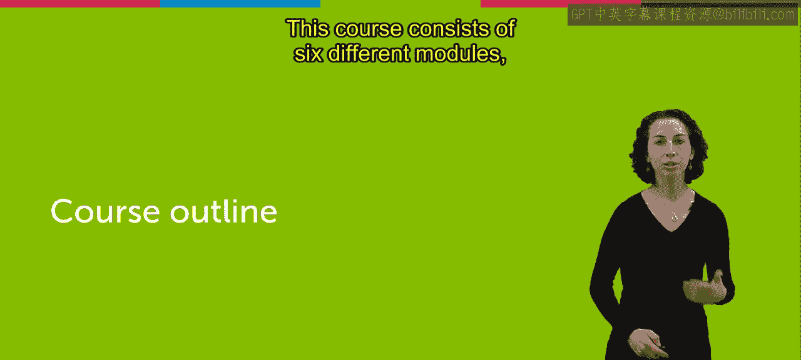
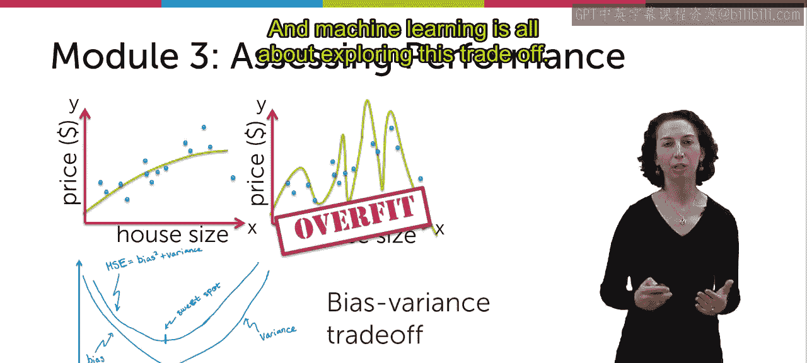

# 机器学习（回归）：第2课：课程前半部分概述 📚

在本节课中，我们将预览机器学习回归课程前半部分的核心内容。课程包含六个不同的模块，我们将逐一介绍每个模块的主题和目标。

## 模块一：简单回归 📈

首先，我们将讨论简单回归。之所以称为“简单”回归，是因为我们只关注单个输入变量，例如房屋面积。在定义这个单一输入与输出（如房屋售价）之间的关系时，我们仅考虑用一条简单的直线来拟合数据，因此得名简单回归。

为了找到最佳拟合线，我们需要定义一个**拟合优度度量**。这个度量标准允许我们判断某些直线比其他直线拟合得更好。根据这个度量，我们可以搜索所有可能的直线，以找到对数据拟合最佳的那一条。

## 模块二：优化技术 ⚙️

在定义了拟合优度度量的背景下，我们将讨论一些重要的优化技术。这些技术比回归本身更具普适性，是本专项课程中会反复出现的核心概念之一。

我们将在此探索的方法是**梯度下降法**。在我们的回归问题中，对于一条简单的直线，核心问题是：什么样的斜率和截距能使拟合优度度量最小化？下图中的蓝色曲线展示了拟合优度，数值越低代表拟合越好。

我们将尝试在所有可能的截距和斜率组合中，找到拟合最佳的组合。梯度下降法是一种迭代算法，它将通过多个步骤最终找到使拟合度量最小化的最优解。

## 模块三：参数解释与预测 🔮

一旦我们找到了最小值，即确定了最佳截距和斜率，接下来将讨论如何解释这些估计参数，以及如何利用这些参数进行预测。

## 模块四：多元回归 🏠

我们将从简单回归过渡到多元回归。多元回归允许我们拟合输入与输出之间更复杂的关系（不仅仅是直线），并能在模型中考虑更多的输入变量。

例如，在房价预测应用中，除了房屋面积，我们可能还想纳入卧室数量、浴室数量、地块大小、建造年份等一系列不同的房屋属性。多元回归使我们能够将这些因素整合到预测模型中。

## 模块五：模型评估与过拟合 ⚖️

在学习了如何将模型拟合到数据之后，我们将转向如何评估拟合的好坏，尤其是在进行预测时。

例如，下图所示的房屋面积与房价之间的拟合看起来相当不错。但如果我们使用一个复杂得多的模型，可能会发现它做出了非常奇怪的行为。仔细观察，这个复杂的拟合函数确实很好地解释了我们的观测数据（图中的圆圈）。然而，它无法推广到预测我们未观测到的新房屋。至少，我不会用这个模型来预测我的房屋价值，因为我不相信这是房屋面积与价格之间的真实关系。

这里出现的问题被称为**过拟合**。在本模块中，我们将详细讨论这个问题。

具体来说，我们将定义三种不同的误差度量：
*   **训练误差**
*   **测试误差**
*   **泛化误差**（或真实误差），这是我们真正希望得到的误差。

我们将证明，泛化误差实际上是我们无法直接获得的，必须使用代理指标（如测试误差）来代替。我们将通过观察误差度量随模型复杂度变化的趋势，来描述过拟合的概念。

## 模块六：偏差-方差权衡 ⚖️

最后，我们将在**偏差-方差权衡**的背景下讨论这些概念。这个权衡描述了以下事实：简单模型通常行为良好，但往往过于简单，无法描述我们感兴趣的真实关系；另一方面，非常复杂的模型非常灵活，有潜力拟合非常复杂的关系，从而很好地描述数据，但不幸的是，这些极其复杂的模型可能表现出非常奇怪的行为。

因此，这导致了所谓的偏差-方差权衡。机器学习在很大程度上就是探索这种权衡。

---

**本节课总结**：我们一起预览了机器学习回归课程前半部分的六个核心模块，从基础的简单回归和优化方法，到更复杂的多元回归，再到关键的模型评估、过拟合问题以及机器学习中核心的偏差-方差权衡概念。