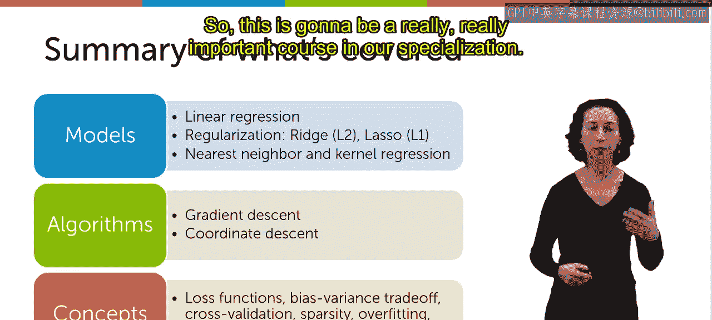
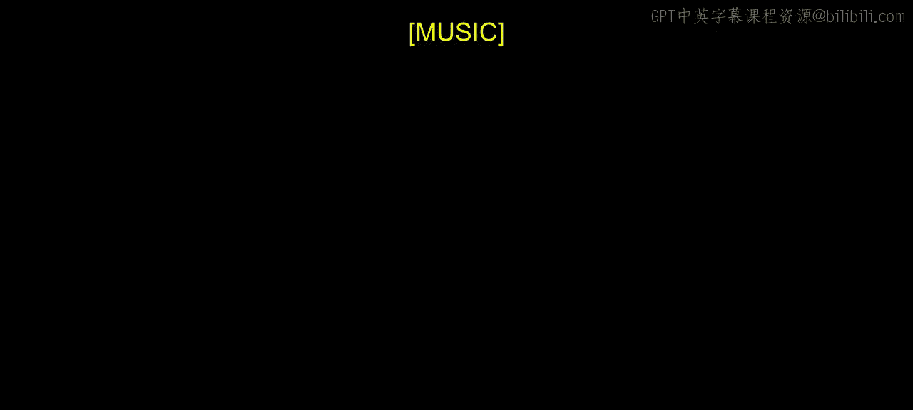

# 华盛顿大学《机器学习（回归，第2课⧸共4课）｜Machine Learning》中英字幕 p04 3_课程后半部分概述.zh_en -BV11b421H7XL_p4-

。

As one example of a way to handle this bias varianceance tradeoff。

 we're going to talk about something called Rige regression。

 which not only includes a term that measures the fit of the function to the data。

 which is what we talked about before， but also incorporates a term that encodes what the model complexity is。

 not quite directly pretty indirectly as we're going to describe in this module。

But a key question then is， how are we going to？Define the balance between how much we emphasize the fit to data versus this model complexity term and for this in Rige regression there's a parameter that balances between these two terms and to define this parameter。

 we're going to discuss choosing it using something called cross validationation and this again is a tool that's much more general than just for regression and is an idea for how to choose these tuning parameters in any machine learning model that we might look at。

Next we're going to discuss a feature selection task， so for example。

 I have my house that I want to list for sale and I might have a really。

 really long list of house attributes associated with this house。

And I want to figure out which are those subset of attributes that are really informative for assessing the value of my house。

 so for example， maybe it doesn't really matter the fact that my house has a microwave when I'm going to predict the value of the house so for reasons of interpretability。

 it can be really useful to do this feature selection。Task and in addition。

 we're going to show that if we have just a few set of features in our model after we've done this feature selection。

 then that can lead to significant increases in efficiencies inform forming our predictions。

And so to do this feature selection task。The first thing we're going to talk about are ways to explicitly search between models that include different sets of features。

But then we're going to turn to a method that's really。

 really similar in spirit to Rige regression that allows us to do this feature selection task implicitly in particular。

 again， we're going to have this measure of fit of our function to our data and a measure of the model complexity。

 but it's going to be a different measure than what we use for Ridge and this measure in particular is what's going to lead to these what are called sparse solutions where only a few of the features are actually present in our estimated model。

And we're going to use this Lasso regression task as an opportunity to teach about another optimization method that's called coordinate descent。

 So we talked about gradient descent earlier and this is another one of these really important optimization methods that we're going to see again later in this specialization and what coordinate descent does is instead of solving a big high dimensionional optimization objective。

It's going to go coordinate by coordinate， so variable by variable optimizing each in turn。

 so we're going to end up making these axis aligned moves as we iterate in this algorithm so again just like gradient tocent it's an iterative procedure。

 but it's fundamentally a different formulation for how these iterates are defined。Finally。

 we're going to conclude by discussing something called nearest neighbor regression。

 which is a really simple but very， very powerful technique。

 So in the simplest case that we're going to describe。

 if I'm interested in predicting the value of my house。

 what I'm going to do is I'm going to go through my dataset set and I'm going to find the most similar house to mine。

 Then I'm simply going to look at the how much that house sold for。

 and I'm going to say that's what I'm predicting my house sales price to be。Well。

 you can generalize this idea of just looking at the most similar house to looking at a set of similar houses and then taking the average value of those houses as your prediction。

But what you can also do is something that's called kernel regression。

 where you actually include every observation in your data informing your predicted value。

 but you' when you go to compute this average， you're going to weight the houses。

 by how close they are to you， so houses that are very similar。

 which are quote unquote nearby to you in this space of similarity are going to be weighted very heavily in this weighted average and houses that are very dissimilar are going to be down weighted a lot。

And this leads to these really nice fits for regression and they're very adaptive as you get more data。

 you can describe more and more complicated relationships。

So these methods are useful when you have lots of data and we're going to discuss this data versus complexity tradeoff in this module so in summary。

 we're going to cover a lot of ground in this course so we're going to talk about all different types of models for regression。

 but we're also going to talk about very general purpose。

 optimization algorithms like gradient descent and coordinate descent and a whole bunch of concepts that are really foundational to machine learning。

 including things like the biasvaris tradeoff cross validation for selecting tuning parameters。

 ideas of sparsity and overfitting and how to do model selection and feature selection so this is going to be a really really important course in our specialization。

