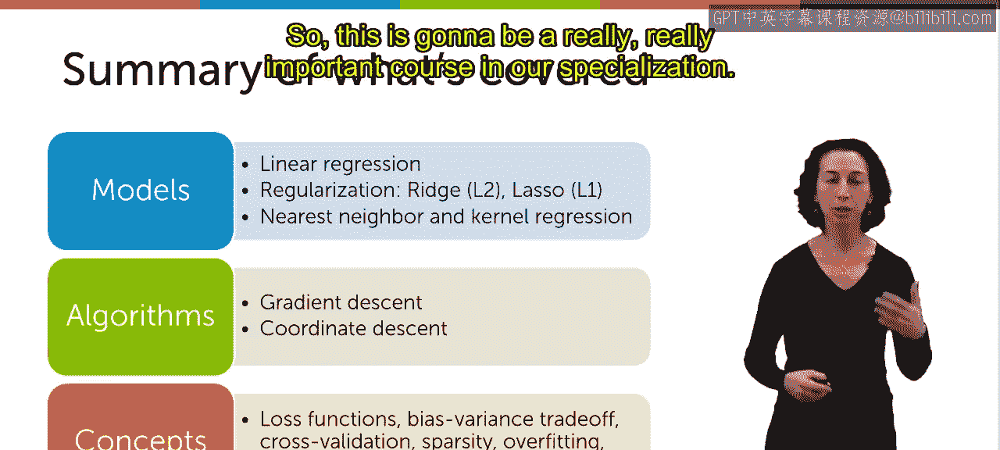

# 机器学习：第2课：课程后半部分概述

在本节课中，我们将学习回归分析中几个核心的高级概念与方法。我们将探讨如何平衡模型复杂度与拟合度，如何选择重要特征，以及一些强大的回归技术。这些内容将帮助我们构建更准确、更高效的预测模型。

## 处理偏差-方差权衡：岭回归

上一节我们介绍了模型拟合与复杂度之间的权衡。本节中，我们来看看一种具体处理此问题的方法：岭回归。

岭回归不仅包含衡量函数对数据拟合程度的项，还引入了一个编码模型复杂度的项。其核心目标函数公式如下：

**目标函数 = 拟合误差项 + λ × 模型复杂度惩罚项**

其中，λ 是一个关键参数，用于平衡“拟合数据”和“控制模型复杂度”这两个目标。λ 值越大，对复杂模型的惩罚越重。

## 选择平衡参数：交叉验证

那么，如何确定这个平衡参数 λ 的最佳值呢？我们将使用一种称为**交叉验证**的方法。

交叉验证是一种通用的工具，不仅限于回归问题，它适用于任何需要选择调优参数的机器学习模型。以下是交叉验证的基本步骤：

1.  将数据集随机分成若干份（例如5份）。
2.  依次将其中一份作为验证集，其余作为训练集。
3.  用训练集训练不同 λ 值的模型，并在验证集上评估性能。
4.  选择在验证集上平均性能最好的 λ 值。

## 识别重要特征：特征选择任务

在实际问题中，我们可能拥有大量特征。例如，预测房价时，特征可能包括面积、卧室数量、是否有微波炉等。特征选择的目标是找出对预测真正有信息量的特征子集。

这样做有两个好处：一是提高模型的可解释性，二是使用更少的特征可以显著提升预测效率。

为了完成特征选择，我们首先会讨论如何显式地搜索包含不同特征集的模型。接着，我们将转向一种与岭回归思想相似，但能隐式进行特征选择的方法。

## 隐式特征选择：套索回归

这种方法就是**套索回归**。与岭回归类似，它的目标函数也包含数据拟合项和模型复杂度惩罚项，但惩罚项的定义不同。

套索回归使用的惩罚项会导致所谓的**稀疏解**，即最终模型中只有少数特征的系数不为零，从而自动实现了特征选择。其目标函数可表示为：

**目标函数 = 拟合误差项 + λ × Σ|系数|**

## 优化新方法：坐标下降法

我们将以套索回归为例，学习另一种重要的优化算法——**坐标下降法**。

之前我们介绍了梯度下降法。坐标下降法是另一种迭代优化算法，其核心思想是：不直接求解高维优化目标，而是逐个坐标（即逐个变量）进行优化。在每次迭代中，它沿着坐标轴方向移动，依次优化每个参数。

## 简单而强大的技术：最近邻回归

最后，我们将讨论一种非常简单但功能强大的技术：**最近邻回归**。

在最简单的情况下，如果我想预测我的房子的价格，我会在数据集中找到与我的房子最相似的房子，然后直接将该房子的售价作为我的预测值。

我们可以将这个思想推广：不是只看最相似的房子，而是看一组相似的房子，然后取这些房子价格的平均值作为预测。更进一步，可以使用**核回归**：数据集中每一个观测值都会影响预测值，但在计算平均值时，会根据每个房子与目标房子的相似度进行加权。非常相似的房子权重很高，非常不相似的房子权重则很低。

这种方法能产生非常漂亮的回归拟合结果，并且具有很好的适应性：随着数据增多，它可以描述越来越复杂的关系。当拥有大量数据时，这些方法非常有用。在本模块中，我们也将讨论数据量与模型复杂度之间的权衡。

## 总结

本节课中，我们一起学习了回归分析中多个重要的领域。我们不仅讨论了岭回归、套索回归、最近邻回归等多种回归模型，还介绍了梯度下降、坐标下降等通用优化算法。同时，我们深入理解了机器学习的一些基础核心概念，包括偏差-方差权衡、用于选择调优参数的交叉验证、稀疏性、过拟合以及模型与特征选择。这些内容构成了我们专业课程体系中非常重要的一部分。