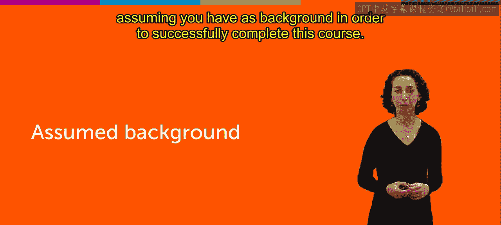
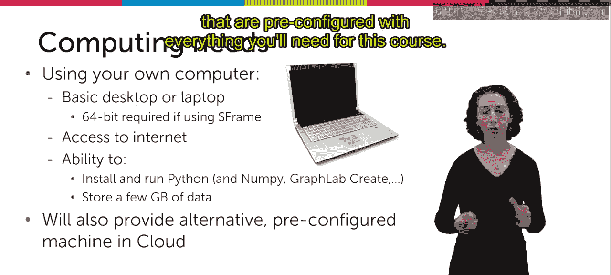

# 华盛顿大学《机器学习（回归，第2课⧸共4课）｜Machine Learning》中英字幕 p05 4_假定背景知识.zh_en -BV11b421H7XL_p5-

。

But before we delve into the course itself， let's just talk about what we're assuming you have as background in order to successfully complete this course。

So in terms of math background， we're assuming that you know very basic calculus。

 like how to take the derivative of a single variable function。

 but even that we're going to walk through fairly slowly。

 but it's good if you remember it We're also going to assume that you know how to do very basic linear algebra manipulations like how to multiply to vectors or two matrices and also of course what the notion is of a matrix and a vector but again。

 we're going to step through these ideas fairly slowly at the beginning of the course in terms of programming experience。

 we've tried to make this course as open as possible to people having preferences in different languages we're going to encourage the use of Python but this is not actually required So all of our programming assignments。

 we're going to provide you with some starter code and that starter code will be in Python So of course it's helpful if you are familiar with Python but again。

 you're welcome。Use any language you would like， we're focused on teaching you the concepts of machine learning rather than any specific implementation details。

 but I should mention that if you did the programming assignments for the first course。

 you are set for what will be required in this course。So in the first course of this specialization。

 we relied on pre-implemented algorithms like GraphLb createate。

 but in this course we're actually going to teach you all the algorithmic details and how to implement these algorithms so that you can code these up yourself so in particular in this course we're suggesting that you use S frames which from the first course you remember is an open source library that allows for really scalable and efficient data manipulation but you're welcome to use any data structure that you would like。

 or libraries such as pandas。And for our assignments。

The structure of assignments are going to start with exploring high levelvel concepts in the first part and then delving into the implementation details of each of the algorithms。

 so for the first part we're going to encourage the use of pre implementedplemented algorithms so that you can test these high- levelvel concepts without getting bogged down and potential bugs in your actual implementation and then in the second part once you've explore those concepts。

 then we're going to have you actually implement all the algorithms from scratch without relying on these pre-implemented methods。

If you're using Python， you will be using the Numpy library for manipulating matrices and vectors。

Okay， so the net result is that in this course， you're really going to get your hands dirty in implementing all the methods related to regression that you saw in the first foundational course of the specialization。

 as well as a bunch of new methods that we're going to explore in this course。So finally。

 let's discuss what computing resources you guys need， and there are two options。

 either you have your own computer and it can actually be a fairly basic computer。

 but if you're going to use S frames， you're going to need a 64 bit machine。

You'll also need to have access to the internet， of course。

 to watch these wonderful videos as well as to implement your programming assignments and you'll need the ability to install and run Python and any libraries we're using associated with that and to store a few gigabytes of data。

But the alternative， especially if you don't have a 64 bit machine。

 is we're providing a set of machines in the cloud that are preconfigured with everything you'll need for this course。

 so all you'll need is internet access to access those machines in the cloud。

So now that you guys are psyched about this course， let's get started。

