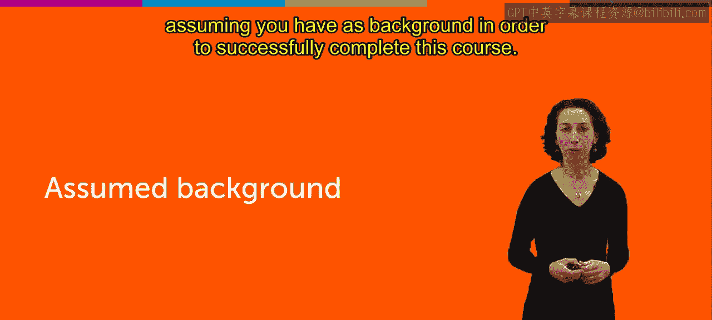
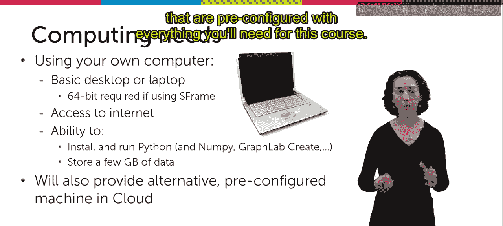
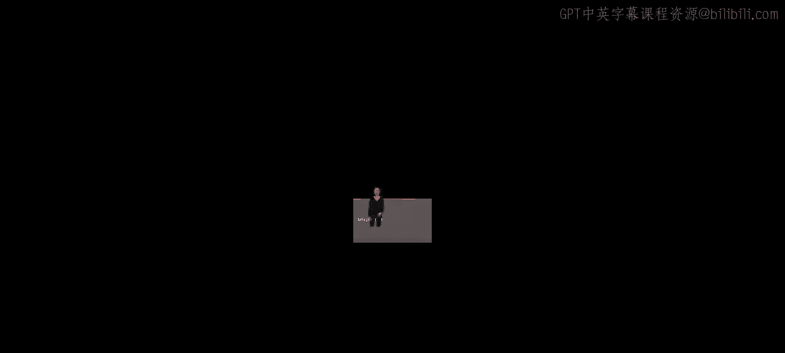

# 机器学习（回归）：第2课：课程背景知识要求 📚

在本节课中，我们将介绍成功学习本课程所需具备的背景知识。了解这些前提条件有助于你更好地准备并跟上课程进度。

---

## 数学背景要求

上一节我们介绍了课程的整体情况，本节中我们来看看对数学基础的要求。我们假设你具备非常基础的微积分知识。

以下是具体的数学知识要求：

*   **基础微积分**：例如，知道如何对单变量函数求导。课程会以较慢的节奏回顾这些内容，但如果你还记得会很有帮助。
*   **基础线性代数**：例如，知道如何进行向量或矩阵的乘法，以及理解矩阵和向量的基本概念。同样，课程初期会逐步讲解这些内容。

---

## 编程背景要求

在明确了数学要求后，我们接下来看看编程方面的要求。我们努力使本课程对各种编程语言偏好的学习者都尽可能开放。

以下是编程相关的具体说明：

*   **推荐语言**：我们鼓励使用 **Python**，但这并非强制要求。
*   **起始代码**：所有编程作业都会提供一些起始代码，这些代码将使用 **Python** 编写。因此，熟悉 Python 会很有帮助，但你也可以使用任何你喜欢的语言。
*   **课程重点**：我们的重点是教授机器学习的概念，而非具体的实现细节。
*   **与前一课程的关系**：如果你完成了本专项课程第一门课的编程作业，那么你已经具备了学习本课程所需的编程基础。
*   **实现深度**：在第一门课中，我们依赖了如 `GraphLab Create` 这样的预实现算法。而在本课程中，我们将教授你所有算法的细节以及如何实现它们，以便你能自己编写代码。

---

## 工具与作业结构

了解了背景知识后，我们来看看课程中将使用的工具以及作业的组织方式。

以下是关于工具和作业结构的详细信息：

*   **数据工具**：本课程建议你使用 **SFrame**（一个开源库，可实现可扩展且高效的数据操作）。你也可以使用任何你喜欢的数据结构或库，例如 **pandas**。
*   **作业结构**：作业结构分为两部分。
    1.  **第一部分**：探索高级概念。我们鼓励使用预实现的算法，以便你能在不被自己实现中潜在错误困扰的情况下测试这些高级概念。
    2.  **第二部分**：实现算法细节。在探索了相关概念后，你将从头开始实现所有算法，而不依赖任何预实现的方法。
*   **Python 库**：如果你使用 Python，你将使用 **NumPy** 库来操作矩阵和向量。

最终，在本课程中，你将亲自动手实现专项课程第一门基础课中见过的所有回归相关方法，以及本课程将要探索的一系列新方法。

---

## 计算资源要求

最后，我们来讨论一下所需的计算资源。这里有两个选项可供选择。

以下是两种计算资源方案：

*   **使用自己的计算机**：你可以使用自己的电脑，配置可以相当基础。但如果你打算使用 **SFrame**，则需要一台 **64 位** 的机器。此外，你还需要：
    *   能够访问互联网（用于观看视频和完成编程作业）。
    *   能够安装并运行 Python 及相关库。
    *   能够存储几 GB 的数据。
*   **使用云端机器**：特别是如果你没有 64 位机器，我们提供了一组云端机器，它们已预配置好本课程所需的一切。你只需要能访问互联网来使用这些云端机器即可。

---

## 总结

本节课中，我们一起学习了成功学习本回归课程所需的背景知识。我们明确了所需的数学基础（微积分和线性代数）、编程准备（推荐Python，但非强制）、课程将使用的工具（如SFrame、NumPy）以及作业的结构（先探索概念，再动手实现）。最后，我们了解了两种满足计算资源需求的方案：使用自己的64位计算机或使用我们提供的云端机器。现在，让我们正式开始课程的学习。