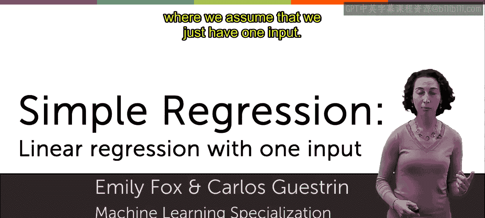
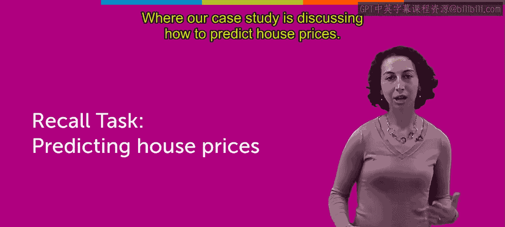
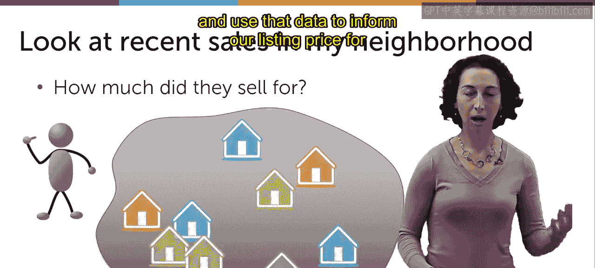

# 华盛顿大学《机器学习（回归，第2课⧸共4课）｜Machine Learning》中英字幕 p06 5_预测房价的案例研究.zh_en -BV11b421H7XL_p6-

。

Okay so for the first part of our course on regression。

 we're going to start with something that's called simple regression and as the name implies it's just a very simple form of regression where we assume that we just have one input and we're just trying to fit a line okay but before we get to starting to talk about this simple regression model。

 let's just recall our task of interest where our case study is discussing how to predict house prices so in particular we have some house that we want to list for sale but we don't know the value of this house and as we discussed at fairly great length in the first course of this specialization what we're going to do in this case is we're going to look at other houses that sold in the recent past and look at how much they sold in different characteristics of those houses and use that data to inform our listing price for our house that we'd like to sell。

