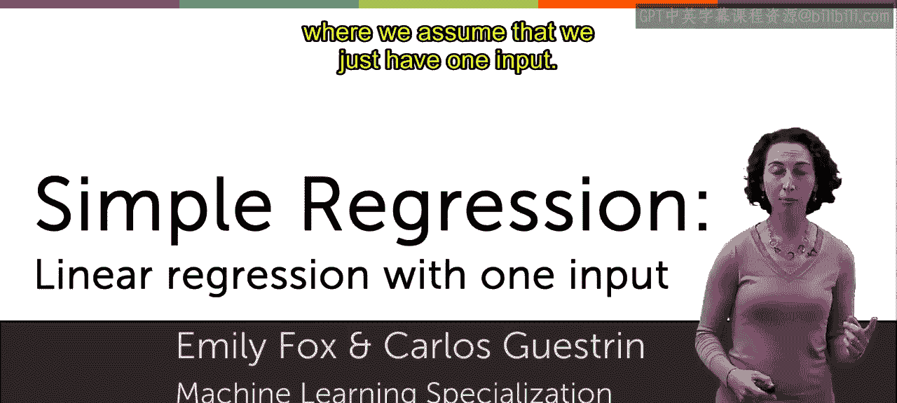
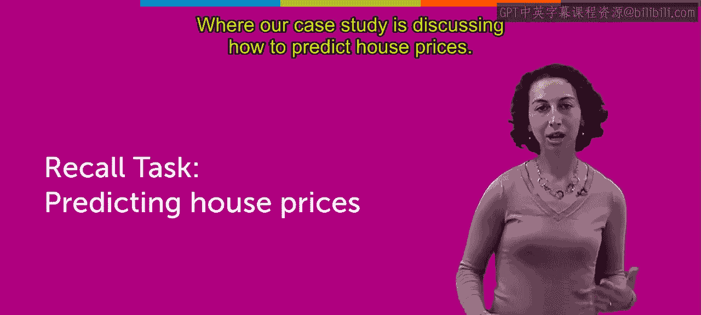
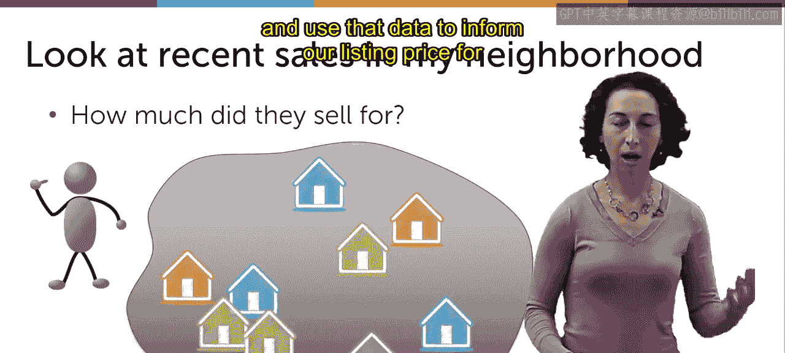

# 机器学习：回归：第2课：预测房价的案例研究 🏠

在本节课中，我们将开始学习回归分析的第一部分——简单回归。我们将通过一个预测房价的案例研究，来理解回归模型的基本概念和应用。

---

## 概述

简单回归，顾名思义，是回归分析中最简单的形式。它假设我们只有一个输入特征，并试图拟合一条直线来描述数据。在深入探讨简单回归模型之前，我们先回顾一下我们的核心任务：预测房价。

---

## 案例研究：预测房价

我们的案例研究围绕如何预测房价展开。具体来说，我们有一套房子想要出售，但不确定它的市场价值。

正如我们在本系列课程的第一课中详细讨论的，解决这个问题的标准方法是：参考近期售出的其他房屋的数据。我们将分析这些已售房屋的售价及其各种特征（例如面积、卧室数量等），然后利用这些数据来为我们想要出售的房屋制定一个合理的挂牌价格。

上一节我们介绍了回归分析的整体目标，本节中我们来看看如何将这个目标应用到一个具体的预测问题中。

---

## 简单回归模型简介

简单回归模型是我们处理这类预测问题的起点。它只考虑一个输入特征（例如房屋面积）与输出目标（例如房屋售价）之间的关系，并用一条直线来拟合这种关系。

以下是构建简单回归模型的核心步骤：

1.  **收集数据**：获取包含输入特征（如房屋面积）和对应输出（如售价）的历史数据。
2.  **选择模型**：假设特征与目标之间存在线性关系，模型形式为 `y = w0 + w1 * x`。
    *   **y** 是预测的房价（目标变量）。
    *   **x** 是房屋面积（输入特征）。
    *   **w0** 是截距（模型参数）。
    *   **w1** 是斜率（模型参数），表示面积每增加一单位，房价的平均变化。
3.  **拟合模型**：通过算法（如最小二乘法）找到最佳的 `w0` 和 `w1` 参数，使得模型预测的房价与实际售价之间的误差最小。
4.  **进行预测**：将我们新房子的面积 `x_new` 代入拟合好的模型公式 `y_pred = w0 + w1 * x_new` 中，计算出预测的房价 `y_pred`。

---

## 总结

本节课中我们一起学习了回归分析的入门知识。我们通过预测房价的案例研究，引出了简单回归模型的概念。简单回归模型使用单一输入特征来预测输出目标，并通过拟合一条直线来揭示两者之间的关系。理解这个基础模型是后续学习更复杂回归方法的关键。在接下来的课程中，我们将深入探讨如何具体构建和评估这个模型。