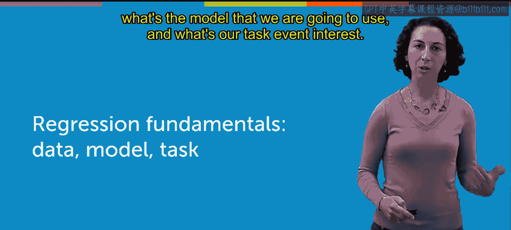
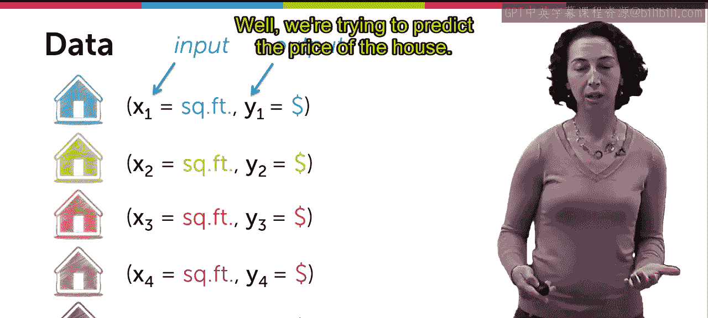
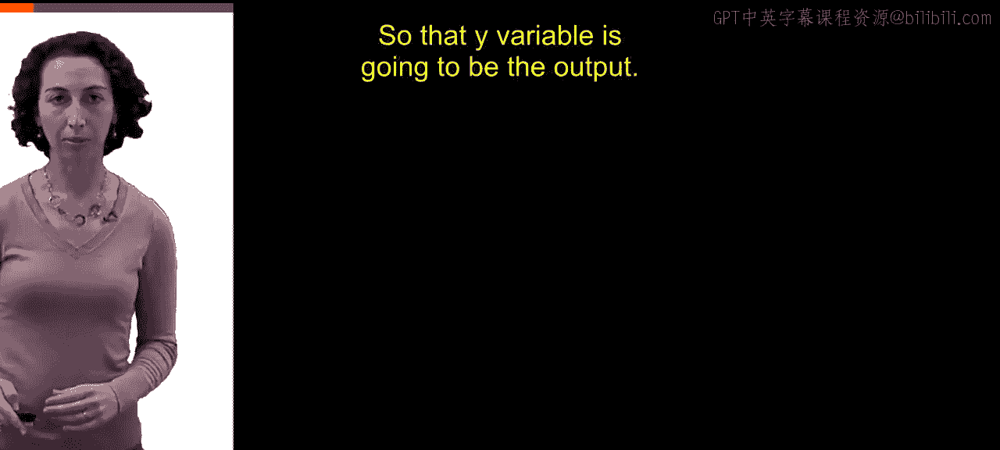
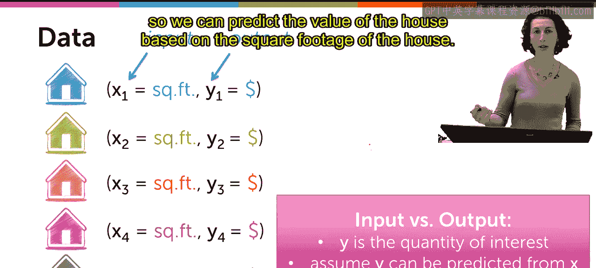
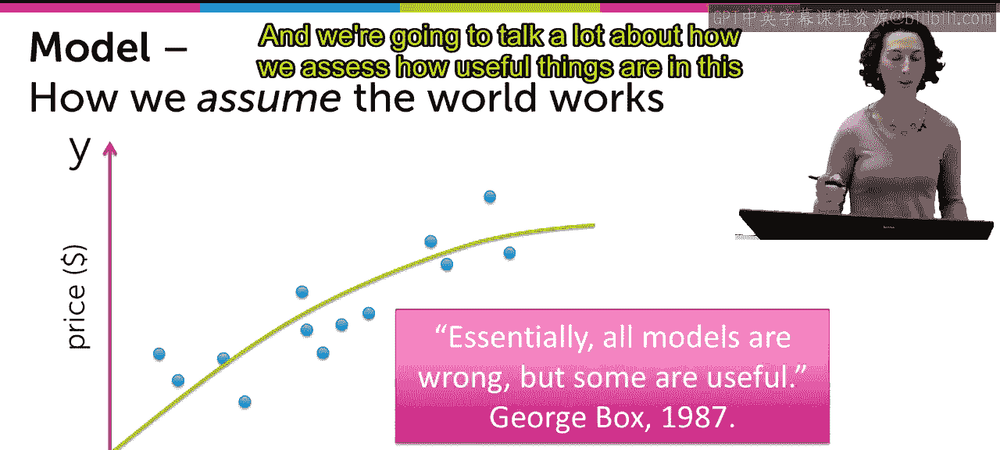

# 华盛顿大学《机器学习（回归，第2课⧸共4课）｜Machine Learning》中英字幕 p07 6_回归基础：数据和模型.zh_en -BV11b421H7XL_p7-

。

So let's go through some of the regression fundamentals， what's our data。

 what's the model that we're going to use and what's our task of interest Okay so the first thing is we're going to take all of our data so all these houses that we looked at that sold recently and for each one of them we're going to record some information and in this case in the case of simple regression where we're assuming that there's just one variable that we're using to predict our house price specifically square feet for every house we're going record how many square feet the house had and what the price was that that house sold for and so we record this for each of our houses that have sold in the past and this variable X represents the input to our model okay this is what we're going to use for our prediction and what's the output what are we trying to predict what we're trying to predict the price of the house so that y variable is going to be the output so what's the difference between the input and the output。

Well， the output Y is our quantity of interest， this is our goal。

 we're trying to predict the value of our house so we can list it for sale and we're going to assume that we can predict y based on X so we can predict the value of the house based on the square footage of the house。

Okay， so I'm going to take my data and I'm going to plot it x versus y where x is the square footage of each house and y is the sales price。

 so that's what this cloud of points represents and we made exactly this plot in the first course of the specialization so just to be clear this circle here represents。

Let's say the I house in my data。And that house had。

Some number of square feet Xi and some sales price Yi。Okay。

 so this is my data and what my model represents is the expected relationship between X and y。

 remember that's what we're trying to figure out because if we have that relationship。

 we can use it for predicting the value of my house that I'd like to list for sale。Okay。

 so we're going to assume some relationship， which is some functional relationship。

 so I'm going to call this some function F of x。And like I said that what that function represents is the。

Expected。Relationship。Between。X and Y。 So let's walk through this in a little bit more detail。

 so let's look at。This house or just for to make this a little bit cleaner。

 let's look at another house here。嗯。Now I've reused the letter that I like to use。

 so I'm going to call this house， sorry， I'm going to reannotate this。

 I'm going to call this house J。This is X J and Y J。

 And the reason I'm doing this is because I is a special notation for the house that I'm interested in。

 And so now this house here that I'm looking at， I'm going to say that it' sold for some value， Y I。

 And based on my model， what my model is saying is that。

I'm assuming that YI is approximately equal to F of Xi。

 this functional relationship between the square footage of house I and its sales price Yi。

But I'm assuming that my model' is not 100% accurate。

 you can easily imagine that there are errors in this model because。

You know you can have two houses that have exactly the same number of square feet but sell for very different prices they could have sold at different times。

 they could have had different numbers of bedrooms or bathrooms or size of the yard or locate specific location neighborhoods。

 school districts， lots of things that we might not have taken into account in our model so our model is just what we're using as our belief about the relationship for prediction but it's not 100% accurate there's some error so the air so just to be clear。

This point here， this x is exactly。F of X I， it's the function evaluated at some。X I value。

And we're saying that are observations which don't fall exactly on this curve defined by F。

There's some error。So we'll call this。Error。Specific to House I， we're going to call it Epsilon I。

So what our regression model is saying is that we're assuming that our。Our observation。Why I。

Is equal。To F of X I。Our expected relationship between x and y plus some error。And in particular。

 we're treating this error as a random quantity， and we're going to assume that the expected value。

Of this error。So this notation is the expected。Value。

So we're assuming the expected value of this error is equal to zero and what is expected value， Well。

 it's just a weighted average of。Over all possible values that error can take。

 weighted by how likely the error is to take each of those values。嗯。But what this is saying。

 saying that our expected error is going to be zero means that it's equally likely。

That we're going to have positive or negative error for any given house sale。嗯。

So it's equally likely that our error is。Positive or negative， and what does this imply。

 this implies that it's equally likely that our observation。

 the specific observation that we get is above or below this functional relationship defined defined by F。

So。Why I is。Equally。Likely。Dubi。😔，Above。Or。Beello。F of X I。Okay。

 so I want to be clear that this is the model that we're using。

 this is how we're assuming the world works。And there's this very famous quote by George Box that says。

 essentially all models are wrong， but some are useful。So what this means is。

No model is going to be exactly how the world works。

 it's not going to exactly predict how houses sell just based on square feet or even if you incorporated other things as well。

 there're always different idiosyncrasies in how the world works but models are going to represent some useful abstraction of the relationship between。

 for example， square foot and price that is useful for tasks such as prediction。Okay。

 so I want to make it very clear that everything I wrote on the last line is just our belief about how the world is going to work。

 or maybe it's not even our belief， maybe it's just something that we're going to use because it's useful as George Bach said。

 or it can be useful and we're going to talk a lot about how we assess how useful things are in this course。

 but we're going to hold off on that conversation for now。

🎼。