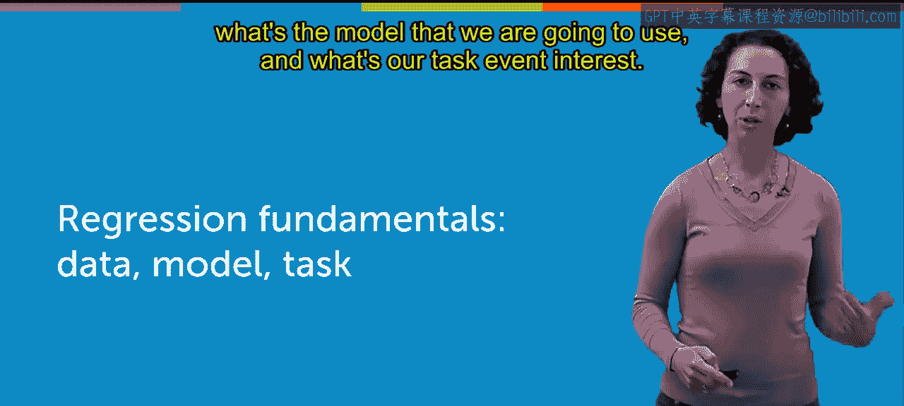
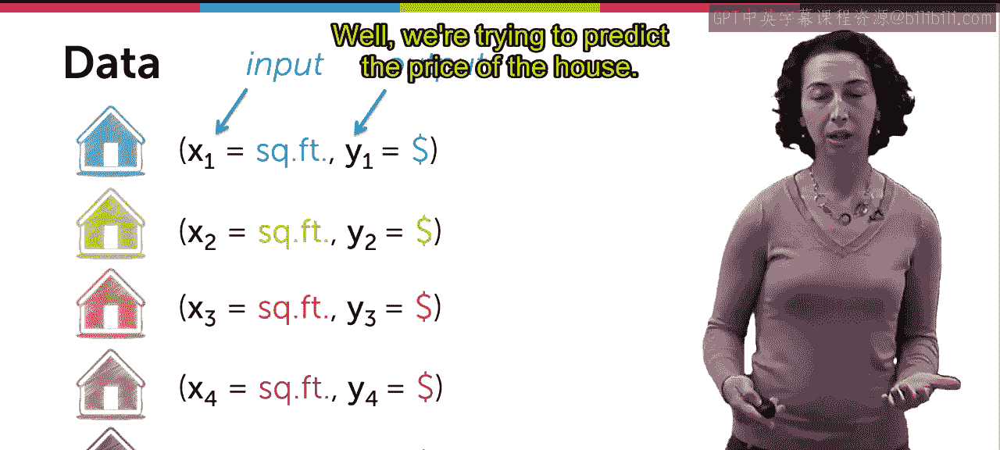
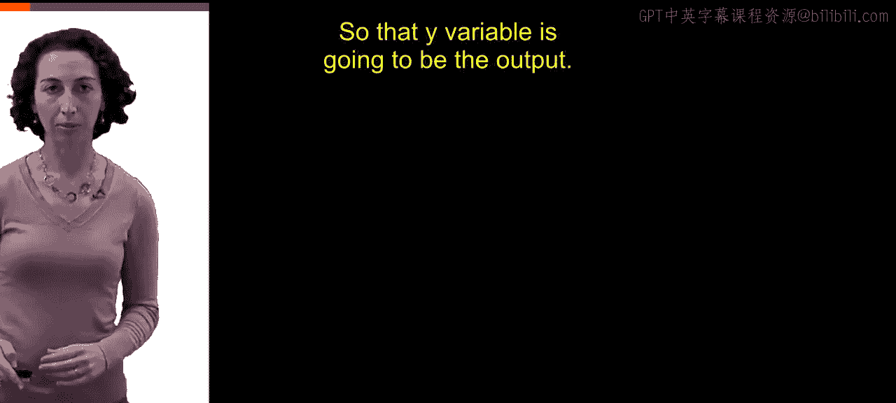
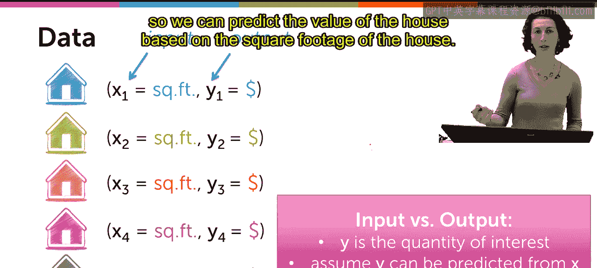
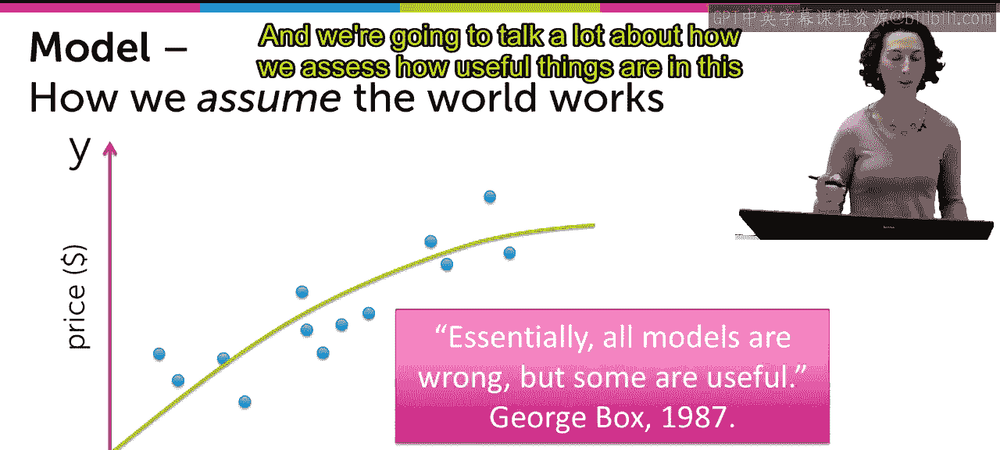

# 机器学习（回归）：第2课：回归基础：数据与模型

在本节课中，我们将学习回归分析的基础知识，包括理解数据、模型以及我们感兴趣的任务。我们将从最简单的线性回归入手，探讨如何利用房屋面积来预测其售价。

---

## 数据与模型

首先，我们需要收集数据。假设我们观察了近期售出的一系列房屋，对于每一栋房屋，我们记录两个信息：房屋的面积（以平方英尺为单位）和它的最终售价。

*   **输入变量 (X)**：这是我们用于预测的变量，在本例中是房屋面积。
*   **输出变量 (Y)**：这是我们想要预测的目标变量，即房屋售价。

输出变量 Y 是我们关心的核心目标。我们假设可以根据输入变量 X 来预测 Y，也就是说，我们可以根据房屋的面积来预测其售价。

接下来，我们将数据绘制在图上，X 轴代表房屋面积，Y 轴代表售价。图中的每一个点代表一栋已售出的房屋。

例如，图中某个特定的点代表数据中的第 i 栋房屋。这栋房屋拥有特定的面积 `Xi` 和特定的售价 `Yi`。

我们的模型旨在揭示 X 和 Y 之间预期的关系。因为一旦掌握了这种关系，我们就可以用它来预测我想挂牌出售的房屋价格。

我们假设存在某种函数关系，记作 `F(x)`。这个函数 `F(x)` 代表了 X 和 Y 之间预期的关系。

---

## 模型与误差

为了更清晰地说明，让我们看另一栋房屋，比如第 j 栋房屋，它的数据点是 `(Xj, Yj)`。现在，我们关注第 i 栋房屋，它的售价是 `Yi`。

根据我们的模型，我们假设 `Yi` 近似等于 `F(Xi)`，即房屋面积 `Xi` 与其售价 `Yi` 之间的函数关系。

但是，我们承认模型并非 100% 准确。很容易想象模型会存在误差，因为即使两栋房屋面积完全相同，也可能因售出时间、卧室数量、浴室数量、院子大小、具体地理位置、学区等众多未纳入模型的因素而以不同价格售出。

因此，我们的模型只是我们用于预测的一种信念或工具，它并不完美，存在误差。

具体来说，图中的 `F(Xi)` 是函数在 `Xi` 处的精确值。而我们观察到的数据点 `Yi` 并不完全落在这条由 `F` 定义的曲线上，它们之间存在一个误差。

我们将这个针对第 i 栋房屋的误差称为 `εi`。

所以，我们的回归模型假设是：我们的观测值 `Yi` 等于预期的关系 `F(Xi)` 加上某个误差 `εi`。

用公式表示就是：
**`Yi = F(Xi) + εi`**

我们进一步将这个误差 `εi` 视为一个随机变量，并假设它的期望值（即所有可能误差值的加权平均，权重为各值出现的概率）为零。

这意味着，对于任何一栋房屋的销售，出现正误差（预测值低于实际售价）和负误差（预测值高于实际售价）的可能性是相等的。

这也就意味着，我们得到的任何一个具体观测值 `Yi`，其高于或低于由 `F` 定义的函数关系的可能性是相同的。

需要明确的是，上面描述的这一切（`Yi = F(Xi) + εi` 且 `E[εi] = 0`）只是我们关于世界如何运作的一种假设模型。正如乔治·博克斯那句名言所说：“所有的模型都是错的，但有些是有用的。” 这意味着，没有一个模型能完全精确地反映现实世界。即使你纳入了更多变量，世界运作中总存在各种特例。然而，模型代表了变量之间（例如面积与价格）一种有用的抽象关系，对于像预测这样的任务是有价值的。

---

## 总结

本节课中，我们一起学习了回归分析的基本框架：
1.  我们定义了**输入变量 (X)** 和想要预测的**输出变量 (Y)**。
2.  我们引入了一个**函数模型 `F(x)`** 来描述 X 和 Y 之间预期的关系。
3.  我们认识到模型不可能完美，因此引入了**误差项 `ε`**，并假设其期望值为零，这意味着模型预测可能 equally likely 地高于或低于真实值。
4.  我们理解了建立模型的目的在于获得对现实世界有用的抽象，而非追求绝对精确。

在接下来的课程中，我们将探讨如何具体定义函数 `F(x)`，以及如何从数据中学习到这个函数的最佳参数。