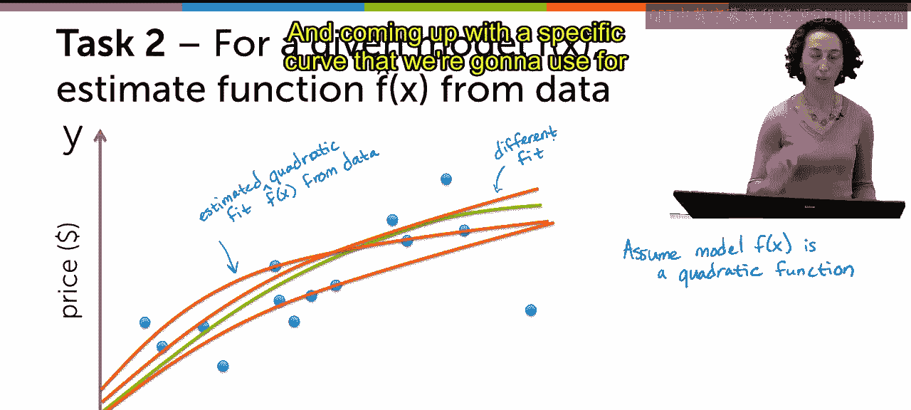

# 华盛顿大学《机器学习（回归，第2课⧸共4课）｜Machine Learning》中英字幕 p08 7_回归基础：任务.zh_en -BV11b421H7XL_p8-

。

Okay， so the first regression task that we have is we have to figure out what model are we going to use are we going to assume that there's just a constant relationship between square footage and price。

 that means regardless of the size of the house， we're expecting every house to sell for the same amount。

Well， that's probably not a great model， are we going to assume that there's some linear relationship？

So as I increase square footage， my price increases at the same rate as I'm increasing square footage。

Or am I going to assume that there's some quadratic fit or some higher order polynomial fit。

 or the list of models I can consider is very long and that's what this course is partially going to be about is exploring different options that we have for models of our data？

Okay， so one task is out of the space of all these models that we might consider。

 which is the one that we should use for a given data and task that we have。Okay。

But now let's assume that。We have selected the model we're going to use in this case here we're assuming that。

嗯。We're going to use just a quadratic fit。Assume。Moel。F of x。Is a quadratic function？

Then our next task is going to be to estimate a specific quadratic fit to the data。Okay。

 so a model just specifies the form of something is going to be defined in terms of some set of parameters。

 and then we're going to have to estimate what the specific fit is from the data。 So for example。

 here this is。This is our estimated。Qudratic。Fit。And we'll call it F hat of x。

 this is our estimated function that's fit from our specific data set。

Or this is another function that we could have fit。

And we'll talk about the way in which we're going to fit。Fs to data in this course okay。

 but the point is that first we have to choose a model， then we have to provide some procedure。

 some algorithm for fitting that model to the data and coming up with a specific curve that we're going to use for our tasks such as prediction。

