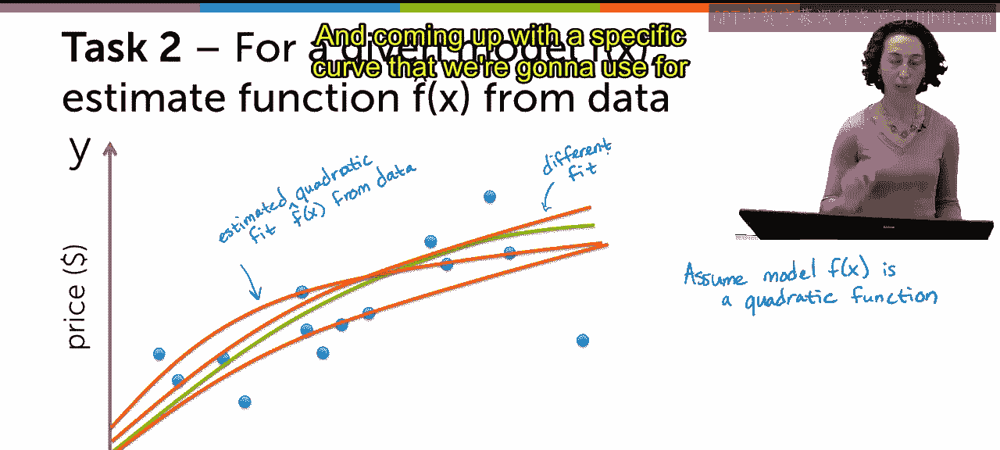

机器学习：第2课：回归基础：任务

在本节课中，我们将学习回归分析中的核心任务。我们将探讨如何为数据选择合适的模型，以及如何根据数据估计出模型的具体参数。

---

我们面临的第一个回归任务是确定使用何种模型。我们需要判断平方英尺与房价之间是恒定关系、线性关系，还是更复杂的多项式关系。

以下是几种可能的模型假设：
*   恒定关系：无论房屋面积大小，预期售价都相同。
*   线性关系：房价随面积增加而按固定速率增长。
*   二次或更高阶多项式拟合：关系曲线更为复杂。

我们可以考虑的模型列表非常长。本课程的部分内容就是探索数据建模的各种不同选择。

因此，一项核心任务是从所有可能考虑的模型空间中，为给定的数据和任务选择最合适的模型。

---

上一节我们讨论了模型选择。现在，让我们假设已经选定了模型。例如，我们决定使用二次函数进行拟合。

那么，我们的下一个任务就是从数据中估计出一个具体的二次拟合曲线。

模型本身只规定了函数的形式，它由一组参数定义。我们需要根据数据来估计这些参数的具体值，从而得到一个具体的拟合结果。

例如，下图中的曲线就是我们根据特定数据集估计出的二次拟合函数，我们称之为 **`F_hat(x)`**。

当然，我们也有可能拟合出另一条不同的曲线。本课程将详细讨论如何将模型 **`F`** 拟合到数据的方法。

核心要点是：首先，我们必须选择一个模型；其次，我们必须提供某种程序或算法，将该模型拟合到数据中，并得出一条用于预测等任务的具体曲线。

---

本节课中，我们一起学习了回归分析的两大核心任务：模型选择和参数估计。我们了解到，模型定义了关系的整体形式，而拟合过程则根据数据确定该形式的具体参数，最终得到一个可用于预测的估计函数。