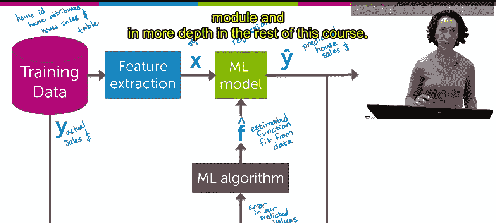
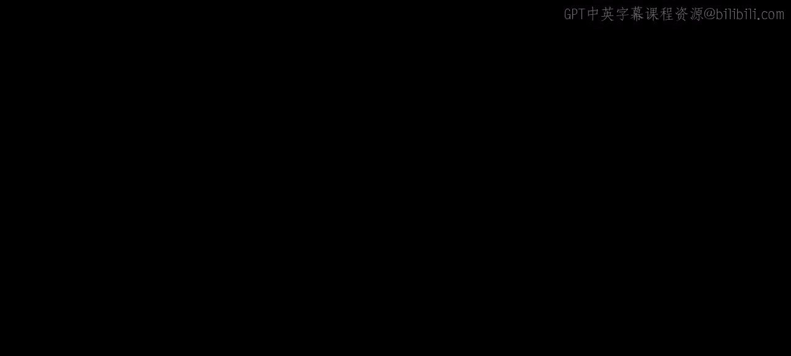

# 华盛顿大学《机器学习（回归，第2课⧸共4课）｜Machine Learning》中英字幕 p09 8_回归机器学习模块图.zh_en -BV11b421H7XL_p9-

。

Okay， so in the first course of this specialization。

 we introduced this block diagram or flow chart for regression as well as a bunch of other machine learning tasks。

 but I just want to walk through this again。So we're going to assume that we have some training data okay。

 so all of a sudden haveve said the word training data and I hadn't said that to this point。

 that's a topic we discussed at a very high level in the first course of the specialization and we're going to discuss the concept of training data test data validation sets。

 lots of other ideas about assessing fitting our models and assessing our fits。

And choosing between models and all these different topics we're going to discuss that in this course。

 but for right now， if you don't know what it means to have training data。

 go back to the first course of the specialization。

 watch that video or look it up online for now I'm going to assume that you know that we have some training data and we're using our training data to fit our a specific model okay and for the rest of this module that's going to suffice we're only looking at training data and all the other discussion about validation sets。

 test sets and everything like this choosing between models assessing the fit of the models that's going to come later in this course Okay so when I talk about data and the rest of this module。

 I'm assuming we're talking about just our training data set that we've already done some split and we have our training data okay。

I think I've said enough on that。So we have our training data and in this case。

 that's going to be some table of。House ID。House square feet。And then the house sales price。

And we have this big table。Of all of these quantities。

And then what we're going to do is extract some features。 So maybe actually at this point。

 instead of specifically saying how square feet， I can just say that there's some set of house attributes。

 we might have things in addition to。2 square feet and so one step we're going to have to do is figure out what input we're going to use for our regression model we're going to talk about more general features later in the course。

 but for now we're just assuming a simple setup where we're going to choose one of our house attributes called that the input to this regression model and work from there so we've talked about using square feet as our selected input。

And then we're going to use our machine learning model， which is regression。

To predict our house sales prices。 So why hat represents our predicted。House sales。

Price and how are we predicting it， Well， based on some estimated line or curve。

 So this is our F hat is our。Estimated。Function。That's fit。From。Our data set。

 or specifically our training data set。And how are we going to determine F hat？

Our estimate how are we going to estimate this function Well first we're going to need to describe some quality metric that says I should describe what y is I already mentioned this earlier。

 but let's write it down explicitly， this is the sales price， the actual。Sales price of our houses。

 and we're going to compare the actual sales price to our predicted sales price using any given F hat。

 we're going to say how well did we do？And that's what the quality metric is。

 so there's going to be some。Error。In our predicted values。

And the machine learning algorithm we're going to use to fit。

These regression models is going to try to minimize that air。

 so it's going to search over all these functions to reduce the air。In these predicted values。Okay。

 so this is our overall flow chart， and we're going to walk through the various components of this throughout this module and in more depth than the rest of this course。

