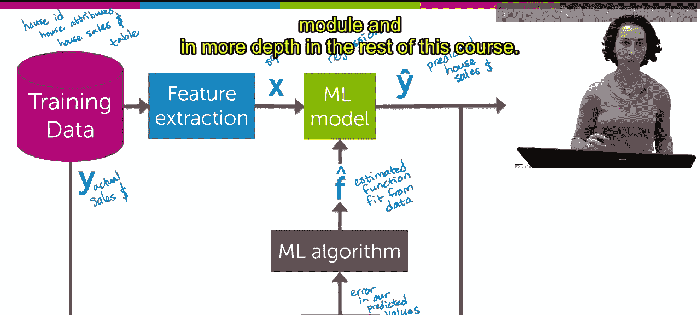
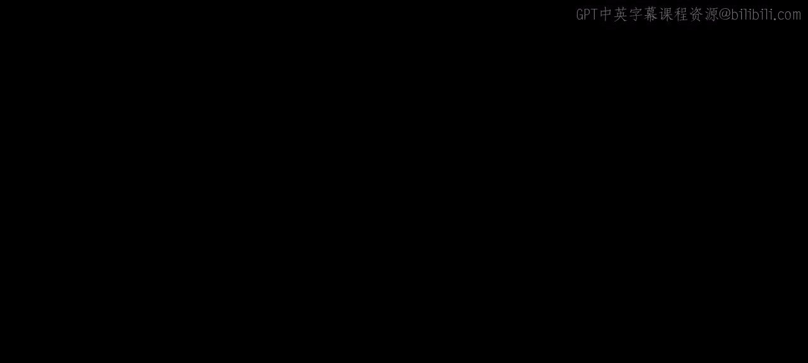

# 机器学习（回归）：第2课：回归机器学习模块图 📊

在本节课中，我们将学习回归任务在机器学习中的标准流程，即模块图。我们将详细拆解从原始数据到最终预测的每一个步骤，并理解每个组成部分的作用。

---

上一节我们介绍了回归的基本概念，本节中我们来看看如何将这个过程形式化为一个清晰的模块图。

在本专项课程的第一门课中，我们介绍了这个用于回归以及其他机器学习任务的模块图或流程图。现在，我们将再次详细梳理它。

我们假设我们拥有一些**训练数据**。训练数据的概念在专项课程的第一门课中已从高层次讨论过。在本课程中，我们将详细讨论训练数据、测试数据、验证集等概念，以及评估模型拟合度、在模型间进行选择等众多主题。目前，我们只需理解我们拥有一些训练数据，并正在使用这些数据来拟合一个特定的模型。在本模块的其余部分，我们将只关注训练数据。

因此，当我们谈论数据时，我们指的是已经完成某种划分后得到的训练数据集。

我们拥有训练数据。在这个案例中，数据是一个包含以下信息的表格：
*   房屋ID
*   房屋面积（平方英尺）
*   房屋销售价格

我们有一个包含所有这些数量的大表格。

接下来，我们要做的是提取一些**特征**。在这一点上，与其具体说“面积”，不如说存在一组房屋属性。我们可能除了面积之外还有其他属性。因此，我们必须做的一个步骤是确定将什么作为回归模型的输入。我们将在课程后面讨论更一般的特征，但现在我们假设一个简单的设置：我们将选择房屋属性中的一个作为回归模型的输入，并在此基础上进行工作。我们讨论过使用面积作为选定的输入。

然后，我们将使用我们的机器学习模型——即**回归**——来预测房屋销售价格。`y_hat` 代表我们预测的房屋销售价格。

我们如何预测它呢？基于某条估计的直线或曲线。这个 `f_hat` 就是我们根据数据集（具体来说是训练数据集）拟合得到的**估计函数**。

我们如何确定 `f_hat`，即如何估计这个函数呢？首先，我们需要定义一个**质量度量标准**。我们已经提前提到过这一点，现在让我们明确地写下来。`y` 是房屋的实际销售价格。我们将使用任何给定的 `f_hat` 来比较实际销售价格和预测销售价格，并评估我们做得有多好。这就是质量度量标准的作用。

我们的预测值会存在一些**误差**。我们将用来拟合这些回归模型的机器学习算法，将尝试**最小化**这个误差。也就是说，它将在所有可能的函数中进行搜索，以减少预测值中的误差。

这就是我们的整体流程图。我们将在本模块以及本课程后续更深入的部分中，逐步讲解这个流程图的各个组成部分。

---

---

本节课中我们一起学习了回归的机器学习模块图。我们明确了从**训练数据**出发，经过**特征选择**，输入到**回归模型**中生成预测 `y_hat` 的流程。整个过程的核心是定义一个**质量度量标准**（即误差）并使用算法去**最小化**它，从而得到最优的估计函数 `f_hat`。这个框架是理解后续所有回归建模技术的基础。