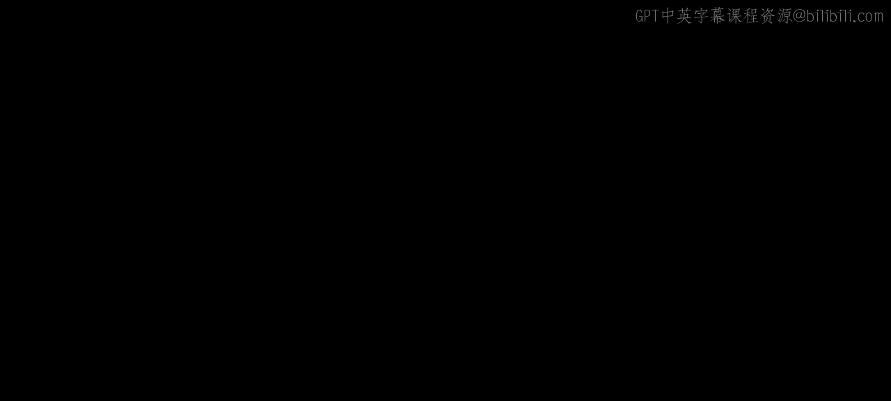
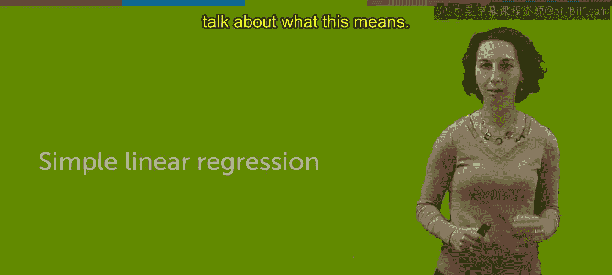
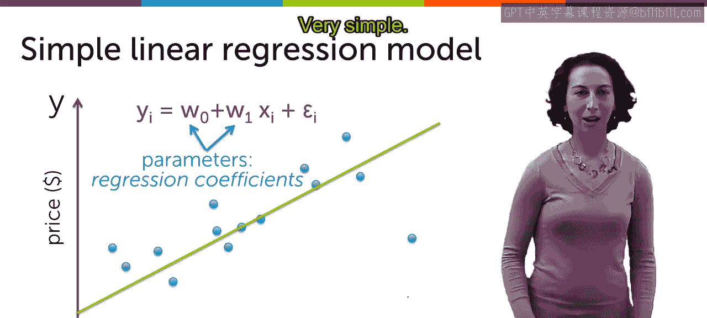

# 华盛顿大学《机器学习（回归，第2课⧸共4课）｜Machine Learning》中英字幕 p10 9_简单线性回归模型.zh_en -BV11b421H7XL_p10-

。

Okay so that represented a kind of high levelve overview about this module as well as other aspects that we're going to touch upon in this course。

 but now let's delve into this specific case of simple linear regression and talk about what this means So going back to our flowchar what we're going to talk about now is specifically the machine learning model So that's that highlighted green box and everything else is grayed out so you can forget about everything else for now we're just talking about our model and what form it takes So our simple linear regression model is just that it's very simple we're assuming we have just one input which in this case is square feet of the house and one output which is the house sales price and we're just going to fit a line。

 a very simple function here， not that quadratic function or higher order polynomials we talked about before。

 just a very simple line and what's the equation of a line Well it's just intercept plus slope times our variable of interest。

So we're going to say that's w0 plus w1x。And what this regression model then specifies is that each one of our observations Yi is simply that function evaluated at XI。

 so that's w0 plus w1 X plus the error term， which we called epsilon I。

 so this is our regression model， and to be clear this error epsilon I is the distance from our specific observation back down to the line。

Okay， so the parameters of this model are W0 and W1 are intercept and slope and we call these the regression coefficients。

 so that summarizes our simple linear regression model， very straightforward， very simple。

 but we'll get to more complicated things later。

