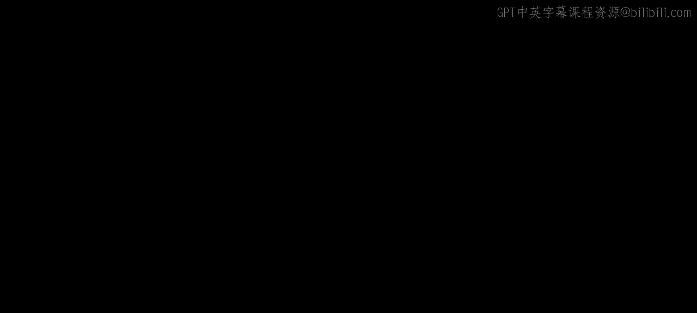
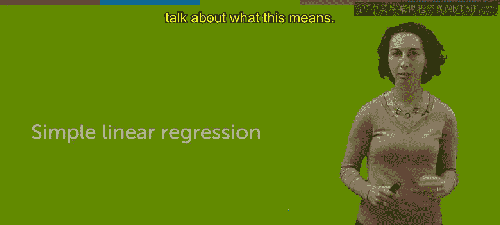
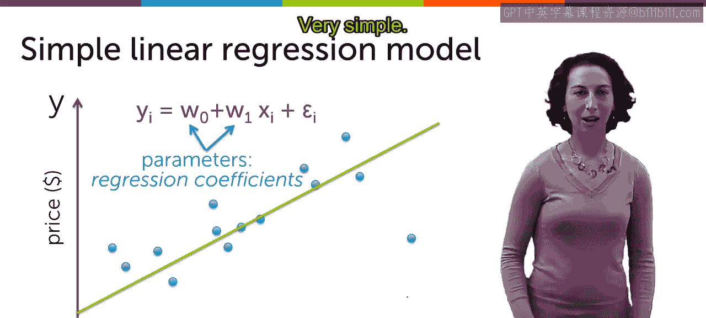

# 机器学习：第2课：简单线性回归模型 🏠

在本节课中，我们将学习简单线性回归模型的基本概念。我们将了解模型的形式、参数以及如何用数学公式表示它。通过本课，你将掌握线性回归的核心思想，为后续更复杂的内容打下基础。

---

上一节我们介绍了机器学习模块的概览，本节中我们来看看简单线性回归的具体含义。回到我们的流程图，现在要讨论的是机器学习模型本身。图中绿色高亮部分代表模型，其余部分暂时可以忽略。我们只关注模型及其形式。

简单线性回归模型非常直观。我们假设只有一个输入特征（例如房屋面积）和一个输出目标（例如房屋售价）。模型的目标是拟合一条直线，而不是之前讨论过的二次函数或更高阶多项式。这条直线的方程是截距加斜率乘以输入变量。

以下是线性回归模型的数学表示：

**公式：** `y = w0 + w1 * x`

其中：
- `y` 是预测的输出（例如房屋售价）。
- `x` 是输入特征（例如房屋面积）。
- `w0` 是截距。
- `w1` 是斜率。

回归模型进一步说明，每个观测值 `Yi` 是函数在 `Xi` 处的值加上误差项 `εi`。

**公式：** `Yi = w0 + w1 * Xi + εi`

这里的误差项 `εi` 表示具体观测值到拟合直线的垂直距离。

模型的参数是 `w0` 和 `w1`，分别称为截距和斜率，统称为回归系数。这概括了我们的简单线性回归模型，它非常直接和简单，后续我们会探讨更复杂的内容。

---

本节课中我们一起学习了简单线性回归模型的基本形式。我们了解了模型如何用一条直线拟合数据，以及如何用数学公式 `y = w0 + w1 * x + ε` 表示它。我们还明确了模型参数 `w0` 和 `w1` 的含义。这些知识是理解更复杂回归模型的基础。