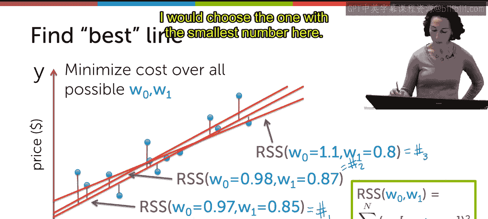
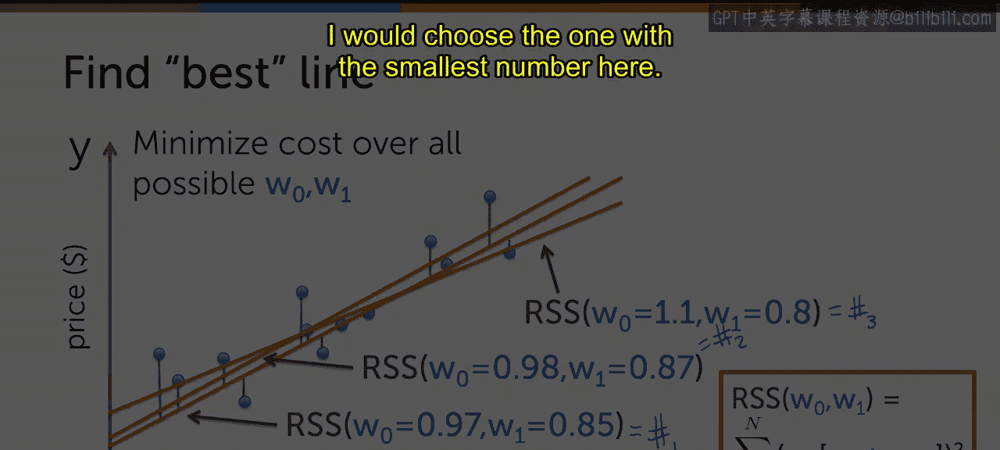

# 华盛顿大学《机器学习（回归，第2课⧸共4课）｜Machine Learning》中英字幕 p11 10_使用给定直线的成本.zh_en -BV11b421H7XL_p11-

。

Okay， while working with a simple linear regression model。

 let's talk about how we're going to fit a line to data。

But before we talk about specific algorithms for fitting。

 we need to talk about how we're going to measure the quality of a fit。

 so we're going to talk about this orange box here， which is this quality metric。And in this case。

 now that we've mentioned that our function is parameterized in terms of some parameters we're calling W that represents w0 and W1 in this case。

 our intercept and our slope， we know that when we're going to predict how values。

 instead of talking about F hat， our estimated function， we can talk in terms of W hat。

 our estimated parameters， because those estimated parameters fully determine our estimated function。

So we're going to modify this block diagram and replace F hat now with W hat and talk about estimating these parameters W。

So what's the cost of using a specific line？Um well。

The one we're going to talk about here and the one that we focused on in the first course of the specialization is residual sum of squares and what residual sum of squares assumes is that we're just going to add up。

The errors we made between。This line here， which represents what we believe the relationship is and what we've estimated the relationship to be between x and y and what the actual observation y was。

 so we're going to take each one of these errors or residuals。And。Sorry， I should be clear。

 I talked about error as the epsilon I， the error was part of my model。

 a residual is a difference between a prediction and an actual value okay so I want to make sure that that's clear so that's why this is called residual sum of squares so this is the formula that we presented in the first course of the specialization so I'll run through it fairly quickly our residual sum of squares is going to be a function of our two parameters W0 and W1 that determines what line we're looking at so of course as I change that line we're changing the cost。

This cost term RSS。And what I'm doing is I'm adding up the difference between the specific house sales price of a given house and what my line specifies it as and what does the line specify the price to be。

 well it specifies it as w0 plus w1 times however many square feet。This house had。Um。

But I'm not just looking at that difference nor its absolute value。

 I'm looking at the square of the difference， that's where the sum of squares comes in。

 well that's where the squares comes in and then the sum is I'm adding over this error over all houses in my training data。

Okay， so just to summarize residual sum squares is I take this difference between what the line is telling me the price of the house should be。

 what the actual house price was， look at that difference。

 square it and add over every house in my training dataset。So we saw this equation before。

 but now I'm going to write it more compactly and we're going to work with this form throughout the rest of this module and of forms like this and the rest of the course where I've introduced this notation。

 this capital sigma， where what this means is if I write sigma。

 and I write I equals one on the bottom of this。Greek letter and a capital N at the top of this Greek letter。

Then what I'm saying is I'm summing over some quantity。

 I'll just generically look at some quantity AI， I'm summing。A1。Plus a2 plus all the way up to A N。

 so I'm summing up n different quantities and in this case。Here。What is AI？Well。

 AI is just this this inner thing here， so it's Y I minus。W0 plus W1 X I。Quantity squared。Okay。

 so this is just shorthand notation for what we had on the previous slide where we're summing over all houses in the training data set。

 but instead of writing this thing in English or writing out this it really。

 really massive sum over thousands and thousands of houses。

 I'm going to write it compactly like this。Okay， so now that we have this notation。

 let's talk about how we think about finding the best line。

So we have this function that if you give me any W0 in W1， it defines a specific cost。So for example。

 this line。Let's say the intercept was 0。97 and the slope was 0。

85 well that results in some RSS so I'll call this some let's call it just number one and then if I give you a different line so that's specified by a different intercept in a different slope。

 that's going to result in a different cost so I'll just say that's some other number and then。

This other line with different parameters has some other number associated with its cost as well。

 and my goal here， when I'm talking about estimating a function from data，Given a specific model。

 which in this case is just a simple line is I'm going to search over all possible lines。

 all W0 and W1， so shifting this line up and down。Looking at different slopes and I'm going to try and find the one that results in the smallest residual sum of squares。

 so out of these three lines， if those were the space of all lines I was looking at。

 clearly it's not， it's a huge space I'm looking at。

 I would choose the one with the smallest number here。

🎼。