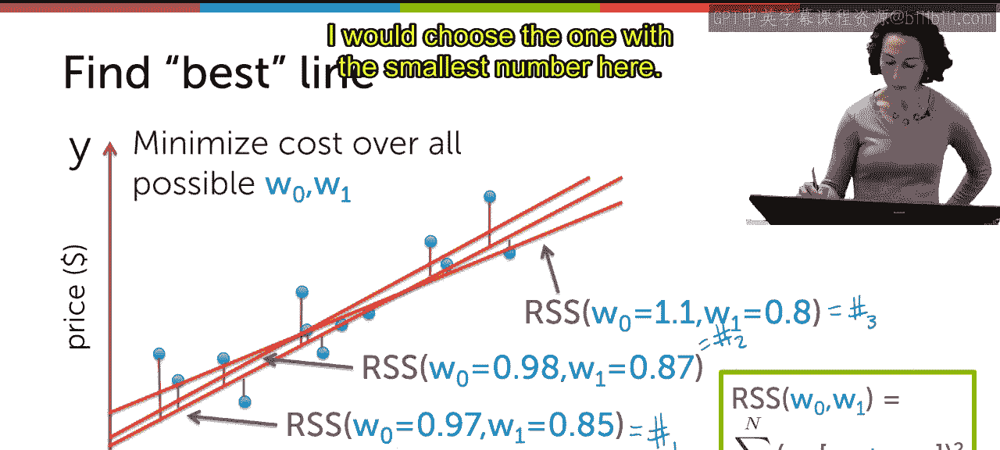
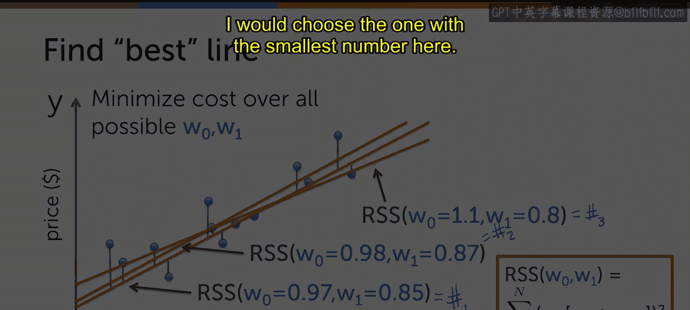

# 机器学习：第2课：使用给定直线的成本

在本节课中，我们将学习如何衡量一条直线对数据的拟合质量。我们将介绍一个核心的质量度量指标——残差平方和，并理解它如何帮助我们找到最佳的拟合直线。

---

上一节我们介绍了简单线性回归模型，本节中我们来看看如何衡量一条特定直线的拟合质量。在讨论具体的拟合算法之前，我们需要一个标准来评估拟合的好坏，这个标准就是成本函数。

现在，我们的函数由参数 **W**（即截距 `w0` 和斜率 `w1`）决定。因此，预测值不再用估计函数 `f_hat` 表示，而可以用估计参数 `W_hat` 表示。所以，我们的目标转变为估计这些参数 **W**。

那么，使用一条特定直线的“成本”是什么呢？在本课程中，我们重点介绍**残差平方和**。其核心思想是：计算我们根据直线预测的房价与实际观测到的房价之间的所有误差，将这些误差（或称残差）平方后求和。

以下是残差平方和的计算公式：

**RSS(w0, w1) = Σ (y_i - (w0 + w1 * x_i))^2**

其中：
*   `Σ` 表示对训练数据集中所有房屋（`i = 1` 到 `N`）求和。
*   `y_i` 是第 `i` 个房屋的实际售价。
*   `x_i` 是第 `i` 个房屋的面积（平方英尺）。
*   `(w0 + w1 * x_i)` 是我们的直线对该房屋售价的预测值。

简单来说，残差平方和就是：对于数据集中的每一个点，计算其实际值与直线预测值之差的平方，然后将所有这些平方差加起来。

---

现在，我们有了这个成本函数。对于任意给定的一组参数 `(w0, w1)`，即任意一条直线，我们都能计算出一个对应的 RSS 值。

例如：
*   直线 A（参数为 `w0=0.97`, `w1=0.85`）对应一个 RSS 值（假设为 100）。
*   直线 B（不同的参数）对应另一个 RSS 值（假设为 150）。
*   直线 C（另一组参数）也对应一个 RSS 值（假设为 80）。

我们的目标是从所有可能的直线（即所有可能的 `w0` 和 `w1` 组合）中，找到使残差平方和 **RSS** 最小的那一条。在上述例子中，我们会选择直线 C，因为它的成本（80）最小。

---

本节课中我们一起学习了衡量线性回归模型拟合质量的核心指标——残差平方和。我们了解到，RSS 是预测值与实际值之差的平方和，我们的目标是找到能使 RSS 最小化的那组参数。在接下来的课程中，我们将探讨如何系统地找到这组最优参数。