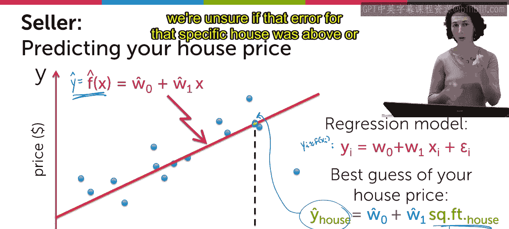
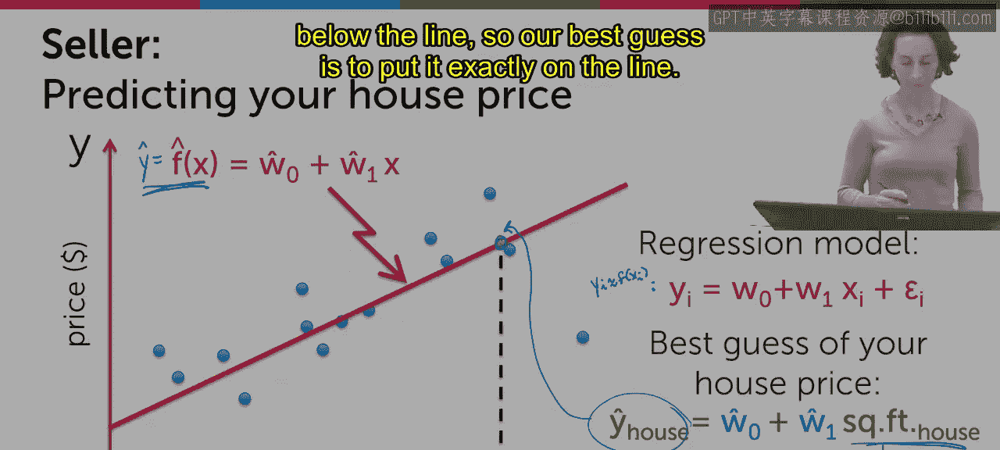
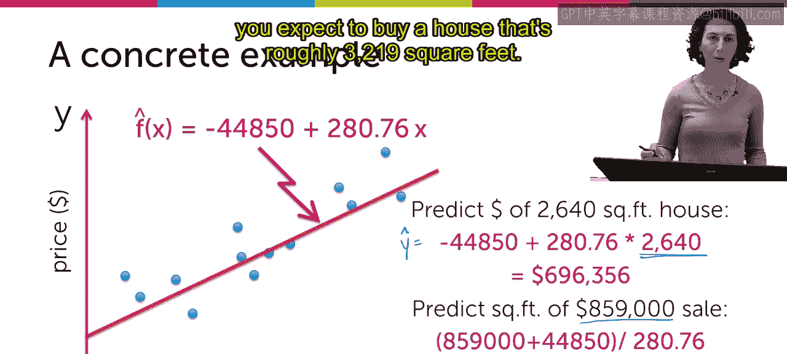

# 华盛顿大学《机器学习（回归，第2课⧸共4课）｜Machine Learning》中英字幕 p12 11_使用拟合直线.zh_en -BV11b421H7XL_p12-

。

Okay， so we've talked about this simple linear regression model just a line and then we talked about。

How our goal in fitting this model is going to be to search over all possible lines and find the line that minimizes the residual sumquas we haven't talked about how we're going to do that。

 that's going to come next we're going to talk about specific algorithms for searching over all possible lines to minimize residual sum squares but right now let's just assume that we have some fitted line and let's talk about how we're going to use it and how we can interpret the parameters。

Let's start by contrasting the model from the fitted line。So our model。

 which I've written again here， is in terms of parameters。These are。Parameterters。嗯。They're unknown。

Variables of our model。And our goal is to estimate these parameters。

 fix values of these variables based on our data。 And so that's what W hat represents。

 These are our estimated parameters。 and these are so these take。Actual values。So for example。

 maybe our intercept is minus 44，850， and our slope is 280。76。

And these aren't random numbers that I generated here。

 this comes from the first course if you look at the notebook for doing the regression fit of。

Sales price on square feet， these were the numbers that came out for these two parameters。Okay。

 so these estimated parameters define a specific line。Okay， that's what this is。

 this line represents。Minus 44，850。Plus 280。076 times x。

 So a model is in terms of some parameters and a fitted line is a specific example within that model class。

 So it's a specific line。 Now let's talk about how we can think about using our fitted line So one thing that we can ask is。

To predict the value of this house that we'd like to list for sale so this house has some number of square feet and we'd like to guess the price and how are we going to guess the price well it's very straightforward we're just going to plug into our fitted line。

And so we're going to take the square feet of this house just represented here。

Plug that into the equation of this line and that's going to produce。

Our estimated value of the house right here。I want to mention one more thing。Here。

 so I want to mention that y hat， that's our predicted value of the house。

Y hat is exactly equal to F hat of x。Okay， our model。 remember， our model said that。嗯。

Yi is approximately equal to F of Xi。But when we go to do a prediction y hat。

 that's exactly equal to F hat of x and y is that that's because the error is equally likely to be above or below the line。

And FHt represents our best guess of the line given our data。

And so if we want to guess the value of the house， we're。

We're unsure if that error for that specific house was above or below the line。

 so our best guess is to put it exactly on the line。

While I can use this fitted line， also if I'm a buyer。

 not just if I'm a seller interested in listing my house for sale， so for example。

 what I mean here is that I might have some amount of money that I can spend on a house and I want to know how big of a house can I expect to purchase with that amount of money。

Well， instead of estimating。Or predicting the value of the house。

 I can think of predicting the square feet， so just using this equation in reverse。

 so I have some amount of money in the bank。And that's going to be。Dollars in bank is。This。

 and then I'm going to look at。How many square feet？

I believe that I can purchase without amount of money。Okay。

 so let's just go through a concrete example， here's the fitted regression line I talked about before。

 so it's minus44，850 plus 280。76 times x and what I'd like to do is predict the value of a house that has 2640 square feet so what I do is just plug in 2640 into this equation。

That's my。Why hat？And that comes out to be if you do that calculation， 696，356。Likewise， I can say。

 well， I want to predict how many square feet of house I can purchase if I have $859。

000 to spend on the house。So if you do this calculation。

 you get that you can afford a house or you expect to buy a house that's roughly 3，219 square feet。

