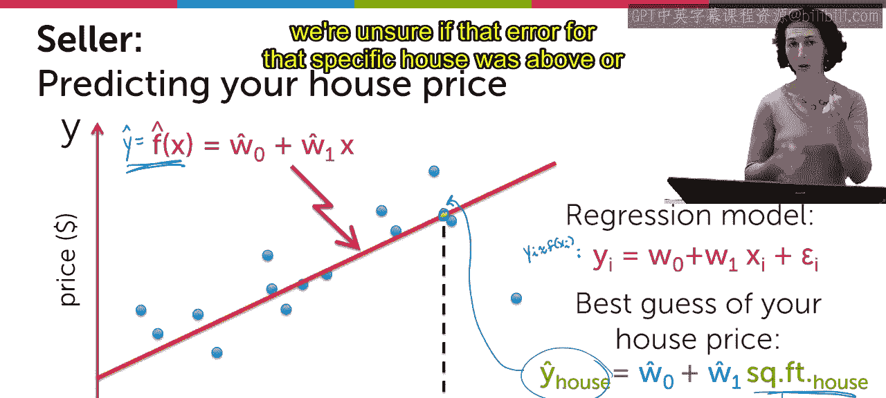
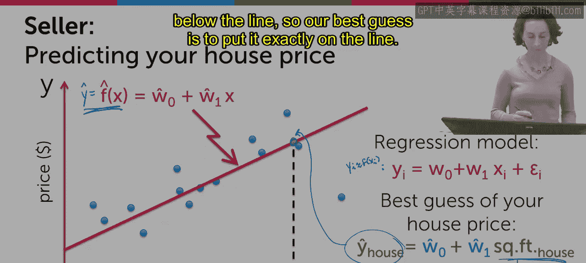
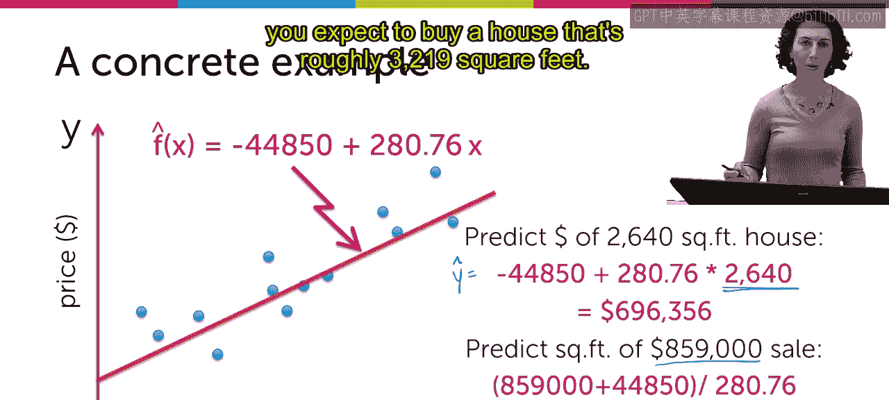

# 机器学习：第2课：使用拟合直线 📈

在本节课中，我们将学习如何使用已拟合的简单线性回归模型进行预测和解释。我们将从区分模型与拟合直线开始，然后探讨如何利用拟合直线进行预测，并解释其参数的实际意义。

## 模型与拟合直线的对比

上一节我们介绍了简单线性回归模型。现在，我们来明确模型本身与拟合直线之间的区别。

我们的模型用参数表示，这些参数是未知的。模型公式为：
\[
y_i \approx f(x_i) = w_0 + w_1 x_i
\]
其中 \( w_0 \) 和 \( w_1 \) 是待估计的参数。

我们的目标是根据数据估计这些参数，得到具体的数值。这些估计值用 \( \hat{w}_0 \) 和 \( \hat{w}_1 \) 表示，它们定义了具体的拟合直线。例如，一个拟合直线的方程可能是：
\[
\hat{f}(x) = -44,850 + 280.076 \times x
\]
因此，模型是一个包含未知参数的框架，而拟合直线是该框架下的一个具体实例。

## 如何使用拟合直线进行预测

现在我们已经有了一个具体的拟合直线，本节中我们来看看如何用它进行预测。

拟合直线的一个主要用途是预测。例如，如果你有一套待售房屋，知道其面积，就可以预测其售价。

预测方法非常直接：只需将房屋面积代入拟合直线的方程即可。预测值 \( \hat{y} \) 等于 \( \hat{f}(x) \)。这是因为误差在直线上下的可能性均等，而 \( \hat{f}(x) \) 是基于数据对直线的最佳估计，因此我们对单个房屋价值的最佳猜测就是将其放在直线上。

以下是两种常见的预测场景：

*   **预测售价**：已知房屋面积，预测其市场价值。
*   **估算可购面积**：已知预算金额，反向计算用这些钱预计能买到多大面积的房子。

## 预测实例

让我们通过一个具体例子来演示如何使用拟合直线。

假设我们拥有之前提到的拟合直线：
\[
\hat{f}(x) = -44,850 + 280.076 \times x
\]

**场景一：预测房屋售价**
若一套房屋面积为2640平方英尺，其预测售价计算如下：
\[
\hat{y} = -44,850 + 280.076 \times 2640 = 696,356
\]

**场景二：估算可购面积**
若你的购房预算为859,000美元，你可以负担的房屋面积估算如下：  
首先，将预算金额设为 \( \hat{y} \)，然后解方程求 \( x \)：
\[
859,000 = -44,850 + 280.076 \times x
\]
计算可得 \( x \approx 3,219 \) 平方英尺。

---

本节课中我们一起学习了如何区分线性回归模型与拟合直线，并掌握了使用拟合直线进行正反双向预测的方法：既可以根据自变量预测因变量，也可以根据目标因变量值反推所需的自变量值。