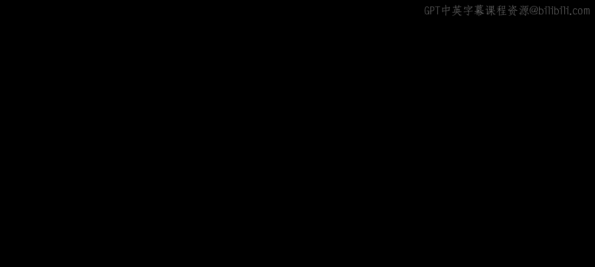
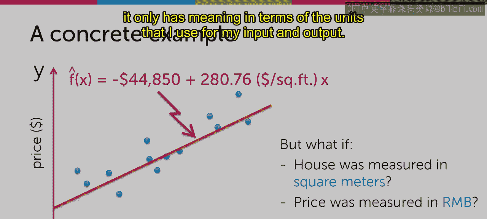

# 华盛顿大学《机器学习（回归，第2课⧸共4课）｜Machine Learning》中英字幕 p13 12_解释拟合直线.zh_en -BV11b421H7XL_p13-

🎼。Okay， so now let's talk about how we're going to interpret the coefficients of our fitted line。

And let's start by talking about W hat zero， our estimated intercept。

 so that's this point right here， this green star and what does that represent well it's the predicted value of a house with zero square feet so we can think of that as just land because we have that y hat。

Is equal to W hat zero when。X equals zero， so when there're no there's no square feet。

 we have that our predicted house value is exactly equal to W hat zero， but I'll say that in general。

This is not normally that meaningful in many scenarios you don't really think of having no input and having the output have some meaningful value and actually in our case if you go back and look at the number where we had that our intercept was minus 44。

850 so it's saying that land you should actually as the seller be giving the buyer money to take that land off your hands。

 but remember that our data's really noisy， it's not a perfect model of what's going on so of course we have to think about interpreting our parameters in the context of what we've included in our model。

Okay， we'll talk more about that in the next module。I also want to talk about W hat1。

 which is our estimated slope and that tends to have a bit more meaning associated with it。

 so the estimated slope， I'm highlighting with this green triangle here saying that per unit change。

In our input， so for one unit， so one square foot。What's our predicted change？

In the value of the house， so for example。Let's say I'm looking at estimating。

The value of a house with。1001 square feet。And I want to look at the difference relative to the estimated value of a house with just a thousand square feet。

Well， what is this， this is equal to if I look at the first term estimating a house with 1001 square feet。

 how would I estimate that I'd take w hat zero plus w hat 1 times 10 and1。Square。Feet。

And then I'm going to subtract。For the second term， I have its estimated value is again， w hat zero。

Plus， W hat1 times 100。Square feet。And these W hat zeros are going to cancel and the difference between these numbers is just one。

 So this will just be W hat one。 So again， W hat one represents the。The predicted。Change。

In the output。Per unit change in the input。Okay， so that's how we're going to interpret W hat1。

 but one thing I want to make very， very clear is that the magnitude。

Of this slope depends both on the units of our input and on the units of our output。

So in this case the slope， the units of slope are square feet per sorry are dollars per square feet。

 and so if I gave you a house that was measured in some other unit then。

This coefficient would no longer be appropriate for that。

 so let's make this a little bit more explicit。So now that we know that there are units attached to these numbers。

 I'm going to put these in， so our intercept has units just dollars。

 so let me be clear what I'm actually highlighting here。

The intercept has units dollars and the slope has units dollars per square feet。

 and when I went through and did my calculation of predicting the value of a house with a given square feet if I actually put in these units。

I see that everything works out here I have dollars here I have dollars per square feet and then i'm multiplying by square feet。

 so when I multiply these two things the resulting units of this is just going to be dollars so the end result is something in terms of dollars that's great and likewise when I use the equation in reverse I have dollars dollars divided by。

Dollars per square feet， and I end up with something that's in square feet。

So I'll just say units work out。Which is great， but what if the house was measured in square meters instead of square feet？

Well clearly I can't just plug into that equation and likewise。

 what if the price was measured in Chinese yuan instead of in US dollars again。

 can't just plug into that equation， so when I think about the magnitude。

It only has meaning in terms of the units that I've used for my input and output。

。