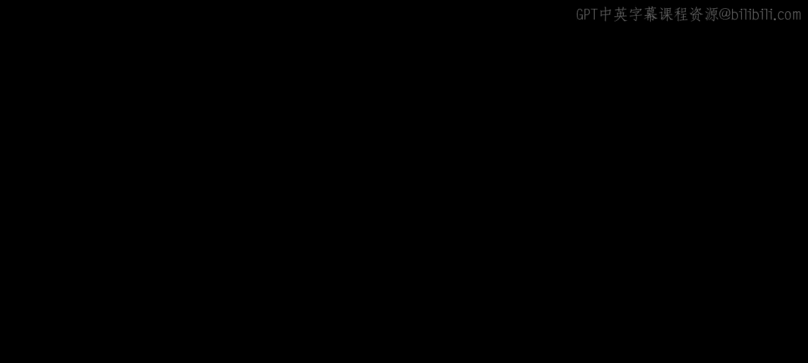
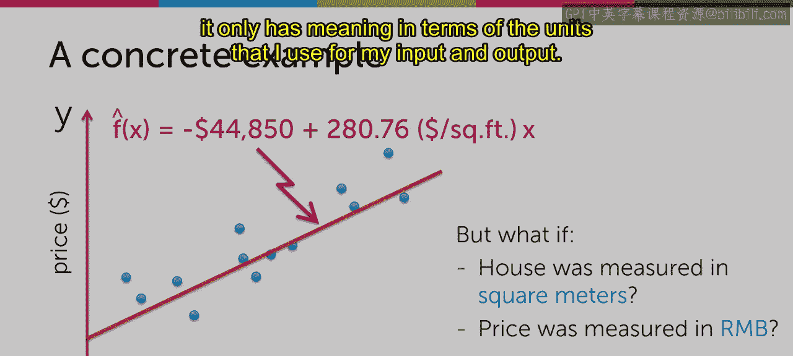

# 机器学习：第2课：解释拟合直线



在本节课中，我们将学习如何解释线性回归模型中拟合直线的系数。我们将重点关注截距和斜率这两个核心参数的含义，并理解它们的单位如何影响解释。

## 解释截距

上一节我们介绍了如何拟合一条直线，本节中我们来看看如何解释这条直线的参数。首先，我们讨论截距 `W_hat_zero`。

截距是当输入变量 `X` 等于零时，模型的预测值。在房价预测的例子中，它代表零平方英尺（即仅有土地）时的预测房价。其计算公式为：

`y_hat = W_hat_zero` 当 `X = 0`

然而，在许多实际场景中，截距可能没有直接的现实意义。例如，在我们的模型中，截距为负值，这暗示“土地”的价值为负，这显然不符合常理。这提醒我们，必须在模型所包含的上下文和数据噪声的背景下解释参数。

## 解释斜率

接下来，我们看看斜率 `W_hat_one`，它通常具有更明确的含义。

斜率代表了输入变量每变化一个单位时，预测输出的变化量。在房价模型中，它表示每增加一平方英尺，房屋的预测价格会增加多少。我们可以通过一个简单的计算来理解：

假设我们想比较1001平方英尺和1000平方英尺房屋的预测价值差异。计算过程如下：

```
预测值(1001) = W_hat_zero + W_hat_one * 1001
预测值(1000) = W_hat_zero + W_hat_one * 1000
差值 = (W_hat_zero + W_hat_one * 1001) - (W_hat_zero + W_hat_one * 1000)
     = W_hat_one
```

因此，斜率 `W_hat_one` 直接等于预测输出的单位变化量。

## 系数的单位与量级

理解斜率和截距的量级至关重要，因为它们完全依赖于输入和输出所使用的单位。

以下是关于系数量级的核心要点：

*   **截距的单位**：与输出变量相同。在我们的例子中是**美元**。
*   **斜率的单位**：是“输出单位/输入单位”。在我们的例子中是**美元/平方英尺**。

当我们使用模型进行预测时，单位必须保持一致：
*   预测房价（美元）= 截距（美元）+ 斜率（美元/平方英尺）* 面积（平方英尺）
*   计算所需面积（平方英尺）= [目标房价（美元） - 截距（美元）] / 斜率（美元/平方英尺）

如果改变单位，例如：
*   将面积单位从**平方英尺**改为**平方米**。
*   将货币单位从**美元**改为**人民币元**。

那么，原有的系数 `W_hat_zero` 和 `W_hat_one` 将不再适用，必须基于新的单位重新拟合模型或转换系数。斜率的数值大小仅在特定的输入/输出单位组合下才有意义。

## 总结



本节课中我们一起学习了如何解释线性回归模型的系数。我们了解到，截距 `W_hat_zero` 是零输入时的预测值，但其现实意义需谨慎看待。斜率 `W_hat_one` 则清晰地表示了输入每增加一单位所导致的预测输出变化量。最重要的是，我们认识到这些系数的数值大小和解释强烈依赖于模型输入和输出所使用的具体单位。