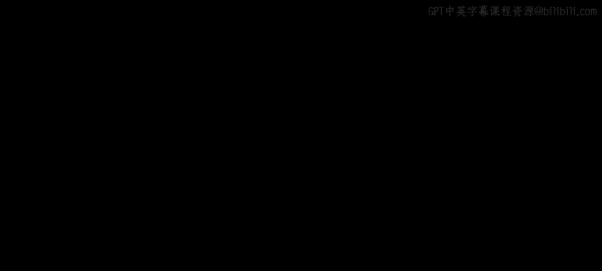
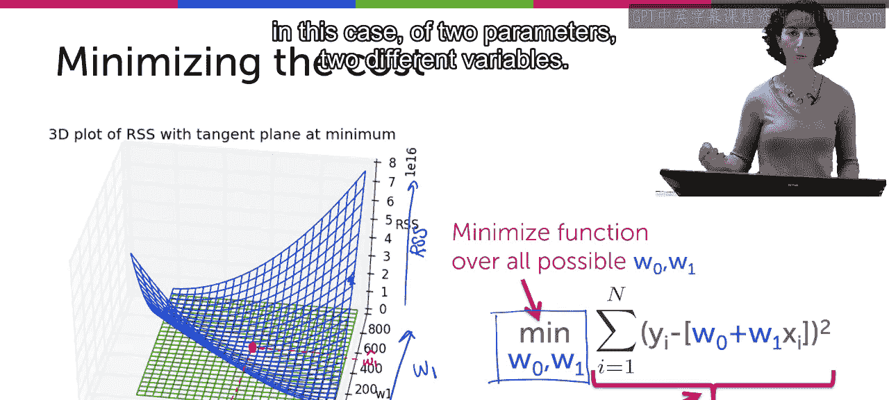

# 华盛顿大学《机器学习（回归，第2课⧸共4课）｜Machine Learning》中英字幕 p14 13_定义最小二乘优化目标.zh_en -BV11b421H7XL_p14-

。

Now that we have an understanding of what the fitted line is and how we can use it。

 let's talk about an algorithm or really algorithms for searching over the space of all possible lines we might use and finding the one that best fits the data。

So in particular， what we're going to be doing is focusing in on this machine learning algorithm。

 which is this dark gray square shown in this flow chart。Okay， so recall that。

Our cost was defined as this residual sum of squares and for any given line。

 we can compute the cost of that line， so for example。

 we showed three different lines and three different residual sums of squares here。

 but our goal was to minimize over all possible W0 and W1 slopes and intercepts。

But the question is how are we going to do this， so that's the key question that we're looking to address in this part of the module。

Let's formalize this idea a little bit more so here what we're showing is our residual sum of squares and what we see is it's a function of two variables。

 W0 and W1 so we can write it generically let's just write it as sum function G of a variable W0 and a variable W1 and what I've done is I've gone ahead and plotted the residual sum of squares versus W0 and W1 for the data set that you guys played with in the first course of the specialization so here along this axis is W0。

And along this axis is W1， and then we're plotting here。A residual sum of squares。 And that is this。

 this blue。Mesh surface here， that's our residual sum of squares for any given W0， W1 pair。

And our objective here。Is to minimize over all possible combinations of W0 and W1。 So mathematically。

 we write that great， I wrote right over what I wanted to show you guys。

 let me erase what I wrote before。And rewrite it so that it's a little bit more。Intelligible。

 but as I was saying， our mathematical notation for this minimization over all possible W0 W1 is。

This notation right here。Okay， so in terms of the picture。

 what we want to do is over this entire space of W0 and W1。 we want to find the place。

 Let me switch colors so that this is。A little bit easier to see on this slide。So we want to find。

The specific value。Of W0。So I'll call that W0 hat。And W1 hat that minimize this residual summit squares。

So this is our objective and switching back to our。Blue color here， this is an optimization problem。

Where specifically the optimization objective is to minimize a function in this case of two parameters。

 two different variables。

🎼。