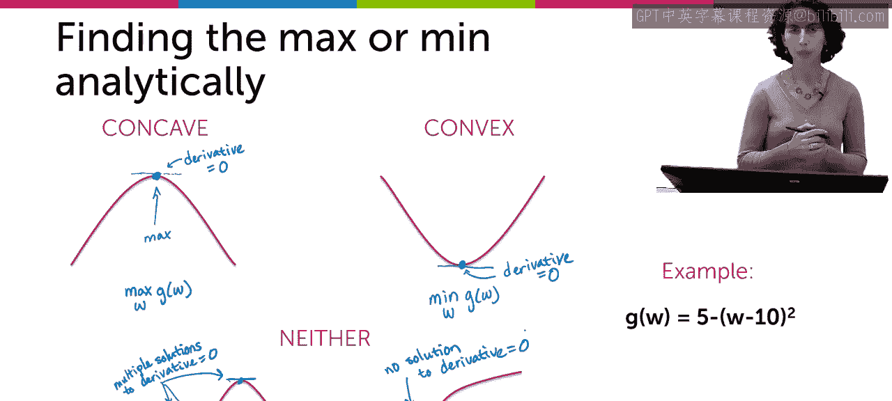
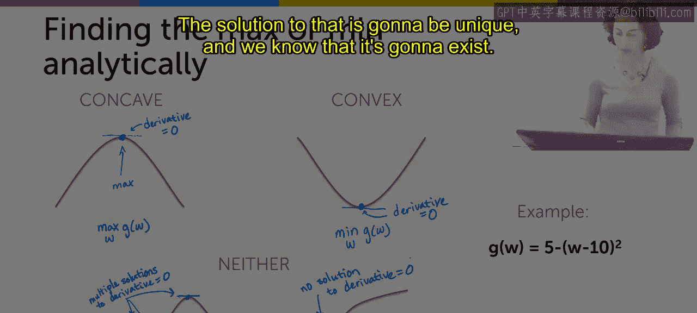

# 华盛顿大学《机器学习（回归，第2课⧸共4课）｜Machine Learning》中英字幕 p15 14_解析法求极值.zh_en -BV11b421H7XL_p15-

。

But before we get to how to minimize residual sum squares in particular。

 let's talk about optimization in a more abstract sense in terms of just a generic function and thinking about how do we minimize it。

 What are the properties of the minimum of a function and algorithms for achieving that minimum。

 One of the first important concepts that we can talk about is the notion of convex and concave functions。

 So here I have a picture of a concave function over just one parameter or one variable。

 We'll call it W。 and this function。Here this is G ofW。

And this is a concave function and the way I remember concave versus convex is concave。

 it looks like you're in a cave， so it looks like the arch of a cave and convex is just the other one okay so the way we can think about defining what a concave function is is we can look at any two values。

Of W， let's call it A and B and look at the value of the function at A and B， so G of a and G of B。

 and let's draw a line between G of A and G of B。 so that's this green line here。And what we see。

Is that this line。Lies below。G of W everywhere。And a concave function is a function where for any value of A and any value of B that you choose。

 when you go and draw this little line between the points of the function。

 it's always going to lie below the actual curve of the function itself。A convex function。

 on the other hand。Let's just draw。A little picture of a convex function。It has exactly the same。

But opposite。 So not the same。 It has exactly the opposite property where if you choose any A and any B。

 So just to be clear， this is W， this is G of W。If I go。And connect。G of A。With G of B。

Let's just align。Then this line。Is above。G of w。Everywhere。Okay。

 so that's the very intuitive geometric definition of what a concave or convex function is。

 but then of course there are functions that are neither concave nor convex。

 so let me just draw two examples here。Here's an example of a function。

That is not concave nor convex， and how do we see that？Let's look at a point A。And a point。B。

And draw a line between these points， and we see that this line lies both below。The curve here。

And above。The curve here， so it doesn't satisfy either the concave or convex。Criteria， and likewise。

 this function。Has the same property。A and B。Draw our little line。Which， okay。

 I didn't draw that well at all。Let me try and draw a straight line。

 but I think you get the point that neither these functions are concave nor convex。Okay。

 so that's the notion of defining what a concave or convex function is。

 but we're looking at an optimization objective where either our goal is to find the minimum or the maximum of a function。

 so let's talk about finding typically if we're looking at a concave function our interest is in finding the maximum and for convex it's in finding the minimum So let's look at what is the maximum of this concave function。

 Well， that's just this point right here。So， that is。The maximum。And here。

What I'm saying is our goal is max over all W。G of W。

In terms of the notation that we introduced a little bit earlier。

And so what's the property of this concave function at this point？Well， what we know。

Is that this is the point where the derivative is zero。

So there's no rate of change of this function at this point。

And what about a convex function if we're seeking to find min over all W？G of w。

 well the minimum is clearly this point right here。And again， what's the property， same thing。

 derivative equals0。And note that for the concave and convex functions。

 there's only one place in which the derivative equals 0。 In contrast。

 when we look at the two examples for functions that were neither concave nor convex that we showed on the previous slide。

 what we see is in this case， for example。There are multiple locations。

Where you have the derivative equaling zero。So let's write that explicitly and say。

That there are multiple solutions。To。Derivative。Equals zero。In contrast for this function。

 there's actually no solution to derivative equals zero， the derivative is nowhere zero。

 the function is continuously has a rate of change。No solution。To。Derivative。Equals zero Okay。

 so the key take home message here is the reason we're talking about concave and convex functions is the fact that when we have an objective to find the minimum or the maximum。

Minimum of a convex， maximum of a concave， the solution to that is going to be unique and we know that it's going to exist。

