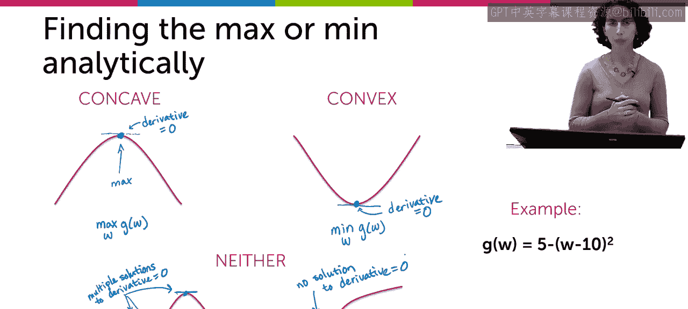
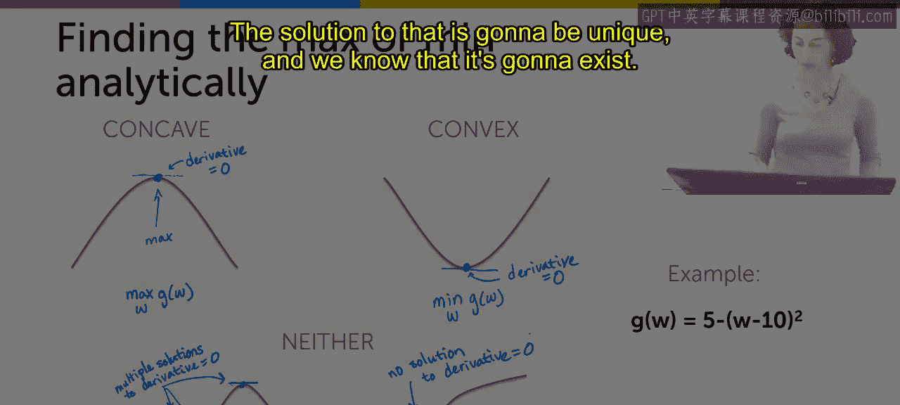

# 机器学习：第2课：解析法求极值

在本节课中，我们将学习如何通过解析方法（即数学公式）来寻找函数的最小值或最大值。我们将首先理解凸函数和凹函数的概念，这是优化问题中确保解存在且唯一的关键。然后，我们会将这些概念应用到最小化残差平方和（RSS）这一具体任务上。

## 凸函数与凹函数

在深入探讨如何最小化残差平方和之前，让我们先从更抽象的角度讨论优化问题。我们将以一个通用函数为例，思考如何最小化它，并探讨函数最小值的性质以及达到该最小值的算法。

我们首先要讨论的一个重要概念是凸函数和凹函数。

下图展示了一个关于单一参数或变量（我们称之为 **W**）的凹函数图像。这个函数是 **G(W)**。

我记忆凹函数和凸函数的方法是：凹函数看起来像一个洞穴的拱顶，而凸函数则相反。我们可以这样定义凹函数：选取 **W** 的任意两个值，称为 **A** 和 **B**，并观察函数在这两点的值 **G(A)** 和 **G(B)**。然后，在 **G(A)** 和 **G(B)** 之间画一条线（即图中的绿色线段）。

我们看到，这条线在任意处都位于 **G(W)** 曲线的下方。凹函数的定义是：对于你选择的任意 **A** 和 **B** 值，连接函数上这两点的线段始终位于函数曲线本身的下方。

另一方面，凸函数具有完全相反的性质。下图是一个凸函数的示意图。

同样，这是 **W** 和 **G(W)**。如果我连接 **G(A)** 和 **G(B)**，那么这条线在任意处都位于 **G(W)** 曲线的上方。

以上就是凹函数和凸函数非常直观的几何定义。当然，也存在既非凹也非凸的函数。

以下是两个例子：

我们如何判断这个函数既非凹也非凸？观察点 **A** 和点 **B**，并在这两点之间画一条线。我们可以看到，这条线在曲线的一部分位于其下方，在另一部分又位于其上方。因此，它既不满足凹函数的条件，也不满足凸函数的条件。同样，另一个函数也具有类似的性质。

## 函数的极值特性

我们讨论优化目标时，通常目标是寻找函数的最小值或最大值。对于凹函数，我们通常关注寻找最大值；对于凸函数，则关注寻找最小值。

让我们看看这个凹函数的最大值是什么。最大值就是图中这个点。我们的目标是求 **max over all W G(W)**。

在这个最大值点，函数有什么性质？我们知道，在该点函数的导数为零（**derivative = 0**），即函数在该点的变化率为零。

对于凸函数，如果我们寻求 **min over all W G(W)**，最小值显然是图中这个点。同样，该点的性质也是导数等于零（**derivative = 0**）。

需要注意的是，对于凹函数和凸函数，导数等于零的点只有一个。相比之下，在前面展示的既非凹也非凸的函数例子中，情况则不同。

对于第一个例子，存在多个位置的导数等于零。我们可以明确地写为：存在 **多个解** 满足 **导数等于零**。

对于第二个例子，实际上没有导数等于零的解，函数的变化率处处不为零，即 **无解** 满足 **导数等于零**。

## 核心要点

这里的关键启示是：我们讨论凸函数和凹函数的原因在于，当我们有一个寻找最小值（凸函数）或最大值（凹函数）的目标时，该问题的解将是唯一的，并且我们知道解一定存在。

本节课中，我们一起学习了凸函数与凹函数的定义及其几何直观，并理解了它们在优化问题中的重要性——能保证极值点存在且唯一。下一节，我们将把这些概念应用到具体的回归问题中，学习如何解析地求解最小二乘法的参数。