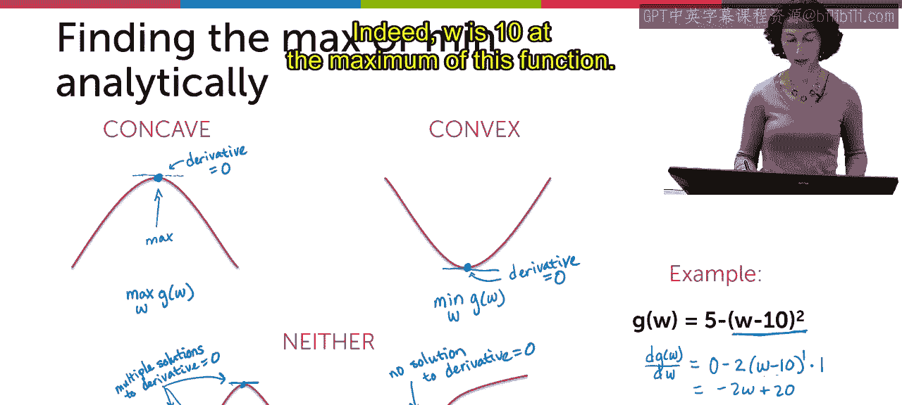

# 华盛顿大学《机器学习（回归，第2课⧸共4课）｜Machine Learning》中英字幕 p16 15_最大化一维函数：工作示例.zh_en -BV11b421H7XL_p16-

。

So let's just look at a quick little example here。 So I wrote down a function。 G of W is 5 minus。

W-10 squared。 So let's take the derivative of this function。

So we have to go back and remember our calculus， but I promise I'll try。

 at least try to keep it simple。So the derivative of5 with respect to W is 0。

 and then the derivative of this term here。Well， if you remember。

 if you have some function to some power， well， first we drop that power， that becomes a multiplier。

 we write that function again。And the power now is one less than what the power was before。

 so2 minus1 is one。So I'll just write that explicitly to the power1。

 and then I have to multiply by the derivative of the inside。

 the derivative of this little function itself。 So what's the derivative of w minus10 with respect to W。

's just one Okay， so writing this a little bit more compactly。 We have minus2 W。Plus 20。

As the derivative。And so if we're interested in finding。The maximum of this equation。

 and let me just say， how do we know if we're at a maximum or a minimum in both cases。

 we had derivative equals zero as the solution。Well， to know if it's a Min max。

 either we can know if we're looking at a concave or convex function。

 but typically we won't necessarily know that we can look at the second derivative of the function。

 okay， but that's just for your information you're not going to need to know that for this course。

Okay， so this function if we draw what this function looks like。Then maybe we can see this。

 So we know that at W equals 10 what's the value of the function。 It's 5。 So at W equals 10。

The value of the function is 5。 and if you。Go and plot this。

 you'll see that the value everywhere else is decreasing。And so it has this concave form Okay。

 so how do I find this maximum when I take the derivative and I set it equal to 0 and I solve for W。

 So let's do that。Let's set。Derivative。Equal to zero。So I have minus 2 w plus 20 equals zero。

 and I solve for W and I get 10。Okay， so that actually matches this picture。

 indeed W is 10 at the maximum of this function。

