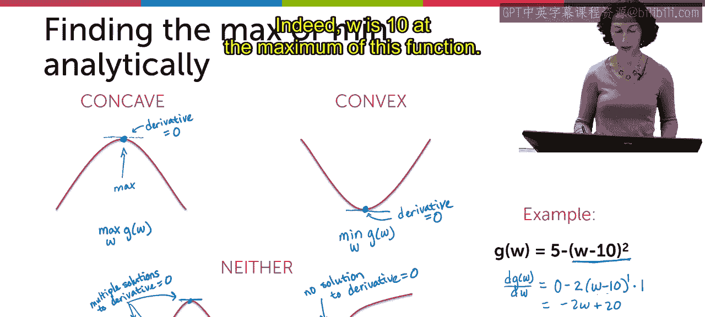

# 机器学习：第2课：最大化一维函数：工作示例

在本节课中，我们将通过一个具体的例子，学习如何找到一维函数的**最大值**。我们将回顾求导的基本步骤，并演示如何通过设置导数为零来求解极值点。

---

## 函数定义与求导

首先，我们来看一个具体的函数。函数定义为：
\[
g(w) = 5 - (w - 10)^2
\]

我们的目标是找到这个函数的最大值。第一步是计算该函数关于变量 \( w \) 的导数。

根据微积分法则，常数项的导数为零。对于形如 \( (f(w))^n \) 的项，其导数为 \( n \cdot (f(w))^{n-1} \cdot f'(w) \)。应用此法则：

1.  常数项 \( 5 \) 的导数为 \( 0 \)。
2.  对 \( -(w - 10)^2 \) 求导：
    *   首先，将指数 \( 2 \) 作为乘数：\( -2 \cdot (w - 10)^{2-1} = -2 \cdot (w - 10)^1 \)。
    *   然后，乘以内部函数 \( (w - 10) \) 的导数，即 \( 1 \)。
    *   因此，该项的导数为 \( -2 \cdot (w - 10) \cdot 1 = -2(w - 10) \)。

将两部分合并，我们得到函数 \( g(w) \) 的导数：
\[
g'(w) = 0 - 2(w - 10) = -2w + 20
\]

---

## 寻找最大值点

上一节我们计算了函数的导数。本节中，我们来看看如何利用导数找到最大值点。对于可导函数，其极值点（最大值或最小值）通常出现在导数为零的位置。

因此，我们令导数等于零，并求解 \( w \)：
\[
g'(w) = -2w + 20 = 0
\]

解这个方程：
\[
-2w + 20 = 0
\]
\[
2w = 20
\]
\[
w = 10
\]

我们求得 \( w = 10 \)。为了确认这是最大值点而非最小值点，我们可以观察函数图像或计算二阶导数。对于这个函数，其图像是一个开口向下的抛物线（凹函数），因此导数为零的点确实是最大值点。

将 \( w = 10 \) 代回原函数，可以求得最大值：
\[
g(10) = 5 - (10 - 10)^2 = 5 - 0 = 5
\]

所以，函数在 \( w = 10 \) 处取得最大值 \( 5 \)。

---

## 总结

本节课中，我们一起学习了如何通过求导来寻找一维函数的最大值。我们定义了一个具体的函数 \( g(w) = 5 - (w - 10)^2 \)，计算了它的导数 \( g'(w) = -2w + 20 \)，并通过令导数为零解出了极值点 \( w = 10 \)。最后，我们验证了该点确实是函数的最大值点，其函数值为 \( 5 \)。这个过程是优化问题中寻找极值的基础方法。