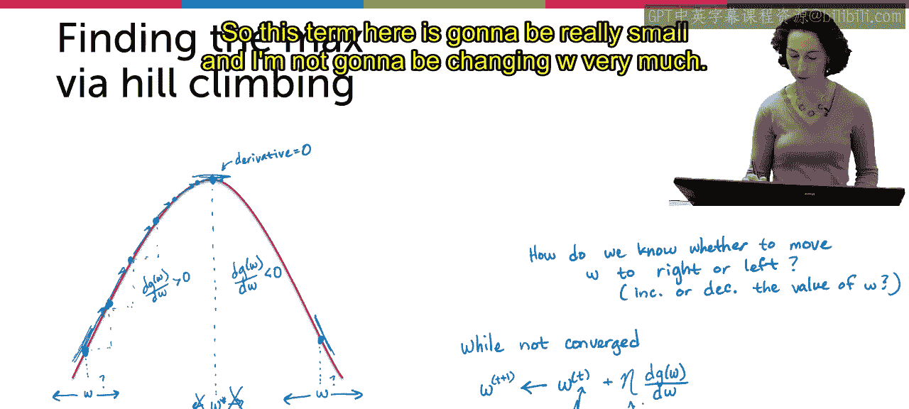
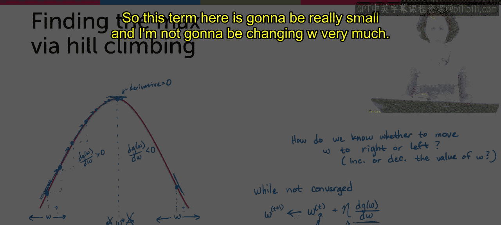

# 华盛顿大学《机器学习（回归，第2课⧸共4课）｜Machine Learning》中英字幕 p17 16_通过爬山法找最大值.zh_en -BV11b421H7XL_p17-

。

Okay， so that's one way to find the maximum or minimum of a function。

 depending on which scenario we're in， is just taking the derivative of the function。

 setting it equal to zero， and that solution will be unique assuming we're in either this convex or concave situation。

But there are other methods for finding the maximum or minimum。

 so if we're looking at these concave situations and our interest is in finding the max over all W of G of w。

 one thing we can look at is something called a hill climbing algorithm。

 where it's going to be an iterative algorithm where we start somewhere in this space of possible Ws。

 and then we keep changing W hoping to get close closer and closer to the optimum。Okay。So。

 let's say that we start。W here。And。The question is， well should I increase W， move W to the right。

 or should I decrease W and move W to the left to get closer to the optimalimum？What is the optimal。

 the optimal is this point here， so if I had this picture in front of me。

 I know that I should be moving to the right， but mathematically what's a way to say that？

What's a way to say that we're increasing that we know， so let me write this down。How do we know？

Whether to。Move W。To the right or left。And equivalently， meaning increase。Or decrease。The value of W。

Well， what I can do is I can look at the function at W and I can take the derivative。

And if the derivative is positive， like it is here。This is the case where I want to increase W。

 but what if on the other hand， I had started the algorithm over here？At this value of W。

Would I want to move to the right， increasing W or move to the left， decreasing W？Well， in this case。

 I'd want to decrease W。And again， if I look at the derivative， I see， in this case。

 the derivative is negative。So we can actually。Divide the space。Where on the left of the optimal。

 we have that the derivative。Of G with respect to W is greater than0。

 and these are the cases where we're going to want to increase W and on the right hand side of the optimum。

 we have that the derivative of G with respect to W。Is negative。

 And these are cases where we're going to want to decrease W。

 And what about if I'm exactly at the optimum， which maybe I'll call W star。

Do I want to move to the left or the right？Well， neither。I want to stay exactly where I am。

 That's the maximum。 And what happens in this case。 Well， if I look at the derivative。At the optimum。

 we know that。The derivative。Is zero， so again， the derivative is telling me what I want to do。

 I don't want to change W at all。So this hill climbing algorithm， the way we can write it is we say。

While our algorithm has not converged， so while not converged， if I can spell。Converged。

I'm going to take。My previous W， where I was at iteration T。So this is an iteration counter。And。

I'm going to move in the direction。Of。Indicated by the the derivative。 So if the derivative。

Of the function is positive， I'm going to be increasing W and if the derivative is negative。

 I'm going to be decreasing W and that's exactly what I want to be doing。

 but instead of moving exactly the amount specified by the derivative at that point。

 we can introduce something， I'll call it ada。And Ada。Is what's called a step size。It says when I go。

 so let me just complete this statement here， so it's a little bit more interpretable。

 so when I go to compute my next W value。I'm going to take my previous w value and I'm going to move an amount based on the derivative as determined by the step size。

Okay， so let's look at a picture of how this might work。

 So let's say I happen to start on this left hand side at this W value here， compute the derivative。

 and I take a step。Determined by that step size， and at this point， the derivative's pretty large。

 this function is pretty steep， so I'm going to be taking a big step。Then I compute the derivative。

 still taking a fairly big step， I keep stepping， increasing what I mean by each of these is I keep increasing W。

Keep taking a step in W， going， computing the derivative。And。As I get closer to the optimum。

The size of the derivative has decreased and so if I assume that Eda is just some constant。

 we'll get back to this in a couple slides， but if I assume that there's just a fixed step size that I'm taking。

Then I'm going to。呃。I'm going to be decreasing how much I'm moving as I get to the optimal。

 and if I end up on the other side of the optimum。Then the derivative there is negative。

 it's going to push me back towards the optimum， so eventually I'm going to converge to the optimum itself。

And note that if I'm close to the optimum， I'm not going to jump very far again because when you're close to the optimum that derivative is really。

 really small， so this term here is going to be really small and I'm not going to be changing W very much。

